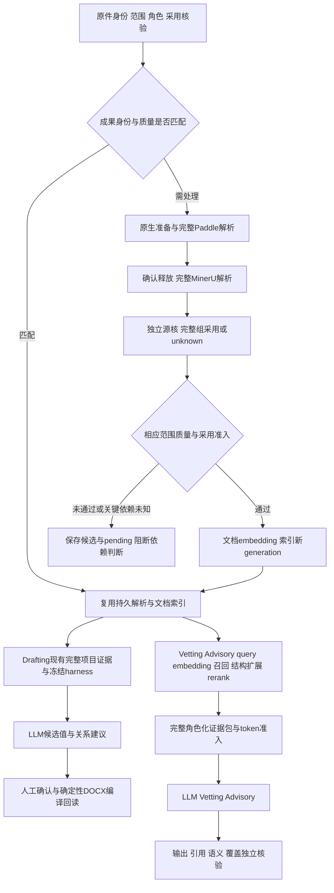

# ConSense LLM 选型与 OER 部署完整分析报告

日期：2026-10-12，Asia/Shanghai。面向：负责 ConSense 后续架构设计与实施的 agent。

本报告整合当前任务研究，回答三个问题：什么模型值得作为 Drafting、Vetting、Advisory 的共同主模型验证；至少256K、优选512K上下文怎样进入真实部署决策；在单 H800 上，怎样安排 OCR、embedding、rerank 与 LLM 的显存、加载、恢复和持久化。技术建议供后续架构设计使用，最终采用取决于三个模块的独立质量结果与目标环境验收。

**当前建议是以 Qwen3.8-27B 官方 FP8 建立三个模块共用的第一顺位验证方案，以 Flash-Next 挑战复杂 Vetting／Advisory 的质量上限，保留 MiniMax M3 官方 API 作为分模块质量参照。** 这个优先序来自任务证据和实际经验，不来自参数规模。27B 尚未通过本项目完整业务或单 H800 长窗验收；Flash-Next 尚未形成单卡可复现的完整部署配方；M3 的 Drafting 正面结果不能填入另外两个模块的通过格。

实施规则以 [OER 已确认范围与执行规则](./oer-scope-and-rules.md) 为准；实时进度以 [实施交接顶部](./HANDOFF-ocr-embedding-rerank-20261008.md) 为准。本报告是2026-10-12研究快照，后续解析进度变化不需要重写全部模型研究。已确认规则、研究建议、历史成绩与未验证候选在下文分别标明。

## 1. 架构决策摘要

| 决策项 | 当前结论 | 状态与依据 |
| --- | --- | --- |
| 主模型评价对象 | Drafting、Vetting、Advisory一起评价，各自通过各自的质量门 | 用户确认；[三模块联合研究](./llm-three-module-rag-selection-20261012.md) |
| Vetting／Advisory输入 | RAG先初筛，再补完整结构、条件、例外、引用链与角色化证据，LLM负责判断或回答 | 用户确认；初筛命中不等于必要依据完整 |
| 规模和架构 | 不限定120B，不由dense／MoE或激活参数判定效果 | 用户确认；公开任务分数支持较新27B超过部分旧大模型 |
| 主方案窗口 | 至少256K总上下文，优选512K；按准确token上限与实际模板计数 | 用户确认；RAG不取消此要求 |
| 第一顺位验证 | Qwen3.8-27B官方FP8，共用主模型 | 研究建议；公开抽取与长文推理支持，本项目未验 |
| 较大质量挑战者 | Qwen3.8 Flash-Next，重点挑战复杂Vetting／Advisory | 研究建议；专业任务信号更强，长抽取未全面领先，单卡配方未闭 |
| 质量参照 | 完整MiniMax M3官方API，按模块保留真实结果和残差 | Drafting有正面保存经验；Vetting／Advisory有失败及未完成范围 |
| OCR与LLM | 不同时使用，允许按完整批次加载／卸载 | 用户确认；无需为OCR长期保留业务阶段显存 |
| 可靠调度基线 | 自有GPU worker退出、确认释放、按同模型同配方重载 | 架构建议；RAM packed缓存与sleep／wake随后优化 |
| 在线检索 | query embedding／rerank仍需执行；有界共驻或与LLM阶段切换 | 架构建议；固定文档向量不消除query计算 |
| K8s GPU组织 | 明确唯一GPU所有者，或真正依次终止／创建独占Pod／Job | 架构建议；sleep释放VRAM通常不释放Pod的整卡资源分配 |
| 当前执行顺序 | 正常完整解析基线→提高解析质量→固定库检索质量→项目与业务→H800 | 已确认；本报告不提前启动后置工程 |

“有希望解决产品需求”的回答是：**Qwen3.8-27B在更高精度、足够上下文和完整RAG证据条件下，有充分理由进入产品主模型验证；现有证据不能承诺它已经满足产品。** Drafting的长清单遗漏、Vetting的发现完整性和Advisory的条件／引用残差，是需要直接回答的三类风险。把显存做大只能解除部分资源限制，不能替代这些质量结果。

## 2. 已确认约束与当前完成边界

### 2.1 资源与运行前提

目标资源为 **K8s、1×H800 80GB、27 vCPU、250GB RAM、650GB高性能存储＋1250GB通用存储**。这是用户确认的资源标签，实际设备可用字节、CPU架构、内存带宽、PCIe拓扑、存储性能、容器runtime、device plugin及PVC能力须在目标环境核验。[资源与部署研究](./oer-llm-deployment-strategy-research-20261012.md)

质量优先，速度慢可以接受。正式OER的OCR视觉主模型、embedding、rerank主要数值计算用CUDA；辅助组件按照准确版本官方建议与整链证据分工。LLM的CPU权重／专家混合推理是另一个部署候选，不能用它为正式OER的未声明CPU fallback提供依据。

扫描范围继续执行完整Paddle与完整MinerU两路解析，允许两路顺序运行。显存优化不改变双路完整证据、整表组采用、原件定位、失败和unknown保留。原生DOCX继续使用原生结构路线；混合文件按实际区域身份处理。首版图形能力是准确定位并返回原图和完整表组，尚未扩为解释箭头、图形关系或隐含工程意义。[已采纳OER设计与Q10](./oer-scope-and-rules.md)

### 2.2 数据范围不能因模型变化扩大

| 材料 | 继续执行的范围与角色 |
| --- | --- |
| 2a NTT／SCT／SCC标准模板 | 仅供Drafting；不进入Vetting／Advisory对象、候选池或提示 |
| GCC、SL技术范围、2b GCT | 固定版本预处理成果可复用；Vetting／Advisory仍按项目实际采用和角色使用，GCT保留tender角色 |
| 项目合约、附录、项目PRE、范围内图纸／清单、2c邮件／纪要 | 每个项目按实际原件与采用声明处理，不继承上一项目值或答案 |
| BQ、SOR、General Summary计价文件 | 范围外，不因大模型窗口更大而重新纳入 |
| 项目工程技术PSS、SL非技术章节 | 范围外；项目PRE及适用GS／SL技术标准继续在范围内 |
| 正文中的Bill编号／名称／递交方式、付款与价格调整条款 | 保留正文责任及关联输入，不扩大为计价文件核算 |
| 2d审查样板／countercheck、2e咨询答案／flowchart | 只在隔离评价和格式参考中使用，不进入同题生产RAG、模型输入或OCR监督目标 |

上述表是架构相关摘要，详细章节范围、来源路由及采用规则仍查 [范围入口](./oer-scope-and-rules.md)。固定库表示处理成果的生命周期，不表示项目自动采用其中所有规定。

### 2.3 当前状态

截至本次读取，18个任务家族已有正常完整输入基线，但固定全部所需原件的最终解析门、固定库质量门、业务门、K8s／H800门均未通过。交接顶部仍保存SL真实完整表格失败与未采用状态，不能由“基线覆盖齐”追认完整解析质量达标。[当前交接](./HANDOFF-ocr-embedding-rerank-20261008.md)

Drafting识别harness、用户确认值和既有冻结状态保持。本报告及其入口同步属于研究／文档交付，没有因此授权新模型／API调用、权重下载、修改运行配置、重启服务、目标部署、提交或推送。后续架构agent可以据此准备具体设计；到达对应阶段且具备行动授权时再执行运行与实施。

## 3. 三个模块究竟要求LLM完成什么

| 模块 | 输入与LLM职责 | 程序／原件／人工的职责 | 核心质量风险 |
| --- | --- | --- | --- |
| Drafting | 从项目资料识别候选取值、完整清单、待确认条件；对两个候选建议supplement／explicit_replacement／contradiction／undetermined | 字节身份、来源跨度、确认值、采用决定、确定性修改计划、最终DOCX编译和保存核验 | 值与对象错配、false与unknown混淆、长清单漏项、required字段缺失、引用不连续 |
| Vetting | 对RAG后完整角色化材料判断跨文件责任、条件、例外、修订、冲突、遗漏及协调风险，输出可复核发现 | 检索与结构扩展、source/chunk身份、采用范围、schema、双侧原文定位、报告归并与导出 | 真冲突漏报、兼容差异误报、跨对象比较、缺证当absence、只发现部分问题、引用不支持 |
| Advisory | 按RAG证据与明确标记的非合同背景回答问题，解释适用条件和流程，缺证时澄清或unknown | 当前来源session、检索、纳入关系、原页／原图／完整表组回取、引用资格、会话状态 | 有证误拒答、无证补常识、漏前提／出口、正文与标题混引、多轮版本或范围混乱 |

职责来源：[任务基线](./llm-task-evaluation-baseline-20261012.md)、[实际源码边界](./research/llm-task-baseline-current-evidence-20261012.md)、[Vetting专项](./research/llm-vetting-rag-task-evidence-20261012.md)、[Advisory专项](./research/llm-advisory-rag-task-evidence-20261012.md)。源码具有接口或schema，不能作为真实业务质量成绩。

Drafting不是让LLM直接任意重写合同。候选与关系建议可以用模型，最终采用和确定性编辑保留既有责任。Vetting可独立对用户上传合约进行审查，不要求先经过本系统起草。审查发现可作为Advisory轻量入口，携带发现与来源身份；进入咨询后仍执行当前问题的取证与判断，不把旧finding当永久正确依据。

三模块共同需要条件、否定、范围、版次和引用，但质量目标不同。正确回答一个已给问题，与主动找齐未知问题，不能用同一个命中率代表。因此共同主模型需逐模块通过，不使用平均总分抵消某模块的关键错误。

## 4. RAG怎样改变选型与失败归因

### 4.1 对27B的有利条件

Vetting／Advisory先经RAG，模型不必闭卷记住全部标准，也不必从整个来源库自行找到每份资料。它主要处理相关证据后的条件推理、跨来源判断、依据合成和引用。这使当前长文推理较强的27B成为合理候选，也降低单凭总参数量选大模型的必要性。

这种有利条件没有已测改善百分比。RAG不自动解决推理、完整性或grounding；初筛偏差会改变模型看到的世界。Vetting尤其需要多审查责任的检索覆盖与相反证据，不能把一组相关top-k命中称为全面审查。

### 4.2 从hit到完整业务材料

建议保留以下明确步骤：

1. 按合法范围、模块角色、当前采用版本检索候选；保存query与候选池身份。
2. 从短窗口定位到完整结构单元，扩展父条、定义、条件、例外、跨页续接和完整表组。
3. 补显式引用目标、相反规则、配对文件及适用／纳入依据；对尚未完成的依赖保留pending／unknown。
4. 形成角色化材料包，记录正文跨度、关系、来源revision、coverage和缺项。
5. 对最终messages／schema与准确provider／model／profile绑定计数观察，保留推理和final输出预算，再提交生成。观察包括tokenizer／template与窗口身份、实际wire digest、source snapshot和output reserve；预览后材料或配置变化须重新核。`over_budget`不发送，未绑定有效计数的额外packet保持`budget_unknown`。API没有可核tokenizer／计数器时，事后usage或其他模型计数不能补成提交前已确认fit。
6. 对输出分别核身份／schema、字面引用、语义支持、条件完整和任务覆盖。

“已观测unit完整”只说明该unit的材料完整；法律闭包还需要该规定实际依赖的定义、例外、采用和引用链。窗口扩到512K也不会自动补入尚未取回的材料。

### 4.3 来源验证与模型材料投影

完整raw／CAS、逐glyph定位、captureCompleteness、软件身份与全量校验声明保留在来源验证和引用展示层。LLM提示使用独立材料投影：正文、完整条款／表组、必要限定、source／页／成员定位、角色、采用、coverage限制及相关unknown。共享的来源校验信息可以去重；正文和语义限定不能去掉。

已有Q1.6旧接缝生成 **13,295,121字符** 提示，说明不能仅按正文字符预算，也不能把每个成员的完整raw／CAS再次展开进提示。提高超时或窗口不是这类重复序列化的主要修复方法。[规则中的业务证据与模型输入分层](./oer-scope-and-rules.md)

来源fresh规则保持：同一请求的私有frame可以复用已验证后的纯重构结果，实际使用对象仍首次完整读核、成功退出前完整rehash，root／revision alias／软件身份退出复验；成功响应落在全部退出守卫之后。跨请求不缓存来源有效性verdict。持久解析／文档向量复用与每次实际来源核验是两种责任，不能混为每次重跑OCR。

### 4.4 失败账本

| 实际情况 | 上游归因 | LLM与业务归因 |
| --- | --- | --- |
| 原件存在关键例外，包中缺少 | 解析、召回或结构扩展缺口，定位到实际缺失层 | 模型若断言不存在例外，另记无依据断言 |
| 主条款和例外均在包中，结论错误 | 该题必要证据供应充分 | 条件／优先级／对象判断失败 |
| 两侧材料不齐或采用未知 | 配对／纳入证据不足，coverage有限 | 应说明缺项，不能报告确定冲突 |
| 无支持证据 | 分别查检索是否覆盖必要范围 | Advisory保留unknown／澄清；Vetting零发现不代表全文无问题 |
| 结论正确但引文不支持或不连续 | 核实际源位置与跨度 | 引用／生成失败；schema合法不抵消 |
| 提示被metadata放大或排包分裂关键组 | 材料投影／排包责任 | 不把它全部记为模型能力不足 |
| 输出length／空final／协议解析失败 | 区分引擎预算、模板、adapter与decoder | 保留不完整终态，不能只取成功片段当完整答案 |

## 5. 现有公开任务分数支持什么结论

### 5.1 独立长文推理和专业交付

下表是2026-10-12已读回的Artificial Analysis页面分数。AA-LCR使用 **v1.1**，GDP.pdf使用 **All-pass**，推理模式随模型记录；它们不是本项目准确率。

| 模型／模式 | AA-LCR v1.1 | GDP.pdf All-pass | 原始来源 |
| --- | --- | --- | --- |
| Qwen3.8-27B Xhigh | 82% | 17% | [与3.6-35B同页](https://artificialanalysis.ai/models/comparisons/qwen3-8-27b-vs-qwen3-6-35b-a3b) |
| Qwen3.8-27B non-reasoning | 69% | 5% | [与Xhigh同页](https://artificialanalysis.ai/models/comparisons/qwen3-8-27b-non-reasoning-vs-qwen3-8-27b) |
| Qwen3.6-27B reasoning | 77% | 11% | [与GPT-OSS120同页](https://artificialanalysis.ai/models/comparisons/qwen3-6-27b-vs-gpt-oss-120b) |
| Qwen3.6-35B-A3B reasoning | 72% | 7% | [与3.8-27B同页](https://artificialanalysis.ai/models/comparisons/qwen3-8-27b-vs-qwen3-6-35b-a3b) |
| Gemma4-31B reasoning | 70% | 6% | [与3.6-35B同页](https://artificialanalysis.ai/models/comparisons/qwen3-6-35b-a3b-vs-gemma-4-31b) |
| GPT-OSS-120B High | 52% | 4% | [与3.6-27B同页](https://artificialanalysis.ai/models/comparisons/qwen3-6-27b-vs-gpt-oss-120b) |
| Nemotron3 Nano reasoning | 38% | 1% | [推理模式比较页](https://artificialanalysis.ai/models/comparisons/nvidia-nemotron-3-nano-30b-a3b-vs-nvidia-nemotron-3-nano-30b-a3b-reasoning) |

对用户所问“效果上的纸面分数”，这里确实支持Qwen3.8-27B在相同命名指标上高于旧GPT-OSS120及3.6-35B。它证明参数更大不必然更好，不能证明27B一定超过所有120B模型。Xhigh与non-reasoning差异也说明推理配方是选型的一部分，不能只记录模型名字。

AA-LCR的固定dataset card有 **100题、30个document sets、234份文档**，平均每set **99,325个cl100k_base token**；法律子集为 **6题、2sets、23文档**。全部相关文档先提供给模型，再问跨文档问题。v1.1修改16个answer keys并调整judge提示，不能与未注明版本的旧表硬比。[固定dataset card](https://huggingface.co/datasets/ArtificialAnalysis/AA-LCR/blob/9a77ef56b717057ade24ceab4d273712a0b4f19e/README.md)

这使AA-LCR成为证据充分后的长文推理代理，关联Vetting／Advisory；它不测独立RAG召回、未知缺陷全发现或本项目连续引文，也不能验收256K／512K。GDP.pdf的All-pass是完整任务通过口径，17%不能读成17%字段准确率。AA服务模式的分数没有证明本地官方FP8、引擎和模板完全相同。[详细方法与模式审计](./research/llm-independent-task-evaluations-20261012.md)

### 5.2 实际公开FP8抽取结果

ExtractBench固定提交 `c972087fe7a5132132f7230d1bdb841d3fbf07ed` 的规范化value指标如下。指标按文档平均，Long指 **超过50页**，不是256K token。

| pipeline | Overall F1 | Short F1 | Long F1 | Long precision | Long recall |
| --- | --- | --- | --- | --- | --- |
| Qwen3.8-27B FP8 | 89.75 | 94.68 | 38.45 | 92.29 | 33.00 |
| Qwen3.8 Flash-Next FP8 | 89.88 | 94.82 | 37.74 | 88.68 | 33.69 |
| Qwen3.6-35B FP8 | 88.11 | 92.86 | 36.90 | 90.57 | 31.73 |
| Qwen3.5-35B FP8 | 88.00 | 93.52 | 31.73 | 81.07 | 26.83 |
| Qwen3.5-9B | 86.10 | 92.31 | 32.22 | 85.52 | 27.22 |
| Gemma4-26B-A4B | 70.27 | 77.70 | 28.88 | 50.10 | 25.56 |

每个数来自 [固定leaderboard.csv](https://raw.githubusercontent.com/run-llama/ExtractBench/c972087fe7a5132132f7230d1bdb841d3fbf07ed/leaderboard.csv)；27B／Flash-Next分别为第44／43行，模型制品与pipeline见 [固定pipeline说明](https://github.com/run-llama/ExtractBench/blob/c972087fe7a5132132f7230d1bdb841d3fbf07ed/docs/pipelines.md)。Long分桶为20份文档；当前CSV、论文v1和较早pipeline配置分别有身份，不能把旧论文分数与当前表直接相减或声称较早配方已重测后续全部修订。这些是抽取实验作者结果，不能给Gemma31B继承Gemma26B行，也不能把FP8行给三进制Bonsai。[指标与版本审计](./research/llm-independent-task-evaluations-20261012.md)

27B与Flash-Next的总体值接近，长文F1没有给出Flash-Next全面胜出证据。更重要的是，27B长文precision92.29与recall33.00同时存在：已返回项较准和大量漏项可以并存。Drafting要查完整清单；Vetting要查完整问题集，不能以“已返回内容都能引用”证明完整通过。

### 5.3 同代指令与专业任务

| 指标 | Qwen3.8-27B | Flash-Next | 解释 |
| --- | --- | --- | --- |
| IFBench | 79.5 | 81.3 | 输出指令遵从的辅助信号，不证明判断或引用正确 |
| CoWorkBench | 70.7 | 73.9 | 厂商内部较宽办公任务，包含法律等领域，不是专门RAG合同审查 |
| JobBench | 33.4 | 55.7 | 支持保留Flash-Next的专业任务挑战价值，不可称作本项目Vetting提升 |

所有数字来自 [Flash-Next固定官卡Language表](https://huggingface.co/Qwen/Qwen3.8-Flash-Next/blob/de4b8e4d43b917e7706784d8bb445c9af86a3540/README.md)。这些作者表与AA独立结果分别记录，不相加成综合分，也不推导统计显著性。[Qwen任务表调查](./research/llm-task-benchmark-qwen-20261012.md)

### 5.4 更贴近Vetting／Advisory的基准缺口

| 基准／方法 | 真正测量对象 | 对本项目的用途与局限 |
| --- | --- | --- |
| LegalBench-RAG | 检索的character precision／recall | 检索层评价参考，不能当生成模型排名；最小snippet仍需本项目条件闭包 |
| ContractNLI | 607份NDA、17个固定断言的entailment／contradiction／not-mentioned及证据 | 条件／例外与证据判断参考，未测开放式全部缺陷发现 |
| CLAUSE | 合同缺陷、遗漏、误报、跨度与解释 | 较贴近Vetting任务，但已核表是旧模型，不能给当前候选补成绩 |
| Legal RAG Bench | context充分性、回答正确与grounding拆分 | 有源法律问答与归因方法参考，不是当前四候选统一完整审查表 |
| FACTS Grounding | 给定文档后是否完成请求及是否有据 | Advisory方法参考；当前目标模型可比分数行未取得，Kaggle正文未读回不等于未发布 |
| RAGTruth | 回答／word span的unsupported、contradictory等幻觉及拒答、截断状态 | 区分grounding与误拒答；旧生成模型或检测器F1不继承为新模型忠实率 |
| ALCE | 答案正确性、句子引文支持和coverage等 | 引用质量拆分参考；原文连续性、版次和法律范围另核 |
| RGB | 噪声、negative rejection、信息整合、反事实鲁棒 | RAG后缺证和混合材料评价参考；不能用常识覆盖已采用特殊条款 |
| FinanceBench | 文档证据问答与数值／时间／单位 | 有源推导方法参考；旧模型联合retrieval失败不等于当前模型幻觉率 |

数量、第一方方法与来源见 [Vetting专项调查](./research/llm-vetting-rag-task-evidence-20261012.md) 和 [Advisory专项调查](./research/llm-advisory-rag-task-evidence-20261012.md)。目前没有取得Qwen3.8-27B、Flash-Next、122B、Super在同源完整合同审查或grounding／引用／answerability上的直接可比成绩。该格保持unknown，不能用闭卷知识、coding或纯检索成绩填满。

## 6. 本机Bonsai与M3的实际证据

### 6.1 Bonsai身份和第五轮结果

本机制品为 **Qwen3.8-27B底座的Ternary-Bonsai-2-27B-PTQ1_0**，不是旧3.6底座，也不是普通官方FP8。保存权重revision为 `b072e1d3b35a0a630cece372c2127528e0994386`，Prism为 `prism-b10743-adfffbe`。第五轮保存运行身份为 `80d0396f-1a3c-4ed0-8232-5c21e966a209`。[本机证据](./research/bonsai-local-task-evidence-20261012.md)

| 同题58有值＋21应空项 | 有值正确候选 | 正确留空 | strict PASS／REVIEW／FAIL | 状态 |
| --- | --- | --- | --- | --- |
| Bonsai第五轮原始运行 | 51/58 | 21/21 | 31／41／7 | FAIL |
| 同一原回答离线接收规则重放 | 56/58 | 21/21 | 33／44／2 | 仍FAIL，没有新推理 |
| M3第五轮保存运行 | 58/58 | 21/21 | 42／37／0 | 37 REVIEW有独立原件语义核验支持 |

数字来源：[原第五轮归因](../../docs/drafting-harness-rounds-4-5-20261009.md)、[Bonsai专项](./research/bonsai-local-task-evidence-20261012.md)、[M3独立审计台账](./testing/m3-round5-20261009/README.md)。PASS／REVIEW／FAIL分母为79项；REVIEW不自动变PASS。原件人工语义审计另有53/58口径，不改写严格51/58。固定题已参与开发，这不是新盲测。

剩余Bills失败含思考泄漏／畸形前缀、decoder先取错误数组和漏register；Sections失败含required `designation`未填及repair引用删中间句。接收规则修复解释了部分51→56提升，剩余格式、值、完整性和引文问题仍需模型／协议受控对照。

另一次M3 Drafting保存运行 `8f01b7df-6234-4ffb-b204-2b009f5cadba` 为非null正确有引用候选57/61、预期null新增候选0/18，strict仍FAIL。该次在已有人工采用状态的项目上运行，严格页面评分受既有采用／编辑影响；57/61是本轮新候选覆盖，0/18表示无新增候选，不证明当前页面18项均留空。人工确认／编辑后的65字段不能计为模型命中。61/18与前表58/21是不同运行分母，不能合并成M3“全正确”。[任务基线](./llm-task-evaluation-baseline-20261012.md)、[实际运行与strict状态口径](./research/llm-task-baseline-current-evidence-20261012.md)

### 6.2 显存／上下文的因果边界

第五轮保存窗口为 **65,536**，F16 K/V、parallel1、默认总生成16,384、medium及每推理块4,096；模型训练窗口声明262,144。历史存在32K和后续64K运行，尚无完整256K／512K业务验证。[上下文归因](./research/bonsai-local-context-capacity-attribution-20261012.md)

该GGUF的理论F16 KV在256K约 **16GiB**，尚未加权重、工作区等，说明本机16GB显卡的完整长窗受限。这个固定Bonsai元数据算术不作为官方3.8 FP8引擎的实际占用。H800与本机资源不同，本机配方FAIL不能排除H800足窗口下的底座能力。

但第五轮15个parts的28条保存engine调用均无truncated或output-cap标记，slot-stop内部 `n_tokens` 最大9,375；Bills1,110字符、Sections1,299字符的primary短源完整入包。现有证据不支持将这两项失败直接归因64K耗尽。`evaluatedPromptTokens`不含cached prefix，不是完整输入计数；adapter缺逐请求完整usage／finish_reason，实际context-shift设置未知。保存区间没有OOM／shift证据不证明全部历史请求正常。

较早18项防水范围分成前16项／后7项的重叠片段，没有单请求看见全部18项。这是具体输入闭包混淆因素，不能宣称GPU确实截断；只增服务窗口而沿用原分片也不会自动合并完整材料。

因此两项判断同时成立：**本机没有验证长窗上限；某些已保存短源失败也没有证明由窗口耗尽导致。** 更高精度、正确模板、完整证据与足窗口需要分因素比较，不能把所有提升预先归因量化或上下文。

### 6.3 M3 Advisory：有完整输入仍有语义残差

2026-10-11 Q1.6保存M3调用有 **53完整source单元**，provider input83,868、output2,647、total86,515 token，正常completed，生成32.1365675秒。独立source-only45项核验为 **25pass／14partial／6fail，ledger32.0/45**。这些是该审计的分项状态和加权账本，不是准确率或官方比赛分。[M3专项第5节](./research/minimax-m3-evaluation-reference-20261012.md)

残差包括timelyNotice分支错误、premises／report／appoint-failure／inadmissibility／confidentiality出口遗漏，以及引用替换标题而非正文。正常结束且输出低于16,384cap，不支持把这些错误全部解释为输出上限。收据身份见附录A。

2026-10-10早一次Q1.6必要GCC正文未进入实际返回集，结果unknown／insufficient且answer空；这是上游证据供应缺口，与后一天完整输入后的语义残差分开。[首次结果](./testing/oer-official-q16-first-business-result-20261010.md)、[检索读回](./testing/oer-official-q16-actual-retrieval-readonly-validation-20261010.md)

### 6.4 M3 Vetting：零发现和机械通过都有限

| 保存运行 | 实际结果 | 不能外推的结论 |
| --- | --- | --- |
| 2026-10-02 HOMES，`minimax-m3-homes-reference-closure-20k-20261002T1830Z` | 一次直连M3 POST，HTTP200／stop；返回1issue，机械accepted1；独立源审confirmed0／false1 | 只审了该候选，没有完整问题gold，不能报整库precision／recall |
| 2026-10-10两源GCC／SCC，job `97ca407a-1fa3-48b0-a1d2-bc884e7574ab` | 19/19机械进度；17主题completed_empty但全部partial；119来源补充请求pending，0finding；semantic评分not_run | 119不是provider调用数；completed与0finding不证明全面审查正确 |

HOMES把下一附录标题混入前一个owner，模型又将其误读为页脚，是输入角色和语义误报混合失败。来源：[引用闭包原报告](./vetting-reference-closure-20261003.md)、[两源partial终态](./testing/oer-official-two-source-vetting-completed-partial-20261010.md)、[Vetting专项实际记录](./research/llm-vetting-rag-task-evidence-20261012.md)。两源保存profile为 `minimax-cn`、model为 `MiniMax-M3`、client为OpenAI兼容协议；它们不能冒充已知远端checkpoint hash。

M3因此是重要质量参照，但也不是已经三个模块全过的产品答案。

修正HOMES附录边界后，同messages的adaptive响应completion16,384、reasoning16,383，没有正式content；disabled返回合法 `[]`。前者是输出预算失败，后者没有正例召回分母，不能据此默认关闭thinking或认定更优。这说明推理预算和final可用性必须成为独立评价项。[边界与预算对照](./vetting-appendix-boundary-20261003.md)

## 7. 候选模型及选择理由

### 7.1 有限候选池

| 候选 | 任务证据与上下文 | 角色及主要未决项 |
| --- | --- | --- |
| Qwen3.8-27B官方FP8 | 较强公开抽取、独立长文推理；原生262,144，官方524,288扩窗 | 共用第一顺位验证；本项目三模块、H800峰值、512K质量未验 |
| Qwen3.8 Flash-Next官方FP8／后续Hopper兼容配方 | 同代专业任务信号较强；原生262,144及官方512K路线；长抽取未领先27B | 优先挑战复杂Vetting／Advisory；完整FP8不适合单卡全驻留，混合配方未闭 |
| Qwen3.6-35B-A3B FP8 | 原生256K／官方512K，实际FP8抽取与较低KV斜率研究证据 | 低驻留MoE工程对照；现有相关分数未领先3.8-27B |
| Gemma4-31B-it | 独立家族、原生262,144；MRCR v2 8-needle 128K average66.4% | 家族与源类型对照；未核得官方512K路线，不能继承26B抽取成绩 |
| Qwen3.5-9B | 实际抽取实验说明小模型有比较价值；官方256K／512K路线 | 有界候选／关系／缺证能力对照；没有接管全任务的证据 |
| Qwen3.5-122B-A10B GPTQ Int4 | 现成官方量化与256K路线，可作旧大模型任务／容量对照 | 仅对当前残差有收益时提高优先级；单卡长窗余量紧，精度需验 |
| Nemotron3 Nano／Super | 有512K／1M分长度RULER，默认窗口与较长配方区分 | 长窗专项；Nano真实长文推理较弱，Super Hopper低比特与中文业务未闭 |
| MiniMax M3官方API／开放权重 | 官方1M与本项目真实参照结果 | API开发质量轨与自部署轨分开；单卡混合资源／质量需另核 |
| DeepSeek V4长窗家族、GLM-5.2／5.3 | 已调查官方1M路线；DeepSeek有较直接长文推理信号 | 有针对性的质量上界／后续研究，不扩大首轮下载与实现范围 |
| Granite4.1／4.2 | 官方提及扩展512K，已核默认128K | ≥256K完整配方与质量证据未闭，暂不作已满足硬门主选 |
| GPT-OSS120、GLM-4.7-Flash、Qwen2.5-72B | 已核官方上限低于256K | 只留短任务／历史工程对照，退出完整主模型池 |
| 本机Bonsai PTQ1_0 | 保存配方FAIL、64K，完整长窗未验 | 历史与同底座归因对照；不把服务切换作为当前动作 |

身份、许可、默认窗口、官方扩窗、revision与方法逐项查 [候选调查](./research/llm-task-model-candidates-20261012.md)、[长上下文调查](./research/llm-context-256k-512k-evidence-20261012.md)、[更大候选调查](./research/llm-h800-larger-model-candidates-20261012.md)。这些候选没有全部成为需下载／运行的任务。

### 7.2 为何先验官方FP8而非继续盯Bonsai或直接BF16

官方FP8有准确制品与真实公开抽取pipeline，能回答Bonsai受限三进制配方的精度／协议归因问题，同时为长KV、工作区和在线E/R留下更有希望的资源空间。BF16可以作为局部难例的高精度控制，但不预设它必然更好，也不预设它在512K单卡可行。

FP8权重量化、FP8 KV和推理模式是三个独立变量。更高精度通常减少量化误差，但合同语义错误也可能来自训练能力、模板、预算、输入关系和decoder。先保持同一完整材料与输出责任，再看Bills／Sections、条件例外、引用及缺证残差是否改善。

从Prism GGUF换到官方FP8若同时改变loader、引擎、模板或decoder，差异先记为整体配方差异；固定或分离这些变量后才能归因量化精度。高精度对照的目的在于调查残差，不预先把成功原因或失败原因写定。

**Qwen3.8-27B官方FP8准确目标footprint及256K／512K峰值当前未获得。** 旧3.6-27B的FP8文件28.747GiB、旧配置KV16／32GiB不能作为3.8的已核预算。27B标签只能支持量级初筛，实际清单、载入张量与引擎状态决定预算。[旧数值口径](./research/llm-task-model-candidates-20261012.md)、[最新身份表](./research/llm-task-benchmark-qwen-20261012.md)

### 7.3 一个主模型还是按模块多模型

先验证一个共同主模型，可减少模板、依赖、缓存、装载和恢复身份。若27B分别通过三模块，复杂MoE的部署成本未必值得；若某模块关键残差稳定存在，就让挑战者在相同完整证据上回答该残差，再决定明确模块路由。

按模块路由由调用者／业务接口显式指定，保留model profile与结果来源。较小模型可做有界候选，但后续模型仍能访问完整必要原文，不能只看小模型摘要。失败回退采用同模型同配方的退出重载；改派模型、降窗口、降精度或删证据都是新的运行身份和评价结果，不能静默发生。

## 8. 256K与512K怎样落实

### 8.1 总窗口预算

```text
系统／任务模板 + 历史／工具消息 + 当前业务输入／完整证据
              + 本轮推理 + 最终输出 <= 引擎实际总窗口
```

具体reasoning token在后续历史和KV中的处理按模板／引擎核验，不能假设免费。每个模型使用自己的tokenizer；页数、字符数或MiniMax token数不能直接当Qwen计数。

| 示例总上限 | 假设推理＋final预留 | 假设模板／历史／工具预留 | 当前证据剩余量 |
| --- | --- | --- | --- |
| 262,144 | 32,768 | 4,096 | 225,280 |
| 524,288 | 32,768 | 4,096 | 487,424 |

这是 `总上限−两项预留` 的算术示例，32,768与4,096没有被采纳为业务限额。[上下文预算调查](./research/llm-context-256k-512k-evidence-20261012.md) 如果输入本身需要完整256K，256K总窗口在保留输出后不足，应选更长官方配方或另行定义保持完整依赖的任务分组。

### 8.2 Qwen原生与官方扩窗分两个profile

Qwen3.8-27B与Flash-Next原生262,144；官方512K路线为524,288、YaRN `factor=2.0`，官方最大命令cap为1,000,000。旧3.6的最大1,010,000属于旧版，不移植成3.8事实。[3.8-27B固定官卡](https://huggingface.co/Qwen/Qwen3.8-27B/blob/1d4bf0f2ff6012fd82039f2fa52739d0dd7c60c0/README.md)、[长窗核查](./research/llm-context-256k-512k-evidence-20261012.md)

扩窗要保存完整官方RoPE overrides、tokenizer、template和实际engine版本，不只改 `max_model_len`。static YaRN可能影响短输入，因此原生256K与扩展512K各自评价正常业务及长输入，分别决定采用状态。模型声明窗口、引擎启动、长输入完成和业务推理正确是四种证据。

### 8.3 长窗口质量测试对象

覆盖正常请求、接近256K、接近512K的真实必要材料，重点改变关键证据位置、密集例外、跨页表组、多来源引用和历史长度。合成填充／重复短题只测部分容量行为，不能代表真实长文推理。

公开Nemotron Super RULER256K／512K／1M为96.30／95.67／91.75，作者历史AA-LCR58.31；Nano对应RULER为92.9／91.3／86.3，作者AA-LCR35.9。合成检索强与真实推理较弱可以并存。作者历史表与当前AA v1.1不保证同设置，不能硬拼排名。[Super官卡](https://huggingface.co/nvidia/NVIDIA-Nemotron-3-Super-120B-A12B-BF16)、[Nano官卡](https://huggingface.co/nvidia/NVIDIA-Nemotron-3-Nano-30B-A3B-BF16)

容量不准入时明确报告该profile失败；必要证据不足时保留unknown或阻断依赖判断。保持完整条件的分组与后续合并可以成为单独实验，但不能拿它冒充短窗模型已经满足主方案256K／512K。

## 9. 单H800显存与主机预算

### 9.1 必须同时核三个峰值

```text
GPU阶段峰值 = 常驻权重 + 活跃KV／线性状态 + 激活／workspace
            + CUDA graphs／非框架分配 + 本阶段辅助模型 + 安全余量
单卡准入    = max(每个正常阶段峰值, 每次切换峰值) <= 实际设备可用字节

RAM峰值     = packed缓存 + CPU执行／offload权重 + 加载临时副本
            + pinned buffers + 解析／索引／业务状态 + 实际系统工作集
存储峰值    = 已选持久制品 + 原件／完整证据 + 索引generation
            + 镜像／构建／加载临时文件 + 保留的旧版与失败收据
```

80GB产品标签不直接等于80GiB；GiB为2^30bytes。定义实际物理总量为M，驱动／固定其他owner／不可释放残留为D，则前式的实际可用预算为M−D，或直接验 `D＋max(正常阶段峰值,切换峰值)≤M`；左侧已经包含安全余量，避免再次扣减。动态NVML free用于当前观测，不代替固定profile的完整预算。GPU allocated、reserved、整卡使用量分别记录，不相加。RAM按实际物理buffer去重，packed缓存与offload权重可能指向同一对象，pinned buffers也可能是这些权重本身，不能按逻辑角色重复计数；实际复制出的副本则完整计入。文件长度包含header，payload为索引中的张量字节；跨版本／跨清单的差额不能直接比较，同制品可重算的文件／payload差额也不等于运行显存节省。

OCR与LLM互斥意味着正常阶段峰值取最大值，无需把所有阶段权重相加；但切换时先加载后卸载会产生真实叠加。E/R若在业务阶段驻留，即使计算串行，其权重与最大检索激活仍要加入业务峰值。

### 9.2 KV不是按参数量估算

普通full-attention单序列理论公式为：

```text
KV bytes = 2(K与V) × KV_heads × head_dim × dtype_bytes
         × full_attention_layers × (输入token + 已生成token)
```

滑动窗口、线性状态、MLA、共享KV、paged blocks、batch与多序列有自己的表示，按准确架构和后端另计。chunked prefill可减临时峰值，不能消除最终活跃KV。权重FP8不自动让KV变FP8；FP8 KV支持、scale与质量需独立验证。

### 9.3 更大模型的已核容量事实

| 准确制品／配置 | 已核量 | 对单卡的意义 |
| --- | --- | --- |
| Flash-Next官方FP8完整索引 | 185,502,232,570bytes＝172.7624168GiB，131shards | 完整FP8不能单卡全驻留；CPU PLE约47.7GiB后其余仍约125.1GiB |
| Qwen3.5-122B-A10B GPTQ Int4 | payload73.429GiB | full KV BF16在256K／512K另6／12GiB，合计79.429／85.429GiB，尚未加线性状态、workspace等 |
| 同一122B的理论FP8 KV | 256K／512K约3／6GiB | 支持与质量未知；不能当已释放的实测空间 |
| Nemotron3 Super官方Hopper FP8 | 119.5212GiB，官方参考至少2×H100 | 单卡需要额外量化／offload；官方NVFP4 Blackwell配方不能继承到H800 |
| MiniMax M3官方MXFP8 self-host参考 | 约444GB | 超过80GB GPU＋250GB RAM名义合计；完整该配方不能全放两者 |
| M3理想4bit裸参数算术 | 428B×0.5byte≈214GB≈199GiB | 仅容量研究下界，未量化层、scale、加载副本、KV和准确可用制品仍未知 |

逐数revision、索引与官方配方见 [更大候选调查](./research/llm-h800-larger-model-candidates-20261012.md)、[原LLM字节核算](./research/llm-h800-selection-20261012.md)、[M3专项](./research/minimax-m3-evaluation-reference-20261012.md)。Flash-Next的47.7GiB来自SGLang Blackwell NVFP4示例中的FP8 lookup；从完整FP8体积扣得125.1GiB是近似容量规划，不是同revision PLE张量或该FP8引擎的实际释放测量。122B KV算术依赖12个full-attention层、2KV heads、head_dim256、BF16；不能将这些配置套到3.8-27B。

减少未使用视觉／MTP组件、限制prefill batch、减少graph或少量权重offload可能改善122B余量。每项实际省下字节须由正式loader和载入清单证明，不能从完整checkpoint体积凭空扣除。Flash-Next剩余FP8理想折半使主干4bit落入研究量级，但尚未确认准确Hopper制品、内核、未量化层及完整峰值，不能据此宣布已装下。

### 9.4 已保存OER显存记录与依赖隔离

| 保存环境／配方 | 参数payload | allocator allocated high-water | allocator reserved high-water | 可用范围 |
| --- | --- | --- | --- | --- |
| Windows Paddle native mixed BF16原件风险集 | 2,901,046,528B | 6,576,616,192B | 16,083,767,552B | 对应保存原件实验；不替代目标Linux／H800峰值 |
| Windows MinerU raw VLM BF16原件风险集 | 2,312,053,248B | 12,915,709,952B | 42,517,659,648B | 参数量不代表复杂表格峰值；reserved不是需配置的物理HBM |
| Linux MinerU full FP16完整GCT两页 | 主模型1,156,026,624参数，全部CUDA FP16 | EngineCore 3,350,478,848B | EngineCore 4,217,372,672B | 仅该EngineCore进程scope，不是整parser／整卡峰值，质量仍未采用 |

原件风险集为23页／14文件，两路完整输出及失败保留。全部数字来自 [当前代码与保存运行证据第3节](./research/oer-deployment-current-evidence-20261012.md) 及其 [原始双路实验报告](./testing/original-pdf-dual-parser-bf16-validation-20261009.md)。allocated包含在reserved中，与共享整卡采样不能相加；Windows特殊记账不能按42.5GB给H800划预算。

当前FP32 `BAAI/bge-m3` 由配置推导payload约2.115GiB；`BAAI/bge-reranker-v2-m3`实读header也约2.115GiB，两者参数约4.230GiB，尚未加激活、pair padding、workspace、CUDA context等。因此参数相加不构成E/R峰值。研究中的8GiB E/R envelope及安全余量公式属于拟议测试起点，未测未采用；完整报告不据此声称LLM固定剩余68GiB。[E/R参数与当前配方](./research/oer-deployment-current-evidence-20261012.md)、[拟议预算](./research/oer-h800-memory-scheduling-20261012.md)

已有Linux full成功路线使用MinerU4.0.10、vLLM0.19.1、Torch2.10.0+cu128，主VLM为FP16、实际部分辅助Torch为CUDA FP32。准确MinerU依赖要求 `vllm>=0.19.1,<0.29.0` 及Transformers `>=5.10.1,<6`；Flash-Next专用vLLM recipe要求0.29.0+。二者不能简单装入同一venv。按模型worker／不可变环境隔离依赖，再由唯一GPU owner管理生命周期；CPU辅助的配置和实际forward分别回传。[固定MinerU源码](https://github.com/opendatalab/MinerU/blob/f232373fb319d63e82aefd30be40a2ccc6005d73/pyproject.toml)、[依赖与官方配方调查](./research/oer-h800-memory-scheduling-20261012.md)

## 10. 加载与显存策略逐项比较

| 策略 | 解决的问题 | 收益 | 成本／限制 | 当前建议 |
| --- | --- | --- | --- | --- |
| 整进程退出后重载 | 阶段释放与依赖隔离 | 所有权清楚、残留易归因、恢复路径可靠 | loader、磁盘／H2D、warmup、prefill重做 | 保留为可靠基线 |
| packed权重RAM缓存 | 重复磁盘读取／重排 | 可降低正常阶段恢复等待 | 表示须兼容，加载副本与pinned峰值要验 | 首选后续优化 |
| vLLM sleep level1／wake | 不退出引擎的阶段释放 | 权重offload到CPU、丢弃KV，可恢复 | D2H／H2D及重新prefill；模型兼容与实际释放未验 | 按准确版本验证，失败回退退出重载 |
| 深sleep／丢弃权重 | 更深状态释放或权重更新 | 释放范围更大 | wake不保证恢复原有效权重，要明确reload | 不作普通批次默认路径 |
| LLM＋有界在线E/R驻留 | 连续问答反复切模型 | 降低每问大权重搬运 | 常驻权重相加，检索与生成激活分别核峰值 | 业务阶段优先优化目标 |
| E/R与LLM互斥 | 长窗／大模型占近整卡 | 保模型和完整材料，query先取证再生成 | 连续问答迁移和prefill等待 | 合法容量回退 |
| GPU计算、CPU权重offload | 活跃模型权重超显存 | RAM扩展权重容量 | UVA／预取／staging与主机通道开销 | 更大质量候选确有收益时研究 |
| CPU专家计算 | MoE专家容量与计算分工 | GPU处理attention／部分组件，CPU算部分专家 | CPU指令、核数、内存带宽与架构支持限制 | KT／llama.cpp类路线单独评价 |
| PLE表CPU驻留与rows预取 | Flash-Next巨大稀疏lookup | 不必将全部lookup表常驻GPU | 实际访问／计算分工按准确recipe核验，主干仍可能超卡 | Flash-Next优先核实路线 |
| 活跃KV置CPU | 单条长序列状态容量 | 真正改变活跃状态存放 | 后端计算／搬运代价与长窗质量 | 准确模型支持后另测 |
| prefix cache CPU／NVMe offload | 已完成前缀缓存容量 | 保存／恢复重复前缀，减少部分重算 | 命中后仍需回GPU，不证明active512K容量 | 可作缓存优化，独立于active KV准入 |
| 权重量化／KV量化 | 权重或状态驻留压力 | 直接减小相关表示 | 内核、未量化部分、scale与质量独立验 | 官方可复现制品优先 |
| 较小模型／明确按模块多模型 | 质量与资源的不同最优点 | 有界任务资源更低，困难任务可选强模型 | 多模板／缓存／切换，前级漏项可能传递 | 由任务结果决定，先验共同主模型 |
| CPU预读／预处理 | 阶段前准备等待 | 不占GPU，可流水预读及原生准备 | RAM／I/O竞争、取消与来源变化 | 低风险后续优化 |
| chunked prefill／有界batch／减少graph | 临时workspace／捕获峰值 | 保持完整请求，降低部分临时峰值 | 不消除权重与固有KV，数值／调度回归 | 峰值归因后单因素验证 |
| text-only loader／关闭未用MTP | 未使用组件占用 | 可减少实际载入与profiling开销 | 须正式入口、能力合同及载入字节证明 | 不追减完整checkpoint数字 |
| mmap／磁盘工作集 | RAM仍不足 | 扩大容量研究上界 | 随机I/O、page faults和缓存抖动 | 不作正常业务基线 |
| UVM／managed memory | 支持程序的按需迁移／远程访问 | 特定实现可超额分配／迁移 | 必须有支持的allocator和程序；UVA地址可见本身不等于managed迁移；H800+x86不是Grace-Hopper | 不承诺一条环境变量解决任意模型 |

机制依据：[部署策略](./oer-llm-deployment-strategy-research-20261012.md)、[GPU调度研究](./research/oer-h800-memory-scheduling-20261012.md)、[更大模型运行机制](./research/llm-h800-larger-model-runtime-options-20261012.md)。前期13类表中的“KV offload”需按本表继续分成活跃KV与prefix cache；它们不能互相替代。

`torch.cuda.empty_cache()`只释放未使用allocator缓存，仍被引用的模型不会因此卸载。[PyTorch官方语义](https://docs.pytorch.org/docs/stable/generated/torch.cuda.memory.empty_cache.html) 普通 `.to('cpu')`也不保证所有量化packed格式可恢复；OS page cache不等于引擎的热packed张量。

### 10.1 三类CPU路线必须区分

vLLM UVA／prefetch权重offload仍主要由GPU计算，成本与实际访问／搬运字节相关，`--cpu-offload-params experts`也不把专家计算移到CPU。CPU专家计算由CPU完成相应专家运算，不是每token都把全部专家权重搬回GPU；KT准确路径在长prefill超过阈值时可切为逐层GPU prefill，需要另容纳一个MoE层，不能预算为零GPU staging，准确Flash架构支持仍需核验。Flash-Next PLE则让巨大lookup表驻留CPU，按配方预取所需rows，不能从表驻留位置推定全部lookup计算都在CPU。27vCPU资源标签不能直接预测任何一类吞吐；H800的HBM内部带宽不能用于计算主机到GPU的搬运时间。[KT与offload源码语义](./research/llm-h800-larger-model-runtime-options-20261012.md)

Flash-Next CPU PLE路线已核 `VLLM_PLE_CPU_OFFLOAD=1`、专用vLLM0.29.0+镜像；官方recipe以4×H100为例，不是单卡262K验收。SGLang0.5.20+有 `--ple-offload-embedding` 及lookup相关路线。PLE表移出GPU后主干容量估计仍超单卡，必须继续核Hopper主干量化／权重offload或CPU专家计算，不能仅开PLE就宣称完成。[候选与recipe证据](./research/llm-h800-larger-model-candidates-20261012.md)

### 10.2 KV路线的实质边界

已核vLLM `kv_offloading`与SGLang HiCache主要用于完成前缀的保存／恢复；它们不证明单条512K活跃attention可留在CPU并按期望方式计算。llama.cpp `--no-kv-offload`确有活跃KV置CPU语义，但准确模型、backend、长窗数值和端到端等待未测。旧swap-space与新offload参数也不能混用版本语义。[运行机制审计](./research/llm-h800-larger-model-runtime-options-20261012.md)

sleep／RAM热缓存解决的是不活动模型让出GPU；推理中offload解决的是活动模型本身超卡。前者不能让一个活动阶段无预算运行，后者可能每请求或每token付代价。

## 11. 推荐阶段架构与K8s组织

### 11.1 数据准备与业务阶段



图示表达后续运行关系，当前固定资料仍需先通过解析门才能进入固定库质量；图中的reuse以准确身份与质量匹配为条件。

完整批次先跑Paddle、确认GPU释放，再跑MinerU、再文档embedding和索引；完成批次后恢复业务LLM。避免每页在OCR与LLM间切换。CPU业务服务、任务账本、会话原消息、来源存储和索引独立存活。

### 11.2 在线E/R两种profile

**有界共驻profile：** OCR卸载，LLM热驻留；E/R按已测预算驻留或逐个装载，query取证与decode串行。常驻空间仍相加，E/R FP32当前配方及最大结构组激活另计。`gpu_memory_utilization`是单engine预算参数，不是跨进程显存隔离；多个engine各设0.9不安全。准确版本若支持 `kv_cache_memory_bytes`，可以按已测池大小固定预算，仍需核其他实际分配。

**互斥取证profile：** LLM释放／sleep，query E/R完成完整包，E/R释放后LLM恢复并生成。Vetting已知任务可批量取证以摊薄切换；Advisory新问题和追加检索仍可能重新切换。完整对话从持久原消息重建，不依赖sleep前KV保留。query结果缓存绑定query、来源generation、模型及配方，rerank分数不成为下一题通用事实，fresh verdict也不缓存。

当前E/R入口是CUDA FP32、embedding／reranker串行offload，短512／overlap64、结构2048；现有代码只释放另一检索模型，不是跨OCR／LLM调度器。半精度或双模型常驻是新配方，须独立验收。[当前代码证据](./research/oer-deployment-current-evidence-20261012.md)

### 11.3 K8s显存空闲不等于资源可重新分配

| 组织方式 | 适用性 | 必须落实的边界 |
| --- | --- | --- |
| 唯一GPU owner协调隔离worker／环境 | 单卡互斥任务的优先候选 | 不将Paddle、MinerU、LLM强塞同一Python解释器；镜像／进程隔离与GPU访问机制按集群核验 |
| 独占Pod／Job真正顺序终止创建 | 平台要求独立镜像时的清晰基线 | 旧Pod资源释放后新Pod才取得整卡；原进程RAM热缓存随终止丢失 |
| 多Pod time-slicing＋应用协调 | 平台确需独立GPU Pod时的研究路线 | 无自动显存／故障隔离，跨Pod锁和回收复杂 |
| MPS | 确有共享计算需求时另核 | 份额可能压缩大模型可用内存；当前互斥任务无优先需求 |
| MIG | 支持且需要硬件隔离时另核 | 分小实例会压缩主模型可用连续实例容量，当前不必长期分割整卡 |

默认device plugin以 `nvidia.com/gpu` 分配整卡。LLM Pod sleep之后仍通常持有其GPU extended resource，另一个独占OCR Job会Pending。要复用已分配GPU，就在已核访问边界内统一管理worker；要重分配整卡，就真正结束旧占用Pod。这两种设计不能同时宣称“新独占Pod获卡”和“旧进程原地热wake”。依据 [Kubernetes Schedule GPUs](https://kubernetes.io/docs/tasks/manage-gpus/scheduling-gpus/) 的资源分配语义与引擎sleep行为；sharing边界见 [NVIDIA共享GPU官方说明](https://docs.nvidia.com/datacenter/cloud-native/gpu-operator/latest/gpu-sharing.html)。多个容器各请求一张GPU不能被假定共用唯一卡，具体设备访问按runtime／plugin验证。

Qdrant Local是文件式单进程所有者，不能多个Pod共写同一路径。后续维持单写者，或验证服务式Qdrant与PVC／恢复配方；本报告没有迁移数据库。[规则中的K8s边界](./oer-scope-and-rules.md)

### 11.4 GPU状态机与安全恢复

建议GPU coordinator记录 `IDLE → DRAINING → RELEASING → LOADING → WARMING → READY → RUNNING`，失败进入有证据的 `FAILED／RECOVERING`。每次切换有owner、task、worker、epoch、准确profile与结果身份。停止新请求，收尾／取消自有工作，落盘，确认实际释放，再加载下一阶段。

lease超时不是旧worker已停止的证明；回收须核实际进程和GPU所有权，避免旧任务继续占卡而新任务进入。只有当前有效owner／epoch可以取得GPU、接收有效完成结果并发布generation；旧epoch迟到结果留为证据，不影响当前成果。OOM／失败后保存partial与journal，恢复同配方；发布新generation采用完整校验后原子切换，保留旧完整成果。新的source未过质量门时不能用旧结果冒充新版。

## 12. 配置身份 持久化与可观测性

### 12.1 每个运行profile的最小合同

| 类别 | 必须固定和回传的内容 |
| --- | --- |
| 模型 | 家族、准确checkpoint／revision、制品SHA或清单digest、权重格式与精度、实际载入组件 |
| 引擎 | engine／源码版本、CUDA／驱动／容器digest、内核、tokenizer、chat template、reasoning parser |
| 窗口与生成 | 原生／官方扩窗、全部RoPE参数、准确总窗口、输入计数、reasoning与final预算、采样、stop、并发／batch |
| 预算观察绑定 | provider／model／profile、tokenizer／template与窗口、最终wire messages／schema digest、source snapshot、output reserve、计数与准入状态；配置／材料变化重新核，不由事后usage补提交前fit |
| 内存与调度 | KV dtype／scales、active／prefix存放、权重／专家／lookup offload、graph／prefill、GPU owner、切换与恢复路径 |
| 来源与RAG | 原件字节SHA、canonical身份、source revision、项目采用、模块角色、范围、query、候选池、embedding／rerank／切块配方、索引generation |
| 输出与评价 | 完整raw response、usage、finish reason／终态、parse／repair／重试次数、引用定位、语义与coverage结果、gold分母与评价器身份 |

API配置名是记录口径；远端没有返回准确checkpoint就保留未知，不伪造revision。量化、窗口、thinking或模板变化均是新profile，成绩不自动继承。reasoning是否进入usage及历史按供应商真实规则记账。

### 12.2 持久化与重处理边界

models／raw／parsed／assets／index／任务收据持久保存，原件不修改。高性能盘优先放已选模型、当前parser必要资产、活动索引及恢复路径；通用盘放完整原件、双路历史、候选归档。650GB快盘不自动足以同时保存所有候选精度、镜像、解压副本和原始资产，按逐文件清单与构建峰值准入。

同版同配方且质量身份完整匹配，冷启动复用固定解析与文档向量；新query只做query向量、范围召回、rerank与判断。切块／embedding变更只重建受影响索引；parser／模型／原件字节变更产生受影响解析新revision；采用／角色／范围变化重建相关视图。SL变版重新识别章节，不能复用旧物理页区间。原件SHA与canonical文本结构hash分别保存。[持久化规则](./oer-scope-and-rules.md)

目标Linux镜像从独立已验证环境建立并锁依赖，不复制Windows venv。本地Linux MinerU full两页成功只证明对应本地环境与配方，不能填H800质量／吞吐格。

### 12.3 观测以完整业务等待为单位

记录每请求的来源核验、检索、结构扩展、序列化、模型切换、prefill、reasoning、final、验证与报告归并时间；分开TTFT、decode速度和整任务时延。ready健康检查成功不等于首题已经回答。

切换成本为drain＋释放／必要D2H＋引擎准备＋H2D＋warmup＋重新prefill；冷恢复再含磁盘读取、loader和重排。若仅作算术，60×10^9bytes与**假设**有效H2D8／12／24GB/s的纯搬运下界为7.5／5／2.5秒，这不是H800实测。流水重叠后测端到端，不机械相加。[切换估算与验收](./oer-llm-deployment-strategy-research-20261012.md)

## 13. 评价设计与完成门

### 13.1 三层评价与两轮模型比较

第一层评价OER／RAG：真实原件完整解析、必要证据召回、结构闭包、采用／角色和排包；第二层提供相同充分证据，评价模型抽取、推理、引用、发现和unknown；第三层用实际RAG与部署profile评价端到端任务、恢复和前端。三层分别记账。

第一轮模型比较使用相同来源、完整必要证据、任务／schema与输出责任，各模型用自己的正确模板和tokenizer，记录推理／输出预算和重试。识别／关系任务不注入gold、人工确认答案或M3输出；仅本来依法使用确认值的确定性文稿生成阶段共用同一确认快照。完整共同材料超出某profile，记容量不准入，或将完整通用分组另列实验。第二轮允许模型使用已经质量通过的最佳精度、窗口、thinking、prefill、KV和调度，比较产品质量与完整成本。不能让M3看整库、27B看零散片段，却把差异全部算模型能力。

### 13.2 按任务构建题目和分母

| 任务层 | 需要覆盖的分类 | 记录指标与分母 |
| --- | --- | --- |
| Drafting值／清单 | 数值单位、实体对象、请求与回复、否定／false／unknown、完整长列表、跨页表、缺证 | 逐字段值与来源、完整列表项、required输出、连续引用；模型候选与最终人工／程序结果分开 |
| Drafting关系 | supplement、明确替换、矛盾、未定；同对象同范围、不同日期、局部修订 | 同一冻结候选对的分类与证据支持；不能以日期自动判采用 |
| Vetting语义 | AND／OR、unless／provided／notwithstanding、Not used、版本／纳入、主体时期范围、最低量与精确量 | 每个独立gold问题的发现／漏报、每个finding的确认／误报、两侧证据与严重性；无gold不报recall |
| Vetting完整报告 | 多topic、反证、重复问题、局部unknown、缺文与真正omission | topic／source／packet覆盖、完整finding与去重、pending、partial、未评；0finding有覆盖证据才可解释 |
| Advisory回答 | 有证问答、条件流程、数值期限、反证噪声、故意缺证、部分可答、旧版干扰 | 逐实质结论正确与支持、引用coverage／定位、unknown／必要澄清、误拒答、答案完整性 |
| Advisory多轮 | 新背景、来源修订、撤回／替换、历史增长、沿finding追问 | 哪些结论应变／不变、source revision及scope一致、历史token与新的检索身份 |
| 长窗与协议 | 正常／近256K／近512K、关键证据位置、长输出、streaming、repair、length／empty | 实际完整输入、输出终态、全部raw、超窗／截断、repair和重试成本；容量与语义分开 |

保留开发暴露、真实留出、原件派生家族和合成压力测试标签。2d／2e只用于隔离evaluator。独立审稿先按原件构建gold，再读模型结果；每个数字给题目／source范围／output位置和可重算分母。自动确定、独立源核、真人确认、unknown、未评分别记录，不新增虚构业务权重或百分比采用线。

### 13.3 阶段门

| 门 | 可检查的完成条件 | 当前状态 |
| --- | --- | --- |
| 正常完整基线 | 各家族有完整正常输入与保存产物，主要残差明确 | 18家族已覆盖；不等于最终质量 |
| 固定原件解析 | 完整适用范围覆盖、关键文字／层级／条件／例外／完整表组零已知错漏、来源定位及旧正确回归、独立普通正文CER≤0.1% | 未通过；现有已确认工程线见[质量计划](../tools/oer_training/QUALITY-PLAN-20261010.md) |
| 固定库质量 | 冻结来源／配方／候选池，必要证据与完整结构、角色／采用、ranking和missing分别评价，失败保留 | 未通过 |
| 模型任务质量 | 三模块分别有独立gold与残差账本；关键业务错误不由风格／平均分抵消，采用线按既有规则及具体题集确认 | 3.8／Flash未验；M3和Bonsai历史结果不是全门通过 |
| 长窗profile | 准确总token、完整证据及推理／输出预算；正常与目标长窗语义／协议通过 | 256K／512K业务未闭 |
| H800／K8s运行 | 准确目标身份、正常／切换GPU与RAM峰值、实际长prefill／decode、所有权／PVC、冷暖恢复与失败演练 | 未执行目标验收 |
| 产品业务与前端 | 原始输入→取证→完整输出→原文／图表定位→报告／DOCX保存回读，真实业务结果独立确认 | 不能用代码／mock／CI／schema或index ready替代 |

CER等解析门是最终采用门，当前正常基线探索不需逐类先达到它才能展示或继续下一类。模型任务新增gold与具体采用条件在后续评价阶段落地，研究中没有补造通过率。

### 13.4 必测运行场景

同版冷启动复用、完整新资料批次、真实变版重新处理、sleep／wake、最大合法请求、连续Advisory、追加检索、取消／OOM／worker崩溃、K8s重建、失败不覆盖旧generation，均留完整收据。每场景说明模型加载次数、source generation、GPU／RAM峰值、input／output、TTFT与整任务时延；性能结果记录样本数、冷／暖条件、中位数及尾延迟。局部启动成功或一次运行不能冒称稳定性能。

## 14. 给架构agent的实施顺序和交付物

当前解析主线继续。到达后续工程阶段时，按以下顺序实施，不展开全部模型×精度×引擎的笛卡尔积。

| 步骤 | 应完成的工作 | 明确完成标准 |
| --- | --- | --- |
| 1 读取当前规则与状态 | 读取scope和handoff顶部，核当前阶段及冻结项，核赛方模型供应／替换／API规则 | 有当前约束清单，历史候选与真实供应身份分别记录 |
| 2 建立数据与材料合同 | 来源路由、角色／采用、RAG结构闭包、fresh frame、LLM投影、版本与unknown接口 | 完整source→packet追踪；去metadata重复且正文／条件不失，未完依赖显式表达 |
| 3 建立评估清单 | 三模块gold、开发／留出划分、M3保存参照、充分包与真实RAG包、缺证／反证 | 每项可回原件，有分母和失败归因，harness冻结边界明确 |
| 4 固定首轮模型身份 | 3.8-27B官方FP8原生256K与官方512K分别profile；必要高精度／Bonsai归因控制 | 制品、模板、engine、预算完整，不继承旧版权重／KV数值 |
| 5 建立退出重载调度 | 唯一owner或顺序独占Pod，隔离worker与持久业务状态 | 每阶段GPU确实释放；取消／失败不争卡，同配方恢复可回读 |
| 6 验证本地业务质量 | 同材料能力对照，再各自可用profile；项目接入、真实题与前端／报告回读 | 三模块独立业务结果，长窗未在可用环境验证则保留未验，不删关键证据追认成功 |
| 7 优化正常等待 | packed RAM／sleep，再在线E/R共驻、prefill／graph或KV优化 | 单因素质量回归与冷暖完整等待记录；退出重载仍可回退 |
| 8 引入较大挑战者 | 按关键残差在可用已授权环境对照Flash-Next，必要时122B／Super或其他明确上界；研究目标混合配方 | 相同完整证据有实际收益；本地实测与Hopper静态预算分开，必须依赖H800的运行项目统一留步骤10 |
| 9 冻结发布准备 | Linux镜像／manifest／PVC／清单、固定成果与完整处理能力、同版复用／变版／恢复配方 | 发布准备身份可审阅；构建、上传、部署授权与状态分别报告 |
| 10 H800最终运行验收 | 前述原件／固定库／业务门通过后，在单H800与真实K8s核峰值、256K／512K、调度、冷暖恢复及目标业务回读 | 目标资源与运行收据闭合；本地成功与目标成功分开，失败保留 |

架构agent应交付：具体架构与职责／接口；模型profile和候选决定表；GPU正常／切换与RAM／存储预算；数据／材料投影合同；评估题目与分母清单；K8s所有权及持久化方案；失败恢复和发布门。每个技术决定写明依据、待核事实和触发替换条件，保持可检查状态。

最需要由执行者查证的未决项是：准确赛方模型及替换权限；目标CPU／PCIe／实际设备字节；27B官方FP8实际载入清单与长窗状态；3.8引擎准确支持版本；Flash-Next Hopper主干量化／专家路线；E/R最大峰值；集群GPU访问与PVC能力；三模块直接任务结果。业务生命周期、OCR／LLM互斥和质量优先已经确认，不重开此类访谈。

## 15. 可直接交给架构agent的指令

> 请先读取 `ai_consense_service/docs/oer-scope-and-rules.md` 和 `ai_consense_service/docs/HANDOFF-ocr-embedding-rerank-20261008.md` 顶部，再以本报告 `ai_consense_service/docs/consense-llm-oer-architecture-analysis-report-20261012.md` 为后续架构设计依据。
>
> 目标为K8s、单H800 80GB、27vCPU、250GB RAM、650GB快盘＋1250GB通用盘；OCR与业务LLM互斥，允许完整批次加载／卸载。先按Drafting、Vetting、Advisory任务质量选择，再做容量准入；Vetting和Advisory均先RAG初筛并补完整必要依赖。至少256K、优选512K总窗口，输入／历史／工具／推理／final共同计数。
>
> 以Qwen3.8-27B官方FP8作为共用第一顺位验证建议，Flash-Next作为复杂Vetting／Advisory优先挑战者，M3官方API作为分模块质量参照。三者均按准确制品与运行profile报告，候选建议不视为已采用。保留Bonsai受限配方FAIL、短源失败未证窗口耗尽、M3 Advisory／Vetting残差，不跨模块或跨精度继承成绩。
>
> 先设计完整证据／来源校验与LLM材料投影、三模块独立评价合同、单GPU所有权与退出重载恢复，再验证RAM缓存／sleep和在线E/R共驻。区分GPU读取CPU权重、CPU专家计算、PLE lookup、活跃KV与prefix cache。每个方案写清正常／切换峰值和失败条件。
>
> 按本报告第14节交付可审阅架构、profile、预算、接口、评价与恢复／发布门。保持当前“解析质量→固定库质量→项目业务→H800”顺序及Drafting冻结项；研究报告不额外授权现在调用模型／API、下载权重、变更在线配置或部署。实际行动按当前阶段和已有明确授权执行，状态如实回写入口。

## 附录A 关键证据身份

| 证据 | 身份／校验值 | 定位 |
| --- | --- | --- |
| Qwen3.8-27B官方FP8 | revision `017b9c7af6b5689d5dd426a76e0bc077eb5ca20a` | [任务表调查身份段](./research/llm-task-benchmark-qwen-20261012.md)；非H800实测footprint |
| Flash-Next官方FP8完整权重索引 | revision `236dfdf285828023ca3bcd3f37366c58a3469b13` | [更大候选调查](./research/llm-h800-larger-model-candidates-20261012.md) |
| ExtractBench分数 | commit `c972087fe7a5132132f7230d1bdb841d3fbf07ed` | 本报告第5.2节CSV及pipeline |
| AA-LCR方法统计 | dataset card commit `9a77ef56b717057ade24ceab4d273712a0b4f19e` | 本报告第5.1节；当前分数v1.1与旧版分开 |
| Bonsai原第五轮strict评分 | SHA256 `8882550D402A290142FC98401F5CB7AE2D40531A068E34F2CD1E22E620F9EF65` | [Bonsai专项](./research/bonsai-local-task-evidence-20261012.md)所列原始路径 |
| Bonsai固定回答离线重放评分 | SHA256 `65338ED791B88EECC3C132744CED1896F88FE0F534A714AA835D1D984F80A5EA` | 同上；不是新推理 |
| Advisory Q1.6新M3 provider收据 | SHA256 `a403634ce8e021f7eeef16056d8f17ab04280bc9b7e1e9488f1fc40faac14c04` | [M3专项第5节](./research/minimax-m3-evaluation-reference-20261012.md)所列实际运行收据 |
| 同题source-only45项独审 | SHA256 `082366681b6371b63b7b447ba82b597d3c0402d059509f34f264a9023b84375a` | 同上；25／14／6及32.0/45口径 |

这些身份来自既有研究保存的证据，不表示本报告重新运行模型或重扫大权重。未来引用收据须核实际文件与运行身份；缺失时保留证据缺口。

## 附录B 完整研究索引

| 主题 | 详细报告 |
| --- | --- |
| 当前业务与OER实施状态 | [当前规则](./oer-scope-and-rules.md)、[handoff](./HANDOFF-ocr-embedding-rerank-20261008.md) |
| 阶段加载与K8s部署 | [部署主研究](./oer-llm-deployment-strategy-research-20261012.md)、[当前代码证据](./research/oer-deployment-current-evidence-20261012.md)、[显存调度](./research/oer-h800-memory-scheduling-20261012.md) |
| 实际LLM任务与评估 | [任务基线](./llm-task-evaluation-baseline-20261012.md)、[源码／运行证据](./research/llm-task-baseline-current-evidence-20261012.md) |
| 三模块RAG选型 | [联合研究](./llm-three-module-rag-selection-20261012.md)、[Vetting专项](./research/llm-vetting-rag-task-evidence-20261012.md)、[Advisory专项](./research/llm-advisory-rag-task-evidence-20261012.md) |
| 当前任务分数与候选 | [质量主研究](./llm-task-quality-selection-256k-512k-20261012.md)、[Qwen任务表](./research/llm-task-benchmark-qwen-20261012.md)、[独立评测](./research/llm-independent-task-evaluations-20261012.md)、[候选制品](./research/llm-task-model-candidates-20261012.md) |
| 256K／512K／1M | [准确窗口与质量调查](./research/llm-context-256k-512k-evidence-20261012.md) |
| 单卡更大模型 | [主研究](./llm-h800-larger-model-and-context-strategy-20261012.md)、[运行机制](./research/llm-h800-larger-model-runtime-options-20261012.md)、[准确候选](./research/llm-h800-larger-model-candidates-20261012.md)、[早期权重核算](./research/llm-h800-selection-20261012.md) |
| Bonsai与M3本机经验 | [Bonsai结果](./research/bonsai-local-task-evidence-20261012.md)、[上下文归因](./research/bonsai-local-context-capacity-attribution-20261012.md)、[M3参照与self-host](./research/minimax-m3-evaluation-reference-20261012.md) |

本报告正文提供统一判断和实施合同；附录索引用于查准确来源、历史运行与引擎版本细节。旧研究中的初版候选或容量表按历史语境读取，当前规则与本报告的联合任务优先序决定后续设计方向。
