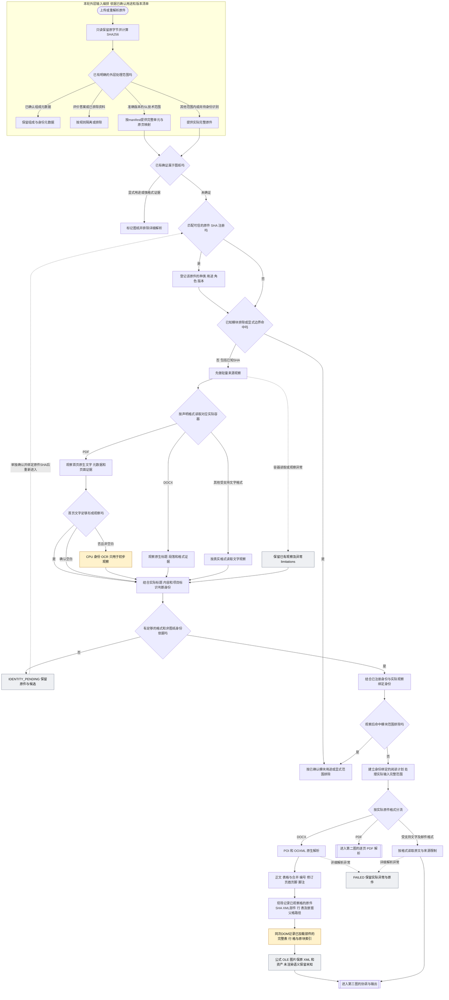
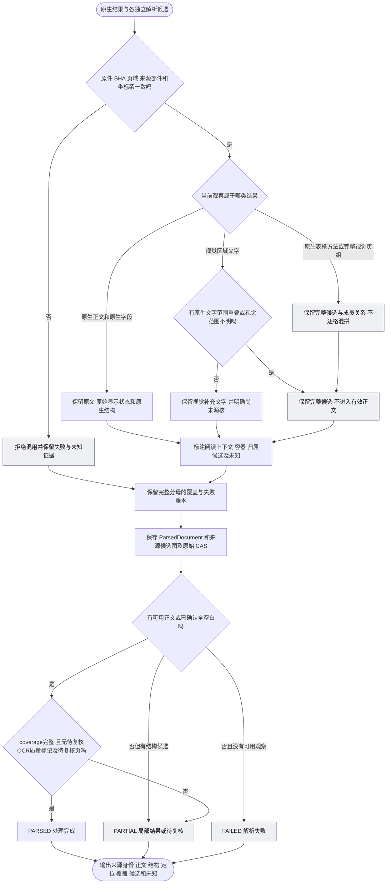

# 识别模块修复后的完整解析流程

日期：2026-10-15，Asia/Shanghai。

本图描述本轮修复后的执行路线，依据现有正常解析代码与已落实的运行修复编制。完整 AoA／APL 七页已实际经正常 Java 解析，常驻完整双视觉请求及活动 8080 OCR 接线也已完成；两原件仍为 PARTIAL，57 字段／74 写区／11 关系的来源语义未通过。橙色节点标出本轮修复的运行接缝；灰色节点表示保留候选、未知或待确认。实测与剩余门见[实施记录](../testing/oer-recognition-repair-20261015.md)。流程止于来源解析结果，不展开 embedding、检索、重排、Vetting 或 Advisory 判断。

第一图把**本轮外层输入编排**与**正常解析入口**分开：已确认的metadata-only、评价隔离及SL技术范围来自原件SHA绑定的清单／manifest和完整原页映射。普通parser不会自动将任意SL切成技术章节，也没有把所有封面／目录自动转成metadata-only的通用分支。没有已确认外层限制的新文件，以实际完整输入进入身份观察，不能靠文件名提前排除。

<!-- oer-i20-progress:start -->
**I20已闭合，源码精确采纳及采纳后独审0Must：选中表格的完整物理成员可正常取用。** 完整27份保存结果逐值评价及不同作者独审通过：462表／4377行／15659格，原混合载体目标74表／262行／601格、234个额外闭包格均能取用，旧正文、完整chunks、strictFP及legacy完整JSON保持。最终234项测试通过、6项既有可选跳过；首轮1项失败及准备失败保持。2个main及2个既有test已精确采纳，fresh current编译15.906秒、637主类／42资源逐字节等于实际验证版本；790其他源码及453活动产物保持，owner20.719秒、峰值Job提交2420424704字节、进程释放，root亲收原工具exit0。完整实际结果独审0Must；采纳后不同作者已核全部4备份/当前文件、790其他源码、453活动产物、fresh637/42及失败保护，0Must。正常材料JSON由186128747降至156906407字节，仅指保存表示，不授实际prompt/token或语义改善。原I19“完整表选入待办”由本轮解决；字段、Notes／OR、有效显示及完整来源语义仍unknown。六类重点Goal实际active，下一项I21分节与页眉页脚绑定；0新OCR／模型，未切活动服务。
<!-- oer-i20-progress:end -->

2026-10-16 I19补充：Word分支在同一次正常DOM读取中保存已加载正文、页眉页脚、脚注与尾注的物理表／行／格清单，并用原件SHA、部件SHA、QName路径与现有块／格索引绑定。完整27份的462表／4,377行／15,659格已与原XML逐项核验；嵌套表、没有独立正文块的行及无表成员的已加载根均明确保留。未加载story、渲染网格、空格填写含义及语义继续未知；清单尚未由正常候选图完整转发，不将它画成模型整表闭包已完成。旧正文、格位置及19 PARSED／8 PARTIAL保持，活动服务未切换。

## 一、文件进入、身份与格式路由

身份判断的边界：文件名和 PDF Title／Subject只提供线索，不单独证明文件用途、项目采用或整件图纸身份。已绑定的 SHA只证明准确字节及其登记身份，不证明解析质量；未被整体排除的已知SHA文件仍执行观察。观察阶段的容器不符、损坏或OCR不可用会先进入观察limitations，再按已有身份和观察证据决定pending或继续；不能将这些情况一概画成全局FAILED。详细解析中的实际异常另记FAILED。

NTT／SCT／SCC标准模板按已确认用途仅供Drafting，项目同名文件另按自身身份处理。SL在外层按该版原件SHA绑定的完整技术范围选入，不将旧版固定页号推广到新版本；`DocumentParser.parsePdf`逐页处理的是它实际收到的完整PDF，不在内部自动删除SL PRE。

## 二、PDF逐页判断、原生表格与双视觉解析

```mermaid
flowchart TD
    pdfStart([外层已准备且身份允许的完整 PDF 输入]) --> pageLoop[遍历实际输入全部页面 读取原生字形 坐标 表单 appearance 图像与矢量覆盖]
    pageLoop --> nativeKeep[保留原生文字 字段和完整页面证据]
    nativeKeep --> visualNeed{需要视觉补读吗}
    visualNeed -->|文字短或乱码 图像或矢量缺口 整表单阅读任务| raster[以原页渲染整页 RGB 并绑定页号和坐标变换]
    visualNeed -->|无可观察缺口| pageDone[保留本页原生结果]
    raster --> blankCheck{无原生文字且实际全白吗}
    blankCheck -->|是| blankPage[记录已确认空白页]
    blankCheck -->|否| reuseCheck{同图像 SHA 的身份观察可完整复用吗}
    reuseCheck -->|是| visualReturn[取得完整视觉结果和原始证据]
    reuseCheck -->|否| visualReady{详细 OCR 已启用且服务可用吗}
    visualReady -->|否| visualFailed[保留原生证据 记录该页视觉失败与未知]
    visualReady -->|是| completeRoute[正常 OCR 接口接通完整双解析配置]
    completeRoute --> paddleOwned{Paddle进程实际进入委托子树且接口就绪吗}
    paddleOwned -->|否| visualFailed
    paddleOwned -->|是| paddle[PaddleOCR VL1.6 与 PP DocLayoutV3 完整页解析]
    paddle --> paddleStore[保存原始结果 结构 坐标和资产]
    paddleStore --> paddleRelease{本次子树为空且根进程已退出吗}
    paddleRelease -->|否| visualFailed
    paddleRelease -->|是| mineruOwned{MinerU进程实际进入委托子树且接口就绪吗}
    mineruOwned -->|否| visualFailed
    mineruOwned -->|是| mineru[MinerU4 官方完整页解析 同一原页输入]
    mineru --> mineruStore[保存原始结果 结构 坐标和资产]
    mineruStore --> mineruRelease{本次子树为空且根进程已退出吗}
    mineruRelease -->|否| visualFailed
    mineruRelease -->|是| sourceCheck{来源 字节 页映射和完整输出契约一致吗}
    sourceCheck -->|否| visualFailed
    sourceCheck -->|是| dualKeep[分别保留双解析证据和分歧]
    dualKeep --> featurePolicy{已验通用特征规则唯一选中完整页候选吗}
    featurePolicy -->|是| wholeSelected[选择一整页候选并保留另一原始结果]
    featurePolicy -->|否或规则竞争| wholeUnknown[保留两路完整候选 不自动认定正确]
    wholeSelected --> visualReturn
    wholeUnknown --> visualReturn
    visualReturn --> pageDone
    visualFailed --> pageDone
    blankPage --> pageDone
    pageDone --> morePages{还有范围内页面吗}
    morePages -->|有| pageLoop
    morePages -->|没有| nativeTableSelect{有字形且存在原生布局或表格缺口的页吗}
    nativeTableSelect -->|没有| tableUnknown[明确记录未请求的原生表格页为未知]
    nativeTableSelect -->|有| tableIdentity{原件已绑定非图纸身份吗}
    tableIdentity -->|否| tableUnknown
    tableIdentity -->|是| tableBatches[每批至多64页 且实际上下文至多32MiB]
    tableBatches --> actualSource[每批均传完整原始 PDF与对应页证据 不裁改原件]
    actualSource --> tableMethods[pdfplumber lines-lines 和 Camelot network 与 stream 独立提候选]
    tableMethods --> releaseFiles[完整投影后释放本次文件映射及临时文件]
    releaseFiles --> batchCheck{该批来源 方法 页域和响应上限均有效吗}
    batchCheck -->|是| methodKeep[分别保完整表格候选 方法失败和实际 CAS 引用]
    methodKeep --> moreBatches{还有原生表格批次吗}
    moreBatches -->|有| tableBatches
    moreBatches -->|没有| pdfOutput[[进入第三图的协调与输出]]
    batchCheck -->|否| batchFailed[记录失败及已保留证据 剩余批次明确未执行]
    batchFailed --> pdfOutput
    tableUnknown --> pdfOutput

    classDef repair fill:#fff2cc,stroke:#b7791f,color:#111;
    classDef uncertain fill:#eef0f3,stroke:#667085,color:#111;
    class visualReady,completeRoute,paddleOwned,paddleRelease,mineruOwned,mineruRelease,releaseFiles repair;
    class wholeUnknown,visualFailed,tableUnknown,batchFailed uncertain;
```

当前代码的具体判断：

| 判断 | 实际依据 | 不可据此推断 |
| --- | --- | --- |
| 是否视觉补读 | 去空白字符数低于配置阈值（本轮 40），或 U+FFFD／U+0000 数量大于 `max(3, visibleChars / 10)`（整数除法），或任一放置图像／绘制矢量区域要求视觉观察，或阅读计划要求整表单布局；原生提取异常也转视觉路径 | 有文字就无需OCR；模型已理解表单字段 |
| 是否原生表格候选 | 页面有原生字形，并出现图像／矢量／原生文字布局缺口或已有表格观察 | 扫描页可用Camelot代替视觉解析；检测到表就结构正确 |
| 是否复用身份观察 | 实际渲染图SHA及观察复用契约匹配；只有满足完整详细解析要求的观察才复用 | 身份OCR做过就免去详细双解析 |
| 选择哪路视觉结果 | 已验的通用特征策略必须唯一选中一个完整页候选；两路原始证据都保留 | 按信心分／多数表决取真；逐格拼一份最佳答案 |
| 表格分批 | 原件字节不变，页域和原生证据对应；响应读取执行8MiB边界 | 截前64页冒充全源、增大上限掩盖巨型物化、失败后无限重试 |
| 视觉采集与投影预算 | 按用户补充的目标平台250GB内存条件，原始推理数组512MiB／页，完整provider响应与Paddle page_json投影各1GiB／次；完整原字节先存盘，超限明确失败 | 上限即预分配内存；响应完整就等于来源正确；将视觉边界套到原生PDF分批 |

图中两路视觉任务按GPU拥有和释放顺序执行，处理的是同一份完整页输入。Linux协调服务从具备委托权限的用户服务内启动；子进程在明确完成cgroup写入并核对实际归属后才启动provider。单次HTTP就绪只证明接口可用，模型加载、实际推理和来源质量另核；接管、模型调用或两秒清理核验任一失败均保留失败，不能继续借用未确认释放的GPU子树。当前正常代码尚未自动裁块只重识别一小区域；模型返回区域后，再做来源坐标和原生／视觉协调。

## 三、证据协调、完整结构保留与最终状态

`PARSED`是程序处理状态：当前判断检查coverage完整、OCR质量不是needs_review且needsReviewPages为空，不以所有limitations消失或来源质量已验收为条件。“已确认全空白”要求实际输入的全部页面均确认空白，不能由单页空白推断整源空白。原件内的表、图像、公式和关系保真在解析范围内；该条款是否适用于项目、业务如何裁决属于后续模块，不在本图中自动推断。

本轮已落实橙色接缝：文件映射正确释放、实际双视觉运行接通、原始采集和投影容量一致，以及常驻／正常入口接线。灰色路径仍保留实际失败／未知状态；本轮七页的 needs_review 和表单语义缺口没有被改标签变成成功。

## 代码依据

- `VettingService`：实际observe、身份门控、带观察和identity的详细解析及结构保存。
- `OerSourceRouting`／`OerSourceMetadata`：确切原件身份、用途、模块边界与未知处理。
- `DocumentParser`／`OerReadingPlan`：格式解析、逐页视觉选择、原生表格任务、来源协调与状态。
- `server.py`／`complete_ocr.py`／`whole_parser_groups.py`：身份OCR、双完整解析、实际输入映射、原始输出与整页候选选择。
- `native_pdf_candidates.py`／`native_pdf_table_candidate.py`／`PaddleOcrClient`：三方法候选、完整原件传输、有界分批与失败账本。
- `DocumentBlock`／`NormalSourceCandidateGraph`：候选与有效正文分离、完整结构保存和可追溯输出。
