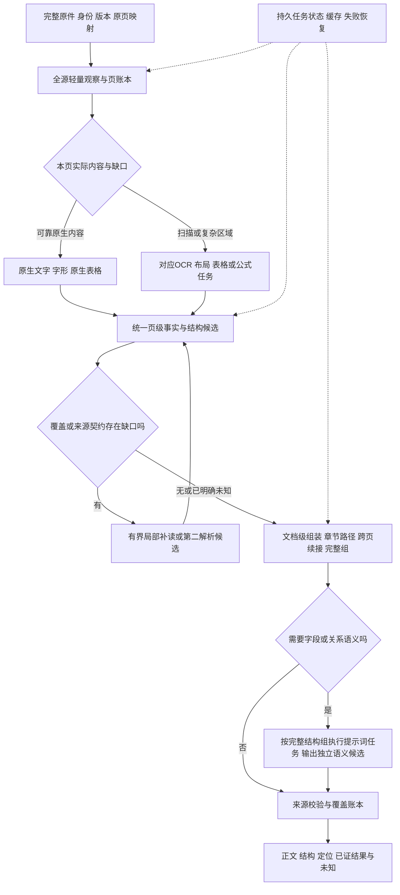

# 长篇合同／技术章节与扫描表单：成熟解析路线及提示词方法研究

日期：2026-10-15，Asia/Shanghai。状态：研究建议，未实施／未采用。

后续执行入口：[识别引擎小步演进路径](../specs/oer-recognition-evolution-path-20261015.md)。用户最新要求先写路径文档，由根代理审核并查看难点原页；当前未开始该路径的代码或实验。本研究的建议按该路径逐项验证，不因被列入计划自动成为已实现能力。

用户关注：架构调整后来源质量未证明提升，累计496次训练计算未使完整字段任务通过；要求查成熟成功经验，特别考虑PRE类长文档、SL技术章节，以及修改提示词的替代方法。本记录仅研究原件解析，不把检索、重排或Vetting／Advisory业务推理混入解析验收。PRE在此表示长篇文档形态，不自动改变已确认原件用途／范围清单。

## 结论

建议保留原生优先、来源身份与证据保全，采用成熟IDP的任务分工：**完整原件登记 → 全源低成本观察 → 按页／结构组选择原生或视觉任务 → 统一来源结构 → 文档级组装 → 按需、带证据的语义抽取与校验**。

提示词是这条路线中可以验证的组成部分，其前提是任务获得完整、足够可靠的来源观察。应先核查并接住现有布局、原图及结构信息，再验证任务选择、字段说明和有界结构任务；没有证据支持继续用同一家族七页的自由长JSON实验代替完整文档能力建设。端到端VLM也可以作为其中一个解析实现，不能仅因本轮失败就否定全部VLM方法。应比较实际输入、任务、结果消费与来源质量，而不是用工具数量或训练次数作判断。

对长文件，完整输入和完整来源覆盖必须保留；计算任务可以分片，文档逻辑关系需要重新组装。250GB RAM有助于热数据／模型资源管理，不能消除推理输出长度、单任务失败恢复和跨页结构问题。

## 一手经验与证据

| 来源 | 有证据的做法 | 能借鉴什么／不能推出什么 |
| --- | --- | --- |
| [AWS FGBS合同处理实践](https://aws.amazon.com/blogs/machine-learning/aws-finance-and-global-business-services-builds-an-automated-contract-processing-platform-using-amazon-textract-and-amazon-comprehend/) | 官方团队将合同入库、异步Textract分析、结构结果保存、分节和术语抽取分开，UI允许校验／更正；报告人工维护工时由150降到30小时／月 | 是真实合同处理实践及架构经验；不是千页合同全字段准确率证明，不能移植其分钟级延迟为本项目承诺 |
| [ABBYY数百页租约案例](https://www.abbyy.com/customer-stories/generative-ai-idp-extracts-data-from-lease-agreements-with-82-accuracy/) | 先按Preamble、Premises、Renewal Options等条款分段，再将对应段交给GPT-4 Turbo按提示抽字段，异常进入人工复核站 | 是贴近长合同的厂商／伙伴案例，客户未具名；支持分段与专用提示的工作流，不搬用标题准确率为本项目预期 |
| [AWS多页异步接口](https://docs.aws.amazon.com/textract/latest/dg/api-async.html)、[结果分页](https://docs.aws.amazon.com/textract/latest/APIReference/API_GetDocumentAnalysis.html) | 提交JobId，完成后获取分页结构结果 | 支持大文件采用持久任务、分阶段保存与分页读取；API响应分页不等于跨页语义已经闭合 |
| [Docling标准PDF源码](https://github.com/docling-project/docling/blob/main/docling/pipeline/standard_pdf_pipeline.py)、[DoclingDocument](https://docling-project.github.io/docling/concepts/docling_document/) | 分工处理PDF后端、OCR、layout、table及document assembly；用文档对象保存层级、来源定位与结构 | 适合作为统一文档结构主干的参照／独立基线；树和key-value容器不证明自动识别所有填写状态和语义owner |
| [MinerU2.5作者论文](https://arxiv.org/abs/2509.22186) | 低分辨率全局布局与原始分辨率局部内容识别解耦 | 说明全页概览与局部细读是已有成熟模型路线；不是所有任务都靠整页自由生成，也不证明本项目关系已正确 |
| [Google Layout Parser](https://docs.cloud.google.com/document-ai/docs/layout-parse-chunk) | 结构树保存标题与段落归属；官方仍明确PDF跨页表可能拆成两个表，batch有页数／文件限额 | 长文件需要外部任务编排及跨页组装；不能将Markdown或商用服务可处理长PDF等同完整逻辑保真 |
| [Google Custom Extractor机制](https://docs.cloud.google.com/document-ai/docs/ce-mechanisms) | 文档级说明和字段name／description参与底层prompt；支持零样本起步及后续评价；提示与验证规则另分工 | 提示词／schema是可行工具，值得先做固定权重对照；字段提示不应承担程序校验，不能靠描述补来源没有的事实 |
| [Google Extract与Derived的区别](https://docs.cloud.google.com/document-ai/docs/ce-derived-signature) | 直接抽取有text/page anchors，推导值不一定有这些anchors；derived功能有Preview及跨页限制 | 来源逐字值与推导结果必须分别标注；不能把推断输出伪装成原件值 |
| [Azure准确度与置信度](https://learn.microsoft.com/azure/ai-services/document-intelligence/concept-accuracy-confidence) | OCR与字段抽取置信度需要分别检查；关键应用可按校准后的结果进入复核 | 模型自信、两模型一致均不能替代来源质量检查；人工补齐也不能算自动解析成绩 |
| [OmniDocBench作者实现](https://github.com/opendatalab/OmniDocBench)、[DocILE作者实现](https://github.com/rossumai/docile) | 前者分文字／表格／公式／读序评价；后者另设关键信息定位抽取及行项目任务 | 文档转换高分不自动证明空白表单、角色归属或跨页关系；评价必须对应我们实际任务与未见版式 |

上述产品能力、作者论文与厂商案例分别标明证据级别。没有发现能直接证明“任意千页技术规范＋任意空白签署表单＋完整关系零错漏”的现成通用系统。云产品在本研究中是经验参照，不构成上传原件、采购或云部署建议的已采用状态。

## 对PRE类／SL长技术章节的推荐处理

1. **只读登记完整原件。** 绑定SHA、版本、用途、实际页数和原页映射；已确认图纸类原件路由排除，不靠文件名／旧SL页号推广新来源。
2. **完整低成本观察。** 先读原生文字、字形、标题／编号、目录、页眉脚、图片覆盖和页面框架；隐藏OCR层与可见内容一致性需要另核。每个范围内页都有处理账本。
3. **按实际缺口升级任务。** 普通原生正文保留原生提取；表格、公式、扫描区域使用对应解析能力。第二模型或局部重读由预先固定、与gold无关的缺口／分歧规则触发。所有页双模型和逐格事后拼优不是可靠性证明。
4. **计算分片、结果可恢复。** 单原件允许多页批次和章节任务；按源SHA、物理页、渲染配方、引擎／模型配置、解析契约及提示词／schema版本形成任务键。保存状态和结果，失败只重做受影响任务。CAS资产去重不能冒称这一层完整任务缓存已经实现。
5. **文档级组装。** 页级结果形成条款／标题路径、读序、表格和表单对象；对跨页段落、重复表头、续表、脚注作用域和OR选项完整组建立有来源的候选。相邻页窗仍无法闭合的内容扩展完整结构组或保留unknown。
6. **语义任务按完整单元执行。** 输入本章／条款路径、相关完整结构组和必要前后页，不把整本书当一个自由JSON生成请求。这里是解析结构／字段抽取，不是下游法律适用裁决。
7. **分别验覆盖、内容、结构和恢复。** 总字数、HTTP200和JSON合法都不替代来源完整性。所有失败、排除和未证项保留，不能因只让难页进视觉而缩减评价分母。



这是建议路线，不是现有实现已全部具备的声明。Docling的page_range可用于编排，但max_num_pages是限额、convert_all是逐文档迭代，不能据此声称已有任意大文件的页级流式恢复。逻辑分层也不要求新增同数量容器；本项目单H800、250GB RAM和最多5容器的限制仍须在目标环境单独验证。

## 修改提示词：优先区分三种动作

| 动作 | 适合解决 | 不能代替 |
| --- | --- | --- |
| 选择识别任务，如OCR／Table／Formula | 内容已在输入中，识别任务选错导致结构损失 | 布局遗漏区域、完整组没有输入、来源判定 |
| 字段schema及任务说明 | label／value／角色混淆、选项与字段的结构化表达、引用证据 | 像素中看不清的文字、缺失写区图像、未执行的跨页范围 |
| 结果审查与缺口描述 | 基于完整原图／原文识别遗漏候选、发现不闭合组，触发有界补读 | 校验程序、独立来源评分或确认模型自报“全部完整” |

本项目已经有不训练的正例：账本FoT8同完整表单crop由Text任务改Table，字面区域14／19→19／19、逻辑组11／13→13／13。它证明任务路由有价值，不能扩大为整页／全文／空态均通过，也没有证明自由语义提示能够补齐缺失布局。

### 2026-10-15补充：没有布局，提示词能改善多少

用户质疑的前提成立：若输入只剩展平文字、缺少原图和布局证据，提示词不能可靠恢复丢失的列对齐、写区范围或空间归属。若输入包含完整原页图像，视觉模型仍能从像素观察排版，即使没有外部显式布局JSON；但这不证明覆盖完整、坐标准确或跨页结构已经形成。

当前代码保有部分布局观察，尚未形成完整、已验证的文档结构：

- [complete_ocr.py:506](../../tools/vetting_eval/complete_ocr.py#L506)把块类型、文本、readingOrder、bbox／polygon、原图坐标投影及可用table放进regions。
- [DocumentParser.java:567](../../src/main/java/com/consense/document/DocumentParser.java#L567)将完整visualRegion及frame／provenance保入DocumentBlock，并规范化块框；保存的provider声明不等于已验证结构。
- [structured_parser_evidence.py:390](../../tools/vetting_eval/structured_parser_evidence.py#L390)从HTML归一化表格单元时bbox仍为未提供，原provider cell观察另存；表格HTML不保证单元几何已经接通。
- [OerReadingPlan.java:55](../../src/main/java/com/consense/document/OerReadingPlan.java#L55)的owner／valueState默认unknown；写区锚点及OR／Notes／continued关系目前主要为候选，不能由此授完整字段语义。

因此实施优先顺序应为：先核对现有布局在输入、适配和消费中的保全，再补缺失的区域／结构观察，最后在完整结构单元上测试提示。它们可在同一页级任务内组合，不要求为每一层新增服务。纯提示收益需与补输入、换裁图或修适配的收益分别报告。

### Codex／Agent阅读扫描件的机制与可借鉴点

本节以2026-10-15读取的OpenAI官方文档为依据，说明公开能力与可复现工作流，不声称知道Codex每次文件阅读的完整内部实现，也不推广为所有Agent采用同一处理链。

- [Images and vision](https://developers.openai.com/api/docs/guides/images-vision)确认模型能直接分析图像及可见文字；图像本身保有排版信息，因此视觉阅读不以外部先产出完整布局JSON为必要条件。同页文字、视觉位置与任务说明可以共同用于判断；模型内部视觉表示不能直接当成可审计的坐标或完整结构。
- [File inputs](https://developers.openai.com/api/docs/guides/file-inputs)明确Responses API的视觉PDF输入同时提供抽取文字和页面图像；此为该API契约，不代表本地Codex查看任意文件时自动走相同路径。
- [Codex Prompting Guide的View_image](https://developers.openai.com/cookbook/examples/gpt-5/codex_prompting_guide#view_image)展示将本地图像加入上下文的工具。结合原页渲染与保坐标的区域读取，可以实现整页观察及局部细读；这不是默认自动执行每次crop／zoom的证明。
- [Running agents](https://developers.openai.com/api/docs/guides/agents/running-agents)说明模型输出工具调用、执行后继续观察的循环。可借鉴按具体疑点补充输入的机制，回读需有调用／范围／累计预算上限及停止条件；多次自检不等于独立来源验证。

建议在现有流程复用的最小做法：首遍原生／视觉解析后，按完整页／结构组列条目与区域；需要细读时同时提供整页背景、原分辨率局部和父章节／前后续页；程序发现编号断裂、组不闭合或归属竞争后触发有界回读；独立输出带来源的结构候选并沿正常入口消费。缺布局可以由视觉阅读任务补产候选，不要求另建完美布局前置服务，但原件、范围和来源映射必须保全。

通用视觉推理模型与OCR专用模型的任务能力不能假定相同。编排可以复用，复杂角色／跨页语义是否在现有冻结模型上可达仍须实测。交互式问答通常聚焦特定问题；完整解析还需对所有页面、条目、空白和关系检验覆盖。官方视觉文档也列明小字、旋转、线型、精确空间定位及计数限制，故不能从回答流畅授完整原件通过。本轮没有新的来源输入或模型实验。

### 比赛耗时约束：借鉴阅读方法，限制昂贵路径

用户进一步质疑多模态LLM逐页细读的比赛可行性。判断：全书逐页重模型生成、普遍双跑及多轮视觉回读不适合作为长文件默认路线。现有[修复实测](../testing/oer-recognition-repair-20261015.md)的AoA4页＋APL3页完整链路为943.156秒（约15分43秒），每个详细请求固定完成两路parser；该数字包含当前管线开销，不是通用多模态LLM纯推理基准，也不能线性外推PRE／SL或H800速度。

比赛候选应分配工作：DOCX及可靠原生PDF用原生结构；扫描正文使用覆盖完整页的文字／布局识别；表格及表单使用对应结构任务；少量有明确缺口的完整区域再考虑有界视觉语义回读。常规详细OCR路径的新增接线、识别覆盖及耗时仍需验证，当前identity OCR不能冒称已有这条详细路径。必要视觉范围由来源缺口和质量要求决定，不按预设百分比强行裁减。

优先优化任务选择、同配方结果复用、批内模型生命周期及输出体积，分别记录加载／推理／诊断采集／传输开销。语义任务复用已有原文，只输出来源ID、跨度及关系等增量结构；不让模型重抄整章。全量原始tensor取证属于诊断强度，若要调整常态采集必须保留任务身份、必需来源和失败回执并验证契约，不在本研究中静默关闭。

如果新评审文件几乎全是复杂扫描表单，昂贵任务比例可能很高；此时单卡时限内能否满足完整质量尚无证据。不能靠缓存已知资料代替陌生来源能力，也不能通过跳页、少抽字段或降低分母宣称满足比赛速度。本轮未执行速度实验或改变采集／运行配方。

官方源码也支持进行适当的提示词实验：[MinerUClient](https://github.com/opendatalab/mineru-vl-utils/blob/2843b62a1c68feafce42fa52f6e21080eb094fc2/mineru_vl_utils/mineru_client.py#L530)有prompts与system_prompt；[PaddleX DocVLM](https://github.com/PaddlePaddle/PaddleX/blob/ffb64904d23708863ff5b8da312a5cbd52a7f462/paddlex/inference/models/doc_vlm/predictor.py#L648)底层支持image＋query，而正常page pipeline主要选择内置任务提示。因此不能断言这两类模型完全无法改提示，也不能断言改一段文本便具有通用字段语义。

**消费契约必须同时正确。** MinerU和Paddle的部分内容识别输出最后进入block content；若直接让原OCR任务吐字段JSON，现有Java可能只收到一段JSON文字，还可能破坏原表格解析预期。建议保留原OCR／布局输出，提示词任务单独产出可追溯语义候选，再由正常入口校验和消费，而不是由评估脚本补sidecar授能力。

### 可供后续对照的提示词任务草案

以下不是已验证提示词，也没有在本轮调用模型。输入范围必须由编排层提供，模型不能自行把整个文档缩成这几个目标。

```text
任务：依据给定来源建立完整结构候选，不作项目法律适用判断。

输入：来源ID与版本、本章标题路径、带ID/物理页/坐标的原文块，
相关原页或完整写区图像，以及前后未闭合的结构组。

先列出本范围内实际可见的标题、编号条目、表格、字段候选与选项组。
打印编号即使后面没有填写文字，也必须作为可见条目保留。
逐字值与规范化值分开；每个对象引用实际来源块/区域ID。
字段标签、填写区域、角色归属、状态和值分别输出，不从邻项借值。
仅当完整写区及可见状态证据足够时判断filled/unfilled/mixed；否则unknown。
跨页未完或互斥分支不全时，列出已见成员、缺失范围及继续所需证据。
不从惯例、文件名、固定页号或本次评价字段清单补造来源。
输出独立结构化候选；原文与原始OCR结果保持。
```

少量与评价来源隔离的示例可说明输出契约及容易混淆的类型；示例不得提供本轮57字段的答案、固定框或预设未填状态。复杂完整组宜拆为库存、属性／关系、覆盖校验的有限任务，保每步输入、结果和累计预算；不能把拆任务变成无限模型循环。

## 我们应保留和调整的部分

- **保留：** POI／OOXML、PDF原生字形、原生表格方法、实际源身份、坐标映射、完整候选与失败账本；已有框架不应因新的通用parser出现而整体重写。
- **调整：** 当前详细视觉请求固定双跑、默认正文落Paddle；需要把“保两套证据”与“按实际缺口选择和升级任务”分清。长文件还需持久任务及缓存、GPU有界批次复用与故障恢复，不能只提高JSON上限。
- **补齐：** 统一正常入口的结构化消费接缝。R142／R159的局部成果仍为离线候选；普通text块不能自动成为type／state／owner／relationship对象。先明确谁产生、谁校验、谁消费，再决定采用哪种提示词或规则。
- **暂停追加：** 在已暴露七页上盲加训练、扫提示词／阈值或按错误项事后拼最佳。当前模型冻结决定保持；本研究不恢复训练或部署。

## 最小验证与采用条件

建议后续有界比较至少保留三套独立结果：当前正常基线；固定权重的任务路由／提示词／schema候选；必要时一个成熟转换器的独立参照。按相同原件、范围、输出契约和预先固定评分比较，不能只比模型产生的JSON。

来源范围必须同时包含一份完整长文档形态、SL实际完整技术单元、原生和扫描表格、AoA／APL表单；PRE类具体原件的使用仍服从已确认范围。开发与保留来源按文档家族／版本隔离，不能把同一模板页换内容后随机分割当新来源。

分别报告：全文／关键字符保留、编号与空条目库存、表格网格与跨页完整组、章节与条款归属、字段type／state／value、写区与关系、旧正确保持、完整输入覆盖、未证和失败、总耗时与重模型调用量、内存峰值及失败恢复。人工复核结果与自动结果独立记账。选择性复核是实际IDP做法，不能用于缩减原来源标准或把人工补齐算为自动通过。

只有来源缺陷减少且旧正确保持，才可讨论采用；JSON合法、推理完成、训练loss下降和其他厂商benchmark分数均不能代替这一门。研究建议没有证明新的本地／超算质量提升。

## 本地依据与关联研究

- [本轮修复及历史最好对照](../testing/oer-recognition-repair-20261015.md)：真实运行已闭合，来源语义未通过，APL编号回退仍开放。
- [训练与任务路由账本](../testing/oer-progress-ledger.json)：FoT8任务路由正例；九段496训练计算／124更新分别保留，不换算为准确率。
- [商业IDP一手资料](oer-idp-commercial-evidence-20261015.md)。
- [开源解析实现一手资料](oer-open-source-parser-evidence-20261015.md)。
- [当前代码与最小接缝核对](oer-current-direction-gap-20261015.md)。

本轮仅公开资料检索、现有代码／账本只读核对及研究文档写入；没有上传原件、调用解析／业务模型、训练、安装新模型、改现用提示词或启停服务。
