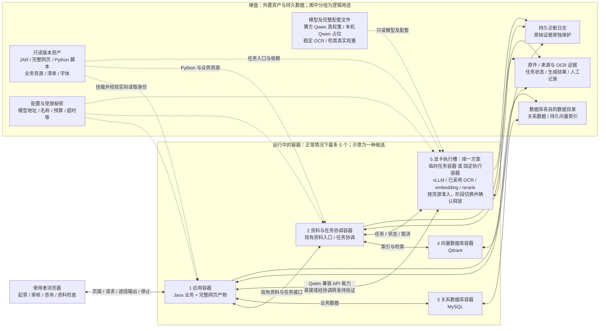

# 比赛部署：目标架构与镜像准备图

**用途：**供工程师预先梳理镜像、容器职责和外置文件。此图是依照[实施说明](competition-container-external-runtime-20261029.md)绘制的**候选目标架构**；不是已运行系统、最终显卡方案或验收结果。实施顺序以[票据依赖](../../../.scratch/competition-external-runtime/README.md)为准，01 未完成前 02、03、04 不进入实施。

**最新决定：**使用 Docker；各实际容器进程必须运行在镜像准备的具名非 root 账户下，登记账户名、UID/GID，并核验各角色、数据库持久目录及 GPU 权限。镜像安装／构建和运行身份分开；不另规定 daemon rootless。本机 Podman 检查只是探索；Docker 已完成隔离测试镜像的非 root、挂载及 GPU 可见性最小检查，业务镜像与完整链仍未验。本机 Qwen 将使用明确标记的假文件和协议替身；图中的 vLLM／Qwen 真权重是赛方目标，真实模型推理及接口兼容仍未验。稳定 OCR、embedding 和 rerank 仍须本机真实权重及推理。

## 候选架构：四个常驻职责 + 一个显卡执行槽

图中的箭头表示需要贯通并验证的职责关系，不表示现有代码已经实现或规定最终网络拓扑；应用到显卡的连线表示业务模型调用能力，实际可直接调用或经协调转发，须在两种候选中分别验证逐段输出和停止。应用与资料服务读取同一份文件时，须登记各自容器路径、权限和映射，并实测文件身份；历史绝对路径不能仅靠改挂载名假定可用。

**显卡槽的两种候选互斥：**

- **临时任务容器：**沿现有 GPU Job 路径评估。各阶段可使用各自镜像，但每次只占用一个槽位；需要真实平台任务身份、统一准入、逐段输出、停止、落盘与退出清理。现有离线有限任务路径拒绝正文流式，不能直接作为满足要求的实现。
- **固定执行容器：**一个容器内按阶段启动、停止实际推理程序；需要验证 vLLM、已采用 OCR 与检索程序及其依赖能否共存，进程树和显存是否确实释放，并保留真实任务身份和结果。当前没有现成固定显卡执行系统。

两种方式的具体协议和选择需经过票据 01 的环境实测及后续票据验证；不预设必须新建固定执行系统。无论采用哪一种，所有 GPU 启动入口须共享可靠准入；若不能证明前一阶段资源已释放，停止后续任务并保留失败证据。单卡资源是否可容纳已选模型及业务预算须实测，不能悄悄换模型、精度或外网服务。

若 vLLM 长期占用第五个容器槽，不能同时再启动第六个 OCR、embedding 或 rerank 容器。只有停止 vLLM 并确认进程与显存释放后替换该槽，或经验证在同一个 GPU 容器内按资源互斥执行，才可进入下一阶段；等待中的业务请求是排队还是拒绝，由最终方案和实测决定。图不假定 vLLM 常驻时其他模型能够并发运行。

## 工程师可准备的镜像职责

| 职责 | 准备方向与外部输入 | 仍须核实 |
| --- | --- | --- |
| 应用 | Java 运行环境及确实不能外置的依赖；外部读取完整 JAR、完整网页产物、业务资源、配置、字体和数据目录。Java 源码与前端源码及离线构建输入保留在硬盘。 | 启动脚本与所有实际入口外置；Java、网页各自构建及受控换版；旧网页资源、权限、流式和停止。 |
| 资料／协调 | Python 运行环境及实际必需的依赖；外部读取版本固定的现有资料与任务脚本、业务资源、配置及工作目录。两个现有 Python 目录需保持相邻导入关系或同步修正所有调用。 | 冻结基线统一资料入口与当前离线入口存在差异，逐项核对资料、原文原页、检索及任务接口；启动、动态导入和子进程的实际路径。 |
| 关系数据库 | 准备与实际部署兼容的 MySQL 镜像及独立持久目录，数据库程序管理其数据；秘密单独提供。 | 一致性备份、恢复、版本和业务关联；本机活动 H2 文件不能直接放入 MySQL 数据目录。 |
| 向量数据库 | 准备 Qdrant 镜像及独立持久目录；索引身份与所用模型配套。 | 实际持久化、模型维度／版本、原件与索引对应及恢复重读。 |
| 显卡执行 | 准备赛方已选 vLLM 与当前采用的 OCR、embedding、rerank 运行环境；模型权重和配套从硬盘加载。本机 Qwen 文件仅为标记占位、协议替身不加载真权重；其他模型使用真实权重。各阶段可准备不同镜像，不等于同时运行多个容器。 | 实际镜像、具名非 root 进程／GPU 权限、依赖隔离、驱动、逐段输出、停止、显存释放及 OCR／检索真实本机推理。真实 Qwen vLLM 兼容 API、预算及模型推理待赛方实测；真实不兼容才最小修复。 |

现有 MinerU 与检索环境的依赖锁使用不同版本的 PyTorch、Transformers 和 Hugging Face Hub；不能假定它们能装入同一个 Python 环境。工程师可准备相互隔离的环境或分阶段镜像，其实际导入、GPU 兼容与进程清理仍需验证；业务 vLLM 的版本不能由 MinerU 的依赖锁推定。

镜像内的运行时、第三方依赖、系统库及文件工具也先评估能否外置；仅把经核实确实无法外置的部分留在镜像，逐项记录原因和后果。镜像与容器需要扫描；用户已确认硬盘文件可直接上云。项目说明文档留在本地和远端仓库，不打入比赛运行包；程序实际读取的业务资源即使是 Markdown 也要保留。文件大小限制的适用范围及分卷仍待赛方核实。

## 计数、持久化与切换约束

- **任意时刻总数不超过 5：**不仅是图中的正常运行数，还包括临时任务、初始化、构建、新旧实例切换、失败恢复和平台注入容器。若平台注入容器，则必须为其腾出槽位，不能在图中五个之外再加；计数口径仍须赛方确认。
- **换版不原地覆盖：**先准备并核验完整新版本，保存草稿并等待或明确处理在途任务，再在计数限制内受控切换；保留旧网页资源和恢复所需数据。不能假定无停机或热更新。
- **数据与秘密分离：**数据库由对应程序管理持久目录；原件、来源、双路 OCR 原始输出、人工记录、任务、生成结果和索引须共同追踪恢复。密钥、数据库和原件不放到网页可访问目录；普通日志不默认记录密钥、原文全文或完整模型答复。
- **资料规则不变：**按现有规则识别并排除图纸，不进行图纸 OCR 或 CAD 解析；不得扩大比赛资料范围，已排除材料不变成必需输入。结果和关键证据成功落盘后才能发布相应成功状态。

## 当前状态与交付前证据

冻结基线已有外置 JAR 和网页产物的第一步，但协调器和 GPU 相关 Python、部分启动命令仍在镜像内；当前离线有限 GPU 业务模型路径不支持流式正文。上述架构是要达到的目标，**不代表外置、模型、容器或业务已通过**。

票据 01 需先完成受保护服务与数据清点、一致性副本、实际 Docker／挂载／非 root 身份／GPU 验证、容器计数和运行方案选择。后续按依赖完成 OCR／检索真实模型、Qwen 标记替身、资料、逐段输出、恢复、断网和浏览器业务链；真实 Qwen／vLLM 与赛方验收保持未验。镜像身份、外置文件及配置身份、真实权重和失败记录分别留证。本机 RTX A4000 与赛方 H800 和平台的差异另记；除 Qwen 接线的明确替身外，不能用健康检查、宿主进程或内存数据库代替本机实测。

详细范围、逐票关闭条件和路径映射分别以[实施说明](competition-container-external-runtime-20261029.md)、[票据](../../../.scratch/competition-external-runtime/README.md)和[文件清单](competition-file-layout-20261029.md)为准。
