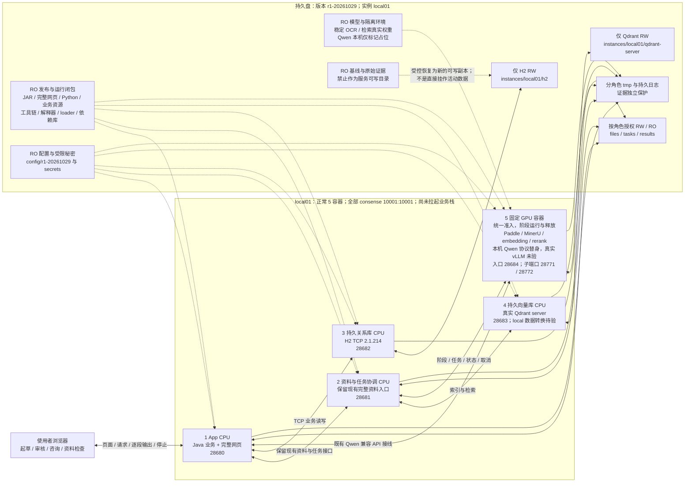

# 比赛部署：选定本机架构与镜像准备图

**用途与状态：**供工程师按[运行方案决定](competition-runtime-plan-20261029.md)准备本机预演；已选定四个 CPU 常驻职责加一个固定 GPU 容器，不再把 MySQL 或临时 GPU 任务容器列为本轮待选方案。此图是准备约定，不是已部署系统或验收回执。票据 01 仍在整理证据并等待门审查，未关闭；02、03、04 按[票据依赖](../../../.scratch/competition-external-runtime/README.md)等待，不据本图进入实施。

**运行身份：**使用 Docker，全部实际容器（包括数据库和初始化职责）采用具名账户 `consense`、UID/GID `10001:10001`；各角色实际进程、挂载和 GPU 权限仍须逐一验证。容器非 root 与构建／安装权限分开记录，不额外要求 Docker daemon rootless。本机 Qwen 仅使用明确标记的占位文件和兼容 API 协议替身；赛方真实 Qwen／vLLM、H800 兼容与推理未验。稳定 Paddle／MinerU 双路 OCR、embedding 与 rerank 后续必须以真实权重在 Docker 内推理。

## 选定架构：四个 CPU 职责 + 一个固定 GPU 容器

箭头表示后续必须贯通验证的职责关系，不证明接口已经接通。固定 GPU 容器复用现有 ownedBoot／LinuxTree 阶段启动与进程树所有权机制，按 Paddle、MinerU、检索隔离 Python 环境；真实 vLLM 依赖另核。CPU 的精确 cgroup 委派探针只支持最小接缝可行性，不证明 GPU 释放、依赖共存或业务链通过。所有 GPU 入口须共享准入，保留真实任务身份、队列／拒绝语义、流式、取消、超时和失败落盘；未确认旧进程与显存释放就停止后继阶段。本机 Qwen 替身在同一第五容器内计数，不额外启动第六个。

## 固定路径与端口

发布为 `r1-20261029`，实例为 `local01`；Linux 持久根为 `/srv/consense-rehearsal-20261029`，Windows 专用外置根为仓库忽略目录 `.local/competition-external-runtime-20261029`。这些是已登记目标，不代表目录已创建、复制、挂载或权限通过。具体生产者、读取者、原有字节与目标位置见[受保护资产登记](../testing/competition-protected-assets-20261029.md)及[文件布局](competition-file-layout-20261029.md)。

| 资产 | Linux 根下位置 → 容器可见位置 | 权限与生效 |
| --- | --- | --- |
| 完整发布 | `releases/r1-20261029/{app.jar,web/}` → `/runtime/release/`；同版 `tools/{vetting_eval,offline_delivery}/` → `/runtime/tools/` | RO；两 Python 目录保持相邻。先完成构建和清单核验，再处理在途任务后重启／切换；不运行中覆盖。 |
| 配置与模型 | `config/r1-20261029/` → `/runtime/config/`；受限 `secrets/` → `/run/secrets/`；`models/`、隔离 `envs/` → `/runtime/models/`、`/runtime/envs/` | RO；秘密只给实际读取角色。模型与环境闭包按实际路径／ABI 准备，各角色另有可写缓存／tmp。 |
| 持久状态 | `instances/local01/{h2,qdrant-server,files,tasks,results}/` → H2 `/runtime/data/h2/`、Qdrant `/qdrant/storage/`，其余 `/runtime/data/` 对应目录 | 库只管理自身 RW 目录；文件按生产／读取职责授权。只读基线另存，恢复必须建立新可写副本。 |
| 日志与证据 | `logs/local01/` → `/runtime/logs/`；`evidence/local01/` → `/runtime/evidence/`；分角色 `tmp/` | 持久日志脱敏，原始证据单独受限；不把数据库、秘密、模型或原件放网页目录。 |

专用端口：App `28680`、资料／协调 `28681`、H2 TCP `28682`、Qdrant HTTP `28683`、GPU 入口 `28684`，GPU 内部子端口 `28771`／`28772`。端口尚未预留，启动前重查；Qdrant gRPC 不额外暴露，确需时再登记。已完成的 host 网络回环探针不证明赛方网络或网络隔离。现有业务、WSL 服务、数据库、模型环境、缓存和网络采集进程按保护登记保留，不盲杀端口或直接使用活动数据。

## 工程师需要准备的运行内容

| 职责 | 准备内容 | 后续真实验证 |
| --- | --- | --- |
| App | 外置 Java 运行闭包、完整 JAR／网页、业务资源、字体和配置；网页由同一 Java 服务提供。源码、JDK／Maven、Node/npm 及离线构建输入在盘上登记。 | Java／网页分别完整重建、实际读取身份、旧网页资源、业务读写、逐段输出、停止和受控换版。 |
| 资料／协调 | 外置现有 `vetting_eval/`、`offline_delivery/` 与实际 Python 依赖、动态导入和子进程入口；保留冻结基线完整资料能力。 | 原文原页、文件身份／旧绝对路径、索引和检索；不能用有限离线入口代替完整服务。 |
| H2 | 外置同版 **H2 2.1.214 TCP server JAR** 与 Java 闭包；从受保护封闭副本建立新的可写实例。server／client JAR 身份分别登记，保留 H2 profile 并外配 TCP URL。 | 鉴权／网络限制、LOB／来源摘要触发器、schema、代表性读写与重启重读；不在 RO 基线上运行建表更新。`MODE=MySQL` 只是 H2 模式，本轮不是 MySQL 迁移；App 不直接打开同一库文件。 |
| Qdrant | 外置可执行程序及可搬运依赖、单独 server 数据目录；版本和客户端适配后续登记。 | 真实 server、持久化、collection／维度和模型身份；既有 local Qdrant／SQLite 保留，后续受控读取／转换，不能直接挂作 server storage 或只比点数。 |
| 固定 GPU | 单容器阶段入口、已采用 Paddle／MinerU／检索各自隔离环境与真实权重；本机 Qwen 明确占位及 API 替身，真实 vLLM 环境另核。 | 每类真实 Docker 权限／推理、所有入口统一准入、流式／取消、进程树和显存释放。RTX A4000 不代替 H800；Qwen 替身不证明真实推理、计数、质量、预算或业务结果。 |

现有 MinerU 与检索锁中 PyTorch、Transformers、Hugging Face Hub 版本不同，不合并安装或由 MinerU 锁推定 vLLM 兼容。Windows venv 不能直接代替 Linux 环境；解释器、动态链接器、库、配置和实际绝对路径须形成同版离线闭包，明确可写缓存位置。固定 GPU 方案不需要向协调容器开放完整 Docker socket。

### 最小用户空间外置探针的结论

已有 CPU 探针 `.local/container-rehearsal-20261029/isolated-docker-01/external-runtime-e41f/{receipt.md,result.json}`：正例把 shell、Python、标准库、动态链接器、共享库和所需配置以 RO 外部挂载提供，镜像仅保留目录／链接及账户文件；具名 `USER consense:consense` 实际运行 UID/GID 为 `10001:10001`。这证明所测闭包可外置，不能把运行时、loader 或系统库默认视为必须内置。

反例在镜像缺少 passwd/group 时仅 RO 挂入外部账户文件，Docker 在应用运行挂载前解析具名 USER，启动报找不到 `consense`。因此本方案镜像保留该具名账户所需的 passwd/group 条目及最小目录／链接；这是本次已测具名 USER 的启动边界，不是所有账户信息或镜像元数据均无法外置的证明。数字 USER 和其他平台行为未测，USER／PATH／HOME／WORKDIR 等元数据也不声称不可覆盖。

探针未运行 Java、数据库、原生业务包、模型或 GPU，不是业务镜像闭包验收。工程师须逐角色核清外置闭包、挂载前路径和确需保留的内容，再登记镜像 digest 与理由；不能把这一通用正例升级为全部依赖可用。镜像和容器仍需扫描；硬盘文件按用户决定可直接上云，文件大小适用口径待核。项目说明文档留本地和远端仓库，程序实际读取的业务资源须保留。

## 计数、准备顺序与未验门

- **任何时刻不超过 5 容器：**正常五职责，GPU 未启时四个；初始化、离线构建、调试、换版、恢复和平台注入也计数。无空位时先停止并确认旧实例退出，不启动第六个；计数口径仍待赛方核实。
- **先保护再准备：**核对 01 的资产／服务归属和证据门；通过后由同一预演环境所有者准备发布、配置、目录权限与可写副本，重查端口、容器数和 GPU 活动。依次验证 H2／Qdrant、资料协调、App，再使用唯一 GPU 槽；各票不独立并行拉栈。
- **再验证行为与恢复：**真实 OCR／检索推理、Qwen 标记替身接线、上传与来源、引用与人工记录、浏览器起草／审核／咨询、停止重建后重读、离线重启和失败恢复分别留证。处理草稿与在途任务后受控换版，保留旧网页及回退数据；关键证据落盘后才发布成功状态。
- **资料规则不变：**图纸识别后排除，不进行图纸 OCR 或 CAD 解析；不扩大原件范围，不恢复此前作废的未完成任务或将旧质量缺口带回全面整改。冻结比较仍为 `8a40dfcca04730ba7b40cdefb36b596a37bbcb53`。

票据 01 **仍未关闭，门审查待完成**。通用 Docker 身份／挂载／GPU 可见、CPU 生命周期及最小用户空间外置探针不等于业务实施通过；真实持久 H2 TCP、Qdrant server 转换、业务镜像、稳定双路 OCR／检索真实容器推理、完整流式／停止／恢复和浏览器业务链仍未验。真实 Qwen／vLLM、H800、赛方权限／网络／扫描受理另列未验。完整关闭条件以[实施说明](competition-container-external-runtime-20261029.md)、[运行方案](competition-runtime-plan-20261029.md)与[票据 01](../../../.scratch/competition-external-runtime/issues/01-baseline-and-runtime-plan.md)为准。
