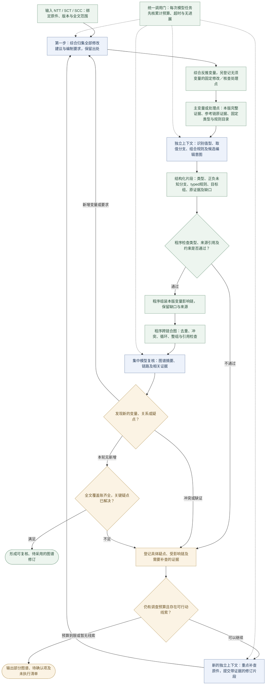

# NTT／SCT／SCC 原子语义能力与图谱拼接

本稿承接用户本轮明确设计：**第一业务步先综合归集全部修改建议与编制要求，再据此反推出变量**，使每个变量的来源可解释；之后对变量与处理点做语义识别，用固定类型匹配并向外探索联动。每个主变量使用独立模型上下文，先组合变量影响链，再拼接整体图谱；发现疑点允许再次重点调查证据。范围统一覆盖 NTT／SCT／SCC 及跨文件关系，各版来源、规则和目标保持隔离。

本稿是设计可行性结论及候选契约，不启动产品实现、真实模型、训练、原件重解析、迁移、服务或 DB 操作。本轮将类型细化为v0.2候选契约：8种值型、7类影响、10类关系、3逻辑连接／8谓词组／7组合方式／10纯配方组，以及7基础编辑意图＋4组合编辑配方。它不追认为现行DTO或已可执行协议。原 DYN／ENG／EAC 门保持。

## 可行性判断

该方案在工程上可行。现有目录、采用、计划、原件编辑可作为后续接入起点；Word 规则和另版 PDF SCC 的已核实例均能拆为类型明确、带来源的局部关系，再组合成链和图。

固定类型减少输出自由度；独立上下文减少先前对话造成的串扰；局部回查使错误可以定位和修订。这些措施不自动证明业务语义正确，同一模型可以在不同上下文重复相同误判。当前尚无该完整流程的模型准确率、时延、调用成本或自动生成实测。

图谱由程序保存与合并。集中对话负责全局复核、发现冲突和分派回查；不以对话记忆保存唯一全图，也不让模型整图自由重写。程序能验证结构、类型、版本、引用和约束，业务语义仍需来源核对、反例与采用门。

## 三个组合层次

三个组合层次之前，先有**修改要求账与变量来源账**，不能直接从旧字段目录、名称或符号清单出发宣称变量完整。

1. **原子语义能力**：完成一个明确的语义判断，返回受限类型、证据及不确定性。
2. **变量影响链**：将相关原子结果按输入、条件、派生／采用决定、引用及目标组合；链可有分支、汇合及外部核查出口，并非强制线性。
3. **模板业务图谱**：在指定模板集合修订内，把多条链共享的已核实体和关系拼接起来，并可追溯每个变量所服务的修改要求，保留独立变量、跨文档关系、未知及未覆盖项。

原子能力是职责拆分，不要求每个程序校验都调用模型，也不要求每个原子结果各加载一份模型。独立上下文是隔离请求；模型进程和固定只读前缀可复用。实际模型调用粒度、并发与预算须经代表链验证，避免变量数乘原子数造成无效调用。

## 原子能力目录草案

| 能力 | 输入与输出 | 主要检查 |
| --- | --- | --- |
| 修改要求归集 | 完整源区域、编制说明及授权规则 → 修改建议／要求账 | 星号、井号、无标记空白、选项、Notes、同步要求及已给修改建议；各保来源、角色、条件和权威 |
| 变量综合归纳 | 修改要求账 → 完成修改所需的事实、选择、清单及其来源映射 | 同义候选归并并保全部出处；固定改文不强造变量，符号不直接充当变量 |
| 语义识别 | 主变量＋完整语义簇 → 业务含义、角色及作用域候选 | 不由同名、相似条号或仅一个 crop 决定同义 |
| 类型匹配 | 含义＋固定目录 → 值类型、处理点类型及约束 | 未支持独立留 unresolved，不强塞近似类型 |
| 条件与关系提取 | 相关条文、指导、例外、引用 → 有向关系及条件候选 | 区分适用、派生、默认、实际采用结果及外部核查 |
| 目标与整组识别 | 当前原件结构 → 本版出现位置、完整分支和符号引用候选 | 完整跨页成员；分析定位不自动等于可编辑原生目标 |
| 证据核对 | 具体主张＋同源原文 → 支持、冲突或缺证 | 支持整条关系及对象／范围；引文存在不等于推论成立 |
| 疑点调查 | 明确问题＋需要的证据 → 带新增依据的修订片段或未决理由 | 只处理疑点及必要关联，保旧版本、变更依据及总预算 |

以上可以由固定提示模板及输出契约实现不同原子能力；无需为每个合约名词新造能力类型。来源结构缺失归原 ENG 首丢层，不能靠语义模型补造解析结果。

## 封闭语义契约 v0.2：先分清六个问题

本节替换 v0.1 将值、影响、关系和编辑动作并列罗列的粗稿。这里的数量是当前候选目录的明确边界，不是宣称所有合同规律天然只有这些种；未覆盖的规律必须保留原文和 `unsupported`，扩充目录须改契约版本并补反例。

| 问题 | 本稿的固定目录 | 不能混入的东西 |
| --- | --- | --- |
| 变量装什么值？ | **8 种值类型** | unknown、人工采用、Not used、引用动作不是值类型 |
| 变量在业务中做什么？ | **4 种业务角色**，与值类型交叉 | 来源权威和是否已采用另记 |
| 变化作用到什么结果？ | **7 类影响结果** | “影响整份文件”不足以指定可执行目标 |
| 变量／决定如何产生影响？ | **10 类关系规则** | 纯共现、同名、`inputKeys` 参与不是已证因果 |
| 多个值如何一起求结果？ | 3 个逻辑连接、8 组谓词、7 种组合方式、10 组纯配方 | 不让模型输出可执行代码或任意算式 |
| 最终如何动原件？ | **7 类基础编辑意图＋4 类组合编辑配方** | 业务采用、求决状态和实际执行结果不能混成一个 action |

所有关系都必须说明：输入实体、读取的是原始值还是已采用结果、条件、影响对象、正／负／未知结果、证据及适用版本。一个变量可以同时产生多类影响，不能建立“boolean 就删除、text 就填空、list 就加表格”的固定一对一映射。

### 1. 先确定实体：有些节点不是需要用户回答的变量

图中至少区分修改要求、变量、变量出现位置、业务决定、原件目标、符号引用和核查事项。它们都保稳定 ID 和来源修订，不能因图上需要连线就全部变成表单字段。

- **变量定义**规定某个业务事实／选择的含义与取值；**出现位置**表示它在哪里使用。一份合同名称可有多处出现，但不是多个独立答案。
- **业务决定**是按事实与规则形成的分支、采用或修改判断；**目标**是被该决定处理的原件范围。`selected42Option`、最终行字母和引用集合可以是派生结果，不自动新增用户问题。
- **核查事项**可以没有业务取值，也可以没有正文编辑；“核对 PRE／Form of Tender／金额来源”不能为了填图而制造 yes/no 答案。
- 合并变量先核业务角色、对象、适用范围和证据；两个查阅地址即使 schema 相同，也分别属于 Specification 与 Drawings 的查阅事项，不自动归并。图纸资料仍沿已定范围排除，不由这个地址字段授权解析图纸。

第一业务步仍是归集全部修改要求，再建立要求→变量／处理点的多对多来源账。固定文字修改和外部核查允许 0 个新输入变量；后续新候选必须回挂已有要求或有证据的新要求。

### 2. 八种值类型：形状、约束和取值后的用法分别声明

| ID／值类型 | 值的形状 | 必须说明的约束 | 当前实例及关键边界 |
| --- | --- | --- | --- |
| V1 `boolean` | true／false | 该布尔命题的准确含义和作用域 | `twoEnvelopeTendering`、`domesticBlocks`；unknown 不放进值域，false 不固定表示删除 |
| V2 `number` | 有限十进制数 | 数量维度、单位／分母、精度、范围、是否整数；币种有据才填写 | 工期（月）、抄印费（金额／页）、首期证书序号不能混算；0 是否有效由本字段约束决定 |
| V3 `text` | 字符串 | 标识／姓名／一般内容／准确采用文字、空白与大小写规则、保真策略 | 电话、`G/F`、Bill `3A/01` 是文字；不能按数字解析而丢前导零；采用原文不是任意生成权 |
| V4 `date` | 明确格式的日历日 | 格式、允许区间和相关日期关系 | 视察开始／结束日；不擅加时刻或时区，七日提前申请是时距约束 |
| V5 `choice` | 一个稳定选项 ID | 封闭候选、显示标签、条件适用、Other 的附加字段 | `L10Pro/Hardcopy`、A/B；A/B 不是 true/false 的通用别名 |
| V6 `multiselect` | 封闭选项的唯一成员集合 | 合法成员、基数、空集语义、输出顺序规则 | 分包专业、Section 工程类型；集合输入顺序通常不改变业务事实，显示顺序另有规则 |
| V7 `record` | 声明字段组成的对象 | 子字段类型、条件必填、逐项来源、部分已知状态 | `{number,title}`、联系人、地址、日期区间；编号已知而名称未知时保编号，不把整对象变空 |
| V8 `list` | 按声明 item schema 的记录／值序列 | 稳定 item ID、业务身份键、顺序、基数、唯一策略、成员有效性 | Bill／Schedule、树、设计责任、附加要求；重复树号是无效待核，附加要求去重须有另外的专用规则 |

`record`／`list` 只能使用已声明的子结构，不能退成任意 JSON。`list` 中哪些字段决定身份、哪些顺序有法律／输出意义必须明示；不能全局按文本排序、按最大编号补缺项，或对所有清单套同一种去重。新增同 schema 成员不必新增值类型。

当前 catalog 的 80 个顶层定义＝79 个业务字段＋1 个 `targetOverrides`，kind 分布为 boolean 41、text 15、list 8、choice 7、number 5、date 2、contract 1、multiselect 1。另有 28 个嵌套字段定义，总计 108 个定义；都可映射到上述八型，旧 `contract` 显式适配为 `record`。这是字段定义覆盖，不是已证明全部业务关系完整，也不是一次任务一定产生 108 个变量实例。

`targetOverrides` 是不定长的人工准确目标决定记录，属于系统采用接口；不是新变量自动推理的万能容器。保已有动作条件要求，不能将 amend 的准确文字要求机械套到 retain／delete。

### 3. 业务角色、来源、状态与采用独立

四种业务角色为 `project_fact`（项目事实）、`adoption_decision`（明确采用选择）、`adopted_content`（准确采用的内容）和 `derived_result`（按规则形成的结果）。同一个 boolean／choice 都可以承担不同角色；不能从值类型推导角色。

来源记录原件、模板指导、外部规定、用户确认、提取候选或推断及其证据；来源本身不等于已经采用。模型只能提交候选和依据，不能写真实 actor、adoptedAt、applied 等权威字段。

| 独立状态轴 | 取值或约束 | 对求值的意义 |
| --- | --- | --- |
| 值状态 | `known / unknown / invalid`；record/list 可逐子项记录 | false、0、已确认空清单都可以 known；缺项与无效保原始内容 |
| 适用性 | `active / inactive / unknown` | inactive 只屏蔽 effective 使用，不能清掉 raw value 或改成 false |
| 求决与问题 | `resolved / pending / conflict / unsupported / stale`，问题带证据 | known 的人工采用值仍可与派生候选冲突；不能用 conflict 抹去原值 |
| 采用身份 | 候选、明确采用、采用失效及 actor／修订 | schema 合法、引用存在或模型复核通过，不自动构成人工采用 |
| 实际执行 | 未规划、阻断、待执行、已应用、失败、取消等 | 由真实编译／保存回执写入，模型无权宣告已修改原件 |

`raw input → 候选／默认／派生值 → 明确采用的 effective 值 → 目标决定 → 编辑计划 → 实际结果` 分开保存。工期 40 月而已有人工阈值 false 时，保人工 false，另记派生 true 和 `InputConflict`；不静默覆盖。冲突如何影响当前决定或导出，沿已有明确政策并在候选规则中显式声明，不能让模型临场选择优先级。

| 输入情形 | 解释 | 不允许的处理 |
| --- | --- | --- |
| 字段未提供／来源未能确认 | unknown，并记录缺失原因 | 默认成 No、0、[] 或移植旧项目值 |
| 有效 false／有效 0／明确 [] | known 的实际值 | 用 truthiness 或空集合测试当成未回答 |
| 类型错误、越界、缺必需身份、重复树号 | invalid，保原输入和问题 | 取默认值掩盖错误、静默去重后按有效树数生成 |
| 上游使字段当前 inactive | raw 可仍已知，effective 不参与本次适用计算 | 删除 raw，或让隐藏的旧值继续触发条款 |
| 同一已确认事实出现不同候选 | 保候选及冲突／采用记录 | 以最后返回、最高置信分或相似字段名直接取胜 |

默认只适用于规则明确允许的缺值原因与本版范围。提取失败、来源身份待定、语义未解、invalid 或 conflict 不能被普通默认规则补成已确认；有效 false／0／[] 不触发默认。当前 Word 的标准预付款 6／7 是有范围的动作默认，不能回写成用户已答，也不能迁到无同等依据的 PDF；旧抄印费 8.7／45 不是已确认最新费率。

### 4. 七类影响结果：先写清“改什么”

| ID／影响结果 | 可作用对象 | 结果必须表达什么 | 不会自动发生什么 |
| --- | --- | --- | --- |
| I1 `field_applicability` | 变量／处理点 | active、inactive 或 unknown 及条件 | 不改 raw value，不自动删正文 |
| I2 `field_domain` | 另一个变量的允许值域／选择范围 | 可用选项、实体成员、范围及本版来源 | 原值越域时保原值并提示，不随意替换成第一个合法值 |
| I3 `field_value` | 派生／共享变量 | 类型正确的候选／有效取值与计算依据 | 不覆盖人工采用，不自动代表已填原件 |
| I4 `target_decision` | 某个原件目标／完整组选项 | 采用哪组、保持、改文、删除或 Not used 等具体决定 | 不因变量为 false 就统一删除 |
| I5 `ordered_structure` | 有序清单／条款成员组 | 最终保留成员、稳定身份、顺序及编号投影 | 不靠旧下标定位，也不直接全局替换字母 |
| I6 `symbolic_reference` | 指向本版稳定目标的引用绑定 | 已采用目标／分支、最终标签与引用集合 | 不使用旧号加减，不改变被引用业务事实 |
| I7 `verification_requirement` | 内部一致性或外部来源核查事项 | 要核什么、由哪些证据判定、当前结果／缺口 | 允许零业务输入、零正文编辑；文件存在不等于核查通过 |

I2 和 I5 是本版比 v0.1 明确补出的结果类型；原 `external_requirement` 收入 I7 的外部核查子类。七型表示结果对象，不表示因果运算。一个变量可扇出到多个不同类型结果，一个目标也可接收多个规则贡献。

### 5. 十类关系规则：再写清“怎样改、什么时候改”

每条规则都声明 typed inputs／readSet、条件、typed outputs／writeSet、证据、source/schema/recipe 修订和未知处理。不得以一个自由文本 `dependsOn` 代替以下规则，也不能由模型自创执行脚本。

| ID／关系规则 | 输入→输出 | 已知满足／不满足时 | 未知、无效或冲突时 |
| --- | --- | --- | --- |
| R1 `applicability` | 条件→I1 | 分别 active／inactive；保原值 | 无法确定则 unknown；受影响链 pending |
| R2 `restrict_domain` | 上游值／已核实体→I2 | 依本版规则计算允许值域；不满足时用明确的非适用／空域策略 | 不把未知域当全集或空集；旧选值越域不自动换值 |
| R3 `derive_value` | 已知有效值→I3 | 按注册的 copy／比较／计算配方提候选；与已采用值核对 | 必需输入未知则未知，非法或冲突保问题；不能强制纠正人工答案 |
| R4 `default_if_missing` | 缺值状态＋适用依据→I3 | 仅命中允许缺值原因才给默认；已有有效值保持 | 无效／冲突／缺默认来源不补；inactive 不等于 missing |
| R5 `select_alternative` | 一组条件→I4 | 由互斥决策表选完整分支，明确不适用路径 | 命中多个、分支不全或条件未决则 pending／conflict；不得凭空选 A |
| R6 `compose` | 多值／记录／集合＋注册配方→I3或I5 | 拼对象、合并要求、筛选成员、投影稳定顺序；保来源 | 必需子项／成员范围不明则保部分结果并阻断依赖完整结果的动作 |
| R7 `coordinate_targets` | 同一已核事实／决定→多处I4 | 对所有声明位置一致渲染；各位置可用不同已核格式 | 缺任何必需位置／依据时保组缺口，不造一个无边界大替换范围 |
| R8 `resolve_reference` | 最终采用决定＋I5＋引用绑定→I6 | 解析为本版最终目标及标签；精确更新引用位置 | 上游未决、目标删除、版次不符或人工整条替换后结构未核时 pending |
| R9 `validate_constraint` | 多个值／决定／结构→I7内部核查 | 输出满足或具体违反；不产生新事实 | 无足够值则待核；不自动交换日期、修正编号或造数据 |
| R10 `verify_external` | 适用决定＋外部要求→I7外部核查 | 核准确来源正文与所需条件；可零编辑完成 | 没资料保缺证；不创建用户猜填值，不生成外部条文冒充证据 |

R2 是表达允许值域变化的候选能力，当前实例可见的是 Section 引用只能使用实际 Section 身份等约束，不能宣称现有 UI 已自动筛选所有选项。R6 明确承担集合／完整结构组合；不把它藏在普通 scalar 派生里。其他 v0.1 关系保留语义并细化输入／输出。

I2的域结果也必须封闭，不能只返回一段“可选择适当项”：`domainStatus=known/unknown`与以下三种描述分开。D1 `enum_ids`声明同一choice目录中的合法成员ID；D2 `entity_ids`声明同命名空间的实际Section／Bill等实体ID；D3 `scalar_range`声明number或date的上下界、开闭边界及数值单位／精度。unknown域不解释为全集或空集。R2仅允许版本化的`domain_from_ids / domain_subset / domain_intersection / range_intersection`子配方；域来源投影与相容域交集属于R2，R6/F5/F6组装实际值与成员，不借它们自由改字段允许域。

合并域先核值型、成员命名空间、单位与作用域；不相容就记冲突。空域是否不可满足取决于基数：active且必须选一个的choice遇空域需阻断；允许零成员的multiselect仍可能合法取[]。原已采用值越域只产生violation并保原值，不自动换成新合法值；需重新采用或明确处置。

下面是合法的“变量影响其他变量”，不是直接改正文：住宅事实→CON8 字段适用性（R1）；实际 Section 清单→相关 Section 字段允许身份（R2/R9）；工期月数→39 月阈值候选（R3）；称谓 Other→准确称谓文字必需性（R1/R9）。再由这些结果进入 R5／R7／R8，最终决定目标文字。

### 6. 不同变量值如何影响结果：八型都必须有值分支

| 输入类型 | 取值分支与可用作用 | 必须检查的边界 |
| --- | --- | --- |
| boolean | true／false 可分别触发适用、分支、核查或明确文字；由规则定义正负输出 | unknown 不是 false；true 也不保证相关字段／外部依据齐全 |
| number | 直接格式化填写；按阈值／区间决策；经有单位配方派生另一数量 | 阈值点是否含等号、非负／正整数、精度与分母；0 合法性按具体字段，不自动舍入 |
| text | 标识同值同步；准确采用文字替换；已登记模板中的受控插值 | 非空并不保证业务值正确；禁止模型把自然语言内容当可执行规则或未授权整条改文 |
| date | 填日期；组成期间；起止／提前量校验；有明确时距依据才派生新日期 | start>end 是约束失败，不自动交换；工作日／日历日／节假日算法没有依据就未支持 |
| choice | 每个选项 ID 映射到明确分支或格式；Other 可激活附加文字 | 0 个／多个已选是未知或无效；改变选项须失效其旧附加结果，不丢原输入 |
| multiselect | 成员包含判断、按角色筛选、按规定顺序拼范围和引用集合 | 空集可能是明确无此范围；unknown 集合不可当空，重复枚举成员不能重复计数 |
| record | 组合多个子字段生成一次目标文本；子字段也可分别作用于不同位置 | 条件必填、部分已知、不同角色同 schema；只缺 title 时不能丢 contract number |
| list | 0／1／多项分支；筛选、计数、合并、重复渲染、稳定重排和域传播 | 先验 item 身份与完整性；古树 1 株可填三处，多株不能擅自循环复制单株条文 |

因此“类型匹配上”只完成第一层。每个字段还必须找到它的取值分段、条件、组合关系和输出目标；若现有八型能装这个值，但没有安全求值／编辑配方，仍保 `unsupported`，不能当已支持。

### 7. 条件语言：三个连接、八组谓词，保持三态

逻辑连接只有 `all / any / not`。叶子谓词按八组限定，具体操作与输入型别一起校验：

| 谓词组 | 允许含义 | 不能做什么 |
| --- | --- | --- |
| P1 `eq` | 同型标量／稳定 ID 相等；有单位量须先按批准规则归一。文字仅可选择明确注册且有来源的比较政策 | 不把字符串“1”、数字1、布尔true相等；不暗含任意大小写、翻译或语义近似 |
| P2 `in` | 标量属于声明候选集／允许域 | 不凭显示标签相似匹配合法 ID |
| P3 `contains` | 已知 multiselect 含某成员 | 不对 unknown 当不包含 |
| P4 `compare` | number／date 的 lt/le/gt/ge 等比较 | 不比较不同量纲或没有依据的日期时距 |
| P5 `count_compare` | 已核完整清单的 count 与常数比较 | 缺号／重复／不完整清单不能给精确树数 |
| P6 `value_state` | 明确询问 known／unknown／invalid、缺值原因 | 检测到 unknown 不会获得该问题的业务答案 |
| P7 `decision_is` | 读取本版最终采用状态／完整分支 ID | 不读取旧候选、原始 yes/no 代替实际目标采用 |
| P8 `field_compare` | 类型相容字段之间的等值／顺序／成员身份关系 | 日期有效不代表起止顺序正确；跨来源需明确绑定 |

短路求值使用以下三态表，U 为 unknown：

| A／B | F | T | U |
| --- | --- | --- | --- |
| F AND B | F | F | F |
| T AND B | F | T | U |
| U AND B | F | U | U |

| A／B | F | T | U |
| --- | --- | --- | --- |
| F OR B | F | T | U |
| T OR B | T | T | T |
| U OR B | U | T | U |

`NOT F=T, NOT T=F, NOT U=U`。这两张表只处理有效数据和unknown；错误另有固定结果`B=blocked`，包含invalid／未解决conflict的具体issueKind，不能偷转成F或U。

当前 Bill1／2 描述匹配登记 P1 的有界文本比较政策 `java_trim_equals_ignore_case_literals`，只对来源明确的 `Preliminaries / Preambles` 两个文字常量使用 Java `trim` 与 `equalsIgnoreCase`；原描述保持。分类可由 F2 固定决策表输出已知常量，不虚构通用“归一化键”，也不将此步骤硬贴 F9 格式化。其他比较政策须另有精确定义和来源。

为避免求值顺序改变结果，规则分两层：先求guard，再进入所选case／recipe。没有进入的case不消费其业务值；其原问题仍在全局账内。**同一个已进入的条件表达式**先确定各被引用值的有效性；任一必要谓词为B，则all／any／not结果均为B；没有B才使用T/F/U表。因此`all(invalid,false)=B`，与遍历顺序无关；`all(unknown,false)=F`。若一个独立false应排除其余数据需求，必须将它写成外层guard，不能依靠编译器恰好先读false。`value_state`可合法检查状态本身，但不会借此消费无效业务值。

已有明确的人工采用优先政策可指定读取选定effective值并另保冲突问题；必须用注册的输入选择／冲突政策声明，不由模型临场忽略B。需要的值仍无有效选择时走`onInvalidOrConflict`，invalid保持pending＋具体问题，真正相互矛盾才标conflict。只有已确认完整空集合才能使用all(empty)=T／any(empty)=F；这些数学结果不授“全部来源已覆盖”。

### 8. 多个变量共同作用：七种组合方式

组合方式复用上述规则与条件，不再建立一套自由自然语言关系。程序只使用注册的、类型明确的 recipe；新增计算不能由模型提交任意脚本。

| 组合方式 | 求值方式 | 当前例子 | 不确定／冲突出口 |
| --- | --- | --- | --- |
| C1 单值绑定与扇出 | 一个事实按明确渲染规则作用一处或多处 | 合约身份、同一树号三处使用 | 各位置保独立锚点；不能合成任意大片替换 |
| C2 逻辑门 | all／any／not 组合多个事实后决定适用 | 工期阈值 AND 基础；住宅 AND CON8 条件 | 按三态表；false AND unknown 可确定 false |
| C3 互斥决策表 | 多维条件→唯一完整分支 | 双信封制度＋分包商提交要求→PDF SCC4.2 A/B | 多命中冲突、未知不选默认分支；未适用也不默认删除 |
| C4 受控默认与候选取值 | 先验有效性，再按明确来源／人工采用政策取值；缺值才默认 | Word 预付款6/7、40月与人工阈值冲突 | 优先级来自规则与采用，不来自模型分数；冲突不抹去 |
| C5 对象／集合组合 | 按专用 schema map/filter/union/dedup/group/order；保逐项来源 | 联系人、一般附加＋PSE、Bill按类型／专业／用途筛选 | 去重键、输出顺序、空集和缺项须明示；不同角色不可同文合并 |
| C6 分阶段结构传播 | 值→最终目标决定→保留成员→标签映射→引用 | SCT5 行删留→字母重算→SCT10叶引用 | 上游实际结构未确认则下游阻断；不能从旧号猜新号 |
| C7 多对象一致性约束 | 读多个值／目标，核范围、互斥、必需组、引用可达和外部配套 | 日期起止、重复Section、PDF铁路与NSC成组 | 约束不满足生成问题；不能为满足约束自动修改事实 |

C5 的标准配方必须声明 item 输入／输出 schema、身份键、顺序键及来源合并政策。已核的附加提交文字可用规范化文字键合并并保首个原文和所有来源；树号／Bill编号重复不能借同一个配方静默“修好”。C6 只接受最终采用目标，不接受“原输入大概会采用”的猜测。

具体可选的纯求值配方先限定为以下十组。每组有版本化的子recipeId和参数schema，模型选择已有项，不能只写“使用compose”再给一段自然语言让程序猜算法。

| ID／纯配方组 | 输入→输出 | 必需限制 |
| --- | --- | --- |
| F1 `project_value` | scalar／record.path→同型值 | 语义角色与来源范围一致，不按名称全局归并 |
| F2 `decision_table` | 条件元组→稳定分支／常量 | 行互斥、覆盖与else明示；未命中不暗含retain |
| F3 `threshold_bucket` | 同量纲number／date→boolean／区间ID | 边界、含等号、精度及单位明确 |
| F4 `build_record` | 声明字段映射→record | 必需项与条件必填明示，保部分已知子项 |
| F5 `filter_partition` | list＋逐项受限谓词→list(s) | 未决成员单列，不能从结果集合静默删除 |
| F6 `stable_union` | lists＋批准身份键→list＋全部sources | 仅明确同角色同作用域项去重，保原文与稳定顺序 |
| F7 `cardinality` | 已知完整有效list→count／any／all | 缺号／重复／不完整集合不能给精确基数 |
| F8 `project_labels` | 最终成员＋顺序＋编号方案→稳定ID到标签映射 | 不能用旧显示字母当实体ID，缺成员不投影最终编号 |
| F9 `format_bound_value` | 已核值／符号绑定＋批准formatter→text | 格式、单位、精确模板和目标明确；不是任意自然语言改写 |
| F10 `parse_declared_ids` | text＋固定分隔政策／可选已绑实体域→typed token list及来源对应 | 明示分隔符、trim／大小写、空token、重复和越域政策；保逐token来源与未识别项，域／基数／角色另用R2／R9核验，不接受任意regex或脚本 |

F10 是本轮逐环节还原补出的候选纯配方：Section 引用的准确 text 必须先解析成标识，再做实体域、单数／多项及角色核验，不能把这一步硬贴为 F5 筛选或 F9 格式化。当前 Java `sectionNamesValid` 使用固定逗号／分号分割、trim及区分大小写的实体匹配；尾空项等现有行为与候选契约分别记录，不能把旧实现可接受当成业务规则正确。输出必须声明 token item schema 与来源对应；重复、未知和空项保留或按明确来源政策处理，禁止静默去重换取通过。此为类型补足，不代表通用解析配方已在产品实现。

复杂金额公式、工作日计算或新的结构转换没有现有配方时保未支持，新增recipe要附明确公式／算法、输入输出型别、单位、来源、边界和失败反例；不能让模型将JS、SQL、XPath、正则脚本或任意拼接表达式作为计算结果送执行器。

### 9. 一条规则的固定模板：正、负、未知结果不能省

模型提出的候选规则至少包含以下信息；这不是现有 DTO，也不是可直接执行的新解释器：

| 字段 | 规则 |
| --- | --- |
| `ruleId / ruleKind` | 稳定 ID；ruleKind 必须为 R1–R10 之一 |
| `templateSetRevision / sourceBindings / schemaRevision / recipeRevision` | 明确本版来源集合、每份原件SHA和目录修订；跨文件只链接已声明集合 |
| `inputRefs / potentialReadSet` | 完整AST中所有guard、case、recipe和引用的静态依赖，包含关闭／短路／未选分支；类型、角色及raw／effective／最终采用均明确 |
| `guard / cases / recipeId` | 按ruleKind选择固定结构；只用已注册连接、谓词、常量和受限配方，不是自由代码 |
| `outputs / writeSet` | I1–I7 结果类型、目标 ID／组／字段路径及范围 |
| `onTrue / onFalse / onUnknown / onInvalidOrConflict` | 分别声明具体结果或明确的“不产生该贡献”；后两者保缺口／问题 |
| `evidenceRefs` | 每条关键判断与关系分别挂原文证据；条件、例外、负分支也需支持 |
| `requiredGroup / constraints / invalidates` | 完整组、验证、依赖失效范围；不完整时不能宣告局部安全 |

`onFalse` 不能被框架统一解释成 delete、not_adopted 或保留；必须由本版指导决定。无指导则 pending。规则可提出片段，但 adoptedBy／执行结果等由程序和真实操作记录。

下面用PDF4.2展示一条候选结构。EV引用是证据包登记ID，必须实际绑定本版原文／定位；示例不是省略了证据即可执行的产品请求。`potentialReadSet/writeSet`还应从完整受限表达式反算核对，不能只信模型自报。另记录本轮`evaluatedReadSet`供诊断，不能用它代替失效传播依赖。

```json
{
  "ruleId": "pdf-scc42-option-choice",
  "ruleRevision": "candidate-1",
  "schemaRevision": "typed-graph-v0.2-candidate",
  "templateSetRevision": "illustrative-pdf-scc-set-r1",
  "ruleKind": "select_alternative",
  "sourceId": "scc-pdf-1bebab1afbc0",
  "sourceSha256": "1bebab1afbc0faaf8aa9c0b9e6c51b023c24e53a094d4987d746fdeb65b30741",
  "requirementIds": ["requirement:pdf-scc42-guidance"],
  "inputRefs": ["fact:twoEnvelope", "fact:requireSubcontractorInfo"],
  "guard": {"op": "eq", "left": {"ref": "fact:twoEnvelope"}, "right": true},
  "onTrue": {"evaluate": "cases", "noMatch": "pending", "multipleMatches": "conflict"},
  "cases": [
    {
      "when": {"op": "eq", "left": {"ref": "fact:requireSubcontractorInfo"}, "right": false},
      "outputs": [{"impactKind": "target_decision", "targetRef": "group:pdf-scc42", "branchId": "A"}]
    },
    {
      "when": {"op": "eq", "left": {"ref": "fact:requireSubcontractorInfo"}, "right": true},
      "outputs": [{"impactKind": "target_decision", "targetRef": "group:pdf-scc42", "branchId": "B"}]
    }
  ],
  "onFalse": {"resolution": "pending", "reason": "NonTwoEnvelopeRequiresSourcedDisposition"},
  "onUnknown": {"resolution": "pending", "reason": "MissingPrerequisite"},
  "onInvalidOrConflict": {
    "invalid": {"resolution": "pending", "reason": "InvalidInput"},
    "conflict": {"resolution": "conflict", "reason": "ConflictingCandidates"}
  },
  "evidenceRefs": ["EV:pdf-scc42-guidance", "EV:pdf-scc42-full-A", "EV:pdf-scc42-full-B"],
  "requiredGroup": "group:pdf-scc42-complete-alternatives"
}
```

此select只形成分支决定；5.2引用规则再读取最终采用的该分支，删除未选正文则由E1编辑配方在完整组检查后编译。三者不能在一个“模型选择A”字符串中隐含完成。

### 10. 实际编辑：七类基础意图和四类组合配方

先产生“业务决定”，再将已采用决定编译为编辑计划。当前 `retain / amend / delete / not_used / not_adopted / pending` 是既有动作标签，不是一个可直接执行的编辑枚举：pending 是求决状态，not_adopted 是采用结果，可能由父决定覆盖或按具体负输出规则处理。

目标的用途、物理范围和业务分组分别声明，不能只保存clauseNumber：

| 维度 | 固定候选集合 | 为什么分开 |
| --- | --- | --- |
| 用途6类 | `slot / prose / label / reference / editorial / collection_member` | 填空、正文、编号、引用、指导和清单成员具有不同授权 |
| 物理范围6类 | `text_span / paragraph / cell / row / table / node_set` | 清文字、删段、删整行和整表的格式风险不同；node_set逐项保锚点 |
| 业务组4类 | `clause_scope / alternative_group / collection_group / coordinated_group` | 完整条文、互斥分支、有序成员和多处同步可各含多个物理目标 |

每个目标至少保sourceId／原件SHA／修订、稳定targetId、用途、scopeKind、准确原生锚点、expectedOriginal和groupRef；引用另保被引实体ID／修订／粒度。PDF页号和quote是分析定位，不自动等于可编辑DOCX目标；显示字母与原生自动编号属性也分别核能力。

| ID／基础编辑意图 | 要改什么 | 必需输入与前置条件 | 边界 |
| --- | --- | --- | --- |
| A1 `preserve` | 保持指定范围 | 原件／原文预条件、保持原因 | 可能是零物理编辑，但仍记录处置；不是遗漏该要求 |
| A2 `fill_slot` | 填已定位槽位 | typed value、批准的格式、准确槽范围 | 不能将一个空白猜为整条授权；只填有据范围 |
| A3 `replace_text` | 精确替换已授权文字范围 | 原文校验、准确采用文字或确定渲染结果 | 不允许模型任意全文改写；替换范围不能越过证据授权 |
| A4 `insert_block` | 在明确锚点插入文字块 | 受控模板／采用文字、顺序及插入点 | 当前编辑器主要是段落插入；新表行、跨容器复制须另验能力 |
| A5 `remove_scope` | 移除准确的文字／段落／整行／成员组 | scope kind、全体成员、原文预条件 | 删除表行不同于清空单元格；不自动删除父条或其他成员 |
| A6 `set_label` | 设置指定显示编号／字母或有能力支持的编号属性 | I5的最终稳定成员→标签映射 | 字符串改号不等于原生自动编号／域结果已正确；不全局替换字母 |
| A7 `clean_editorial` | 清理本次已经解决的编制标记／指导 | 精确标记与对应已决要求、范围和原文 | 不能全局删星号／井号／Notes；法律正文或未决指导保持 |

以下四类是由基础意图构成的**组合编辑配方**，不与基础意图混为一个扁平枚举：

| ID／组合编辑配方 | 基础意图如何组合 | 采用与完整性要求 |
| --- | --- | --- |
| E1 `select_alternative` | preserve所选完整组＋remove_scope明确允许删除的未选组＋必要clean_editorial | A／B含跨页全体成员；负分支形式由原文定，不能只删Option标题 |
| E2 `mark_not_used` | 以replace_text等形成准确Not used，并按本版明确范围清除应退出的正文／依附节点，保规定编号／容器 | 不能只改heading遗留原正文；准确范围、目录标题／书签／域另核；Not used不等于删除 |
| E3 `render_collection` | 对声明容器按稳定item生成fill／replace／insert／remove／set_label计划 | 有完整item schema、成员对应与模板；通用复制表行未支持就阻断，不能套单株文本到多树 |
| E4 `bind_reference` | 读取I6最终绑定后，精确fill／replace引用位置；必要编号由A6另计划 | 被引实体在本次结构中可达，或是已核有效的外部规范对象；occurrence与referent分别绑source/revision/namespace/粒度，允许准确跨文件，禁止误绑旧版、旧号偏移／全文替换 |

模型只输出业务决定和候选编辑意图；程序依据当前格式能力白名单编译。不能因为某个语义配方有名字，就宣称DOCX或PDF底层已支持。当前编辑能力、现有与待补差距见后文真实实例及兼容门。

当前`DocxTemplateEditor.EditType`的11种低层操作按以下映射复用；它们不是再给模型增加11种业务类型：

| 现有实际操作 | 可承接意图 | 已有能力／明确限制 |
| --- | --- | --- |
| `REPLACE_SPAN` | fill_slot／replace_text／明确文本label／局部清理 | 原文、范围及受保护特征守卫；不含任意自动编号重建 |
| `CLEAR_EDITORIAL_CELL` | 准确指导cell的clean_editorial | 保cell与段落结构，不授权清空业务数据单元 |
| `CLEAR_PARAGRAPH` | 明确清空正文／指导 | 可能保编号；清空不等于物理删除 |
| `CLEAR_PARAGRAPH_AND_NUMBERING` | 清段并去直接numPr | 不会重排其他段的编号，不刷新REF/TOC |
| `DELETE_PARAGRAPH` | remove_scope | 受章节与单元格必要段落守卫 |
| `DELETE_ROW` | remove_scope／集合缩减 | 核完整行与合并守卫；不能等同清空一个cell |
| `DELETE_TABLE` | 明确整表remove_scope | 必须有整表范围，不能借全删行制造非法空表 |
| `REMOVE_NODES` | 明确完整组删除 | 逐p/tr/tbl锚点与hash，不接受模型XPath／数字区间脚本 |
| `INSERT_BEFORE` | insert_block／段落清单增长 | 仅段落与明确donor，尚非通用clone-row |
| `INSERT_AFTER` | 同上 | tabs不是新表格cell；新成员样式与身份另核 |
| `KEEP_ROW_TOGETHER` | 布局约束 | 是格式能力，不是新业务修改含义 |

当前固定DOCX规则与精确改文已有接缝；动态解释器、任意新版目标自动绑定、通用表行增长、通用`numPr`重写、任意REF／PAGEREF／TOC刷新和原PDF保格式编辑都不能由本稿追认为已实现。已知不支持的目标输出分析与缺口，不能把重建文档称为原件保格式编辑成功。

所有写入还必须通过：原件SHA／源修订一致、原文预条件一致、目标唯一或明确整组、受影响必需成员完整、写集冲突检查、所需编辑能力可用。两个规则写同一span、父删除与子改文重叠、未选分支仍被引用，不能以数组顺序last-wins。

### 11. 四条完整影响链：值→共同作用→决定→文本

#### 11.1 Word：工期／基础→39月阈值→保函引用

先由 `contractPeriodMonths:number` 在有本版依据时提出 `months>=39` 候选；阈值有人工采用时保采用值并比较冲突。再求 `foundationIncluded AND periodAtLeast39Months`，最后绑定G1/G1a引用。

| 基础事实 | 有效阈值 | 结果 | 文本处理 |
| --- | --- | --- | --- |
| false | true／false／unknown | false | 按本版规则选择G1引用；unknown本身没有变成false |
| true／unknown | false | false | G1；有效false可使AND短路 |
| true | true | true | G1a |
| true | unknown | unknown | 相关目标pending，保原文和编制标记 |
| unknown | true／unknown | unknown | 相关目标pending，保原文和编制标记 |
| 任意 | 人工false而月数40派生true | 保人工值＋冲突问题 | 沿当前明确采用政策，不能静默覆盖／抹冲突 |

这里至少出现V2→V1、C2多输入、I3派生、I6引用及A3/E4编辑；不能只画“工期影响保函”。既有NTT的SCC5.1与Word SCC5.302映射仍须保当前来源未决，不靠类型表自动修正条号。

#### 11.2 PDF：双信封＋提交要求→SCC4.2整组→SCC5.2引用

| 双信封适用 | 是否在投标阶段要求拟用分包商资料／经验 | 4.2结果 | 5.2结果 |
| --- | --- | --- | --- |
| true | false | 完整A(1)–(8) | 保2/3引用组，按指导删3/4组 |
| true | true | 完整B(1)–(9)，含跨页成员 | 保3/4引用组，按指导删2/3组 |
| true | unknown | pending，A/B均不擅自确认 | 引用pending |
| false／unknown | 任意 | 本标准路径不成立或未明；须准确替代处理 | 不自动选A、不自动删两条、不沿用旧Word规则 |

提交要求是独立信息，`twoEnvelopeTendering=true`不能替它回答。选项是派生业务决定，5.2读取它而不再造“请输入条号”字段。证据包分别含4.2指导、完整A/B、5.2引用指导；页号8/9/10/13只作本PDF定位。

#### 11.3 SCT：多个范围变量→整行删留→字母→叶引用

先读每行实际采用决定，不直接按任一布尔值删行；四个行目标分别有范围、来源检查和人工覆盖。再由稳定行身份与原顺序形成最终成员序列，计算显示字母，最后更新指向具体成员的引用。

| 阶段 | 读什么 | 写什么 |
| --- | --- | --- |
| 目标决定 | 双信封、基础、平整、住宅、预制许可及准确目标采用 | e/f/g/h对应稳定行ID的retain/delete/pending等结果 |
| 结构投影 | 全部最终行决定＋固定行 | 保留成员与顺序；相关pending时不宣称编号完整 |
| 标签投影 | 有序稳定成员 | 旧e/f删除后，旧g→e、旧h→f；字母是结果不是用户输入 |
| 精确引用 | SCT10对应的旧h稳定成员 | 该实例输出SCT5(3)(f) |
| 父引用 | NTT3(c)的SCT5(4)、SCC定义的SCT5(3) | 它们绑定不同容器，不能跟叶字母一律改变 |

若人工整条替换SCT5，标准行映射失效；即使原布尔值齐全，仍须核替换后的实际结构及引用。不能把“采用了一段准确改文”当作“最终结构已自动识别完成”。

#### 11.4 PDF：铁路事实＋本版8.2实际采用→22.8完整A/B

| 铁路范围 | PDF SCC8.2最终采用 | 22.8决定及结构 |
| --- | --- | --- |
| true | 不采用 | A：原xiii→xv；新增铁路xiii及NSC xiv；配套引用成组 |
| true | 采用 | B：原xiii→xvi；新增铁路xiv及NSC xv；配套引用成组 |
| true | pending | 选项与编号／引用均pending |
| false | 任意 | 按本版负输出规则处理，不推导8.2为false |
| unknown | 任意 | 铁路链未决；保两个完整候选和来源 |

本PDF的8.2不是GCC8.2，也不是Word8.304。不得套用Word22.307的字母偏移，更不能只留铁路事件而漏掉NSC延误及其反向引用。

### 12. 其他真实反例：证明类型与组合有足够区分力

| 场景 | 分解结果 | 正确边界 |
| --- | --- | --- |
| 称谓Other＋联系人文字 | choice门→text条件必填→record组合→fill | Other未给准确称谓不能猜；其他姓名／电话已知部分保留 |
| 两个查阅地址 | 同record schema、不同变量身份→各自目标渲染 | 不因同型／同值而合并事实 |
| 一般附加＋PSE提交 | 各自适用门→已核文字集合→按批准键合并→有序插入 | RSE角色独立；保首个原文及所有来源，不制造不存在的要求 |
| Bill／Schedule清单 | list记录→按计价类型／专业／用途过滤→稳定呈现 | number字段是文字标识；BQ/SOR不混，不能用最大编号补项 |
| 视察日期 | 两个date→区间record→约束检查→两处填写 | 结束早于开始不自动互换，七日前申请不新增用户日期事实 |
| 抄印费 | number带页幅／金额分母→本版来源核查→格式化填槽 | 0可有效；旧8.7/45不等于最新采用费率；`$`本身不证明currencyCode |
| Word预付款 | adoption boolean→条件默认6/7→正整数约束→目标填写 | missing可按本版标准；0/负数/小数保持invalid；PDF不能借默认 |
| 古树清单 | 有效身份→0/1/多项→采用及标准／项目改文→三处同值同步 | missing≠[]；重复号无效；多树不擅自复制单树模板；金额核查可无新输入 |
| PDF footings邻近星号 | 局部准确决定→受限replace/remove | 不扩大到piles/pilecaps或整条地质定义，旧Word新增指导不自动适用 |
| PRE／Form of Tender | 采用决定→外部核查事项 | 可无业务值、无编辑；文件存在／标题命中不算内容核验通过 |
| PDF8.1→8.7 | 实际采用→完整编号组→GCC引用绑定 | (3)/(4)→(5)/(6)及两处8.2(3)→8.2(5)同步；模板和GCC命名空间独立 |
| not_adopted子动作 | 父决定覆盖＋明确关系→子项covered_by_parent | 不是每个子段都执行delete；父未真正覆盖时不能假称已处理 |
| 三种false | WTO不适用、平整不含、预付款不采用各走自身负输出 | 前者可保号Not used，平整可保父条并删依附提交行，其他可不采用；不共享“false即删除”策略 |

以上四条完整链及反例覆盖现有12个NTT/SCT案例与8个SCC案例的主要差异。证据仍保在本地案例清单，不将原件全文写进Git；这不是新模型运行或完整来源验收。

### 13. 求值顺序、冲突与变量变化后的重算

建议候选求值顺序为：固定来源与要求账→值型／约束与候选身份→适用性／允许域→有据默认与派生→完整分支／目标决定→应用真实人工目标决定→最终成员结构→编号／引用→必要的准确引用目标决定→验证→编译计划。现有baseRules→additionalRules→人工覆盖→references→再次人工覆盖的优先行为须显式兼容，不借新图偷改。

合并规则必须确定：同值同源可合并并保全部出处；不同角色同名不合并；多个域约束仅在相容且同作用域时交集，是否可满足按该字段基数核；多个值候选无批准优先政策则冲突。同目标相同修改可去重保证据；不同修改／父子重叠若属于同一批准配方，先在desired目标层合成唯一最终效果、消除被父范围覆盖的子写项，否则阻断。**编译后的实际操作仍须无冲突通过现有overlap守卫，配方或groupId不能豁免底层重叠校验。** 完整组缺成员不能部分编辑后称整组完成。

变量改变后，沿“读取该值的规则→结果→目标决定→结构→标签→引用／核查”的依赖闭包标失效并重算。失效使用完整AST反算的`potentialReadSet`，包含本轮关闭、短路及未选分支的guard与输入；`evaluatedReadSet`只作本轮回执。否则父事实false→true时旧关闭分支会漏重算。保原输入、旧结果和理由；列表用稳定item ID，不能因删除一行使后续成员身份换人。整条人工改文使结构未知时，引用闭包仍阻断。图谱依赖不完整时保现有整稿stale／只读保护，不承诺局部安全。

真正求值环不能无限迭代碰运气；保受影响强连通分量和缺口，除非有独立批准的有限固定点配方。物理双向引用、共享来源、验证关系不等于派生值互相计算，不能据图上有环一概拒绝，也不能用互相引用当彼此证据。

### 14. 模型的固定工作单与验收门

每个独立上下文按同一顺序回答：

1. 此修改要求需要哪些事实／选择／内容？哪些是0新变量的处理点？
2. 主变量属于V1–V8哪型、什么业务角色、什么约束、当前哪些值／子项未知？
3. 它向外产生I1–I7中的哪些结果？每条分别用R1–R10哪种规则？
4. 每种值分支、共同输入和正／负／未知／冲突结果是什么？是否有默认、例外、互斥或完整组？
5. 最终采用和结构确定后，需要哪些A1–A7基础意图或E1–E4组合配方？每个实际目标有无编辑能力？
6. 每条关键关系的原证据在哪里？参考旧链哪些可复用、哪些因版本／角色／原文不同必须重新核？
7. 尚缺什么、要查哪里、哪些结果不能执行？只有带新增依据的片段才可修订原图。

程序检查类型／引用、正负未知分支、来源和版本、整组、写集、循环与能力；集中模型检查业务含义及证据是否支持整链。普通原子匹配以medium起，复杂组合／冲突／最终覆盖复核用xhigh；这仍不自动使候选 adopted。实际模型调用一律先经已有累计预算门。

本版设计接受条件是：能用固定目录表达当前108个字段定义、12＋8案例；无法表达的项仍在分母且列明unsupported；不能把模型生成的任意表达式当配方；不能把编辑意图名字当格式能力；不能以结构合法或高思考自报宣称业务正确。

只做契约细化和离线文档检查；当前固定编辑器、catalog、提示词运行接线、服务、DB及原件不由本节改变。

### 15. 逐环节原子标注的交付要求

变量影响链必须按具体环节还原，不能只在整条链上汇总 `relationKinds / impactKinds / editIntents`。每个环节分别列出：输入的 V 型与本环节角色、前置 guard、共同取值与 C 型、逐叶 P 型条件、R 型关系、I 型结果及结果值型、适用的 F 型配方，以及每个准确目标的 A／E 型动作和参数。一个变量在不同环节可以分别是主输入、前置变量或共同作用变量；这些角色不永久附着在变量上。

同一变量的不同取值必须分支列出“作用范围→处理方法”。例如 Word `electronicTendering` 在 NTT2 的选择环节是 V5 单选，经 R5／I4／C3／F2 决定完整分支；NTT3(c) 另有双信封前置条件，不能共用一张笼统输入全集。分支选择结果与 A1 保留、A5 删除准确组及 A7 清已决指导分别标注；Not used 使用 E2，不能误标成 A5，也不能把基础动作 A1–A7 编成组合配方 E1–E4。

每个原子规则必须保明确的 false、unknown、invalid／conflict 出口与分支匹配政策。结构派生、最终采用、标签投影、引用解析和具体改文分别保节点或明确的类型化子步骤；源版不明、原生目标未绑定或所需配方未登记时保具体缺口。零输入、零改文的核查也是 I7 环节，但“核查记录为 verified”必须另核其来源身份、要求 ID 和证据完整性，不能只信状态字符串。

当前逐环节还原与证据保存在忽略目录 `.local/drafting-variable-graph-audit-20261015/atomic.json` 与 `atomic.html`，摘要入口为[逐变量还原审计](../research/drafting-variable-graph-reconstruction-audit-20261015.md)。这些是有据分析标注，不是现行 DTO、自动采用或通用解释器已经实现的证明。

## 每个独立模型上下文的固定输入与输出

固定输入包含：schema/type/recipe 修订、模板集合与来源 ID／SHA、修改要求 ID 及其对应账、候选稳定 ID、主变量、完整相关条文、父条、选项、Notes、默认与例外、重复位置、跨页成员、相关实体只读索引、具体调查任务及剩余预算。

参考图谱也属于输入。按用户2026-10-15补充，每条作为参考的变量影响链应附**原证据包**：逐项保留当前节点／有向关系、原文引文、文件与版本／SHA、条款或页段位置、完整条件及例外、现有核验状态。以关系为证据支持单位；一段原文能支持整链时可以复用，不能支持时为不同关系附多份原证据，不能强制一条链只给一段摘录。缺证的边保留候选／未决，不因已画在旧图或经模型同意就升级为已确认因果。

普通原子任务优先带相关子图、可回取的全局实体索引及该子图原证据；跨链／全局复核可带完整精简图和必要证据，仍核实际总token。旧图只提供参考映射和已知规律，修改要求仍由本版完整原件归集；新变量不能因旧图不存在而排除。不同版SCC的原证据按各自来源隔离，同名或条号相似不授权移植。

例如SCT5删行→保留行的字母重算→SCT10叶引用更新，至少要核SCT5完整行及删除指导、重排依据与SCT10实际引用。NTT3(c)和SCC定义的父容器引用另保自身出处和粒度，不能由SCT5一段原文代证全部出口。引用证据与编辑目标定位也分别保留。

固定输出包含：fragment ID、subject ID、语义候选、四轴类型及约束、关系输入／输出引用、有向条件、目标组、逐项证据引用、扩展候选、疑点和缺口。未知引用保为未决实体，不凭名称自动创建已确认事实。

模型输出不能写 adoptedBy、adoptedAt、actualExecutionState 等权威字段；它也不能自行扩大模板集合或把旧版本规则升级为本版规则。NTT／SCT／SCC 概念可有候选对应，同源同义归并需明确证据；原 occurrence、来源与别名保留。

## 组链、合图和重点回查

1. 固定来源与完整覆盖账，以**归集全部修改建议／编制要求**为第一业务步。每项保留建议 ID、原文、位置、提出者／来源角色、适用条件、当前版目标与未决；模型提出的建议不自动获得 PM／合同依据的权威。
2. 综合要求反推完成这些修改需要的事实、选择或清单，建立“修改要求 → 变量候选”的多对多账。一项要求可以需要多个变量；同一变量可以支撑多个修改。固定文案修改、引用重算或外部核查可不产生新的输入变量，仍须有处置去向。
3. 按主变量及完整处理点语义簇分派新上下文，完成类型匹配与上下游探索；新候选先回挂已有要求或有证据的新要求，再进入变量清单。隐含推断带 inferred／待确认；无依据的新变量不得成为自动必填项。
4. 程序核 schema／封闭枚举、要求与变量映射、输入输出型别、来源修订、分支互斥、组成员、写集冲突和求值循环。结构检查通过仍只产生可复核候选。
5. 程序组合影响链并跨链合图；集中模型获取全局摘要及冲突相关证据，可按稳定 ID 回取，不要求一次塞入全部原文。
6. 发现疑点时记录被质疑的要求、原子主张／边、反例、影响链及要寻找的证据；在新上下文补查后以修订片段替代／补充，保旧结果与理由。单片拒绝不会丢掉覆盖账中的原候选。
7. 上下游两端可交叉核同一有向关系；不强制生成反向边，不以两次同模型赞同代替证据。关系之间出现循环先区分物理引用与真实求值依赖。
8. **每次模型任务派发前共用累计预算门**，覆盖初次归集／识别、新增候选、集中复核和重点回查；不能只有回查分支计预算。检查累计调用、时间、输入输出、任务／实体／边数量及无进展状态。同源同任务已查过且没有新材料时不无限重试。到限、没有可行动线索或需外部证据时，交付可靠部分和未决／未执行清单。
9. 无新项只说明在当前范围和发现规则内稳定。全文／源区域覆盖、**全部修改要求的处置、变量的来源映射**、处理点去向、完整选项和引用、关键冲突及不支持项另有退出门；不能通过删项、强归类或强造连线取得完整状态。

确定依赖闭包后可只重查受影响的原子结果和链；依赖不完整或失效范围不清时保现有保守整稿 stale／只读保护。人工准确目标决定仍沿现有采用机制，不借新图改变旧规则优先级。

## 流程图

可编辑 Mermaid 原文见 [流程图源文件](drafting-typed-graph-workflow-20261015.mmd)。蓝色为模型语义任务，绿色为程序组织／检查，黄色为复核分流及未决出口。图中的“通过”仅指对应结构检查或覆盖门，不等于项目规则已采用。

<!-- diagram:start -->

<!-- diagram:end -->

## 实例验证与落地范围

- PDF SCC4.2 的修改要求反推出“是否须在投标时提交分包商资料／经验”变量 → A/B 整组 → SCC5.2 引用。SCC5.2 修改要求复用该决定并解析引用，不另造一个自由填条号的变量；twoEnvelope 不能代答新增选择。
- SCT5 删行 → 最终字母 → SCT10 的叶引用变化。NTT3c 的 SCT5(4) 和 SCC 的 SCT5(3)不因此一律改变，须保留依赖粒度。
- 一般／PSE 提交要求先按适用 gate，再合并去重并保全部 sources；RSE 独立。共享文本不等于相同角色或同样触发条件。
- 工期与人工阈值冲突、Word 标准预付款默认与 PDF 隔离、古树同号多位置、外部金额缺证，分别检验优先级、默认作用域、成组一致及未知出口。

本地只读设计依据在 `.local/drafting-typed-contract-design-20261015/` 的 `ntt-sct-cases.json`、`scc-cases.json` 和 `independent-review.md`；v0.2逐项映射与细拆复核另见 `deep-taxonomy-variable-review.json`、`deep-taxonomy-variable-review.md`、`deep-taxonomy-relation-review.md`、`deep-taxonomy-action-review.md`。原文／证据不复制进Git。

现有代码核对入口为 `input-catalog.json`（字段／子列／来源文字）、`DraftInputRules`（输入有效性及适用性）、`DraftBusinessRules`（默认／派生／目标决定／人工覆盖／引用）、`DraftClauseRules`／`DraftSourceEditCompiler`（固定目标的实际编辑计划）和 `DocxTemplateEditor`（11种低层操作及原件守卫）。v0.2是要约束未来动态分析的候选契约，不能因这些已有固定规则存在而宣称通用关系解释器已经实现。

后续先沿 [DYN 前置能力与任务图](drafting-template-adaptation-prerequisites-20261015.md) 核实际来源结构和完整覆盖，再用代表影响链验证契约、模型输出与编译能力。不得从本稿推导已支持任意关系、PDF 保格式编辑或完整来源验收。

## 当前证据的上下文容量评估

2026-10-15 按用户要求做离线文本计数。使用 `Qwen/Qwen3.8-27B-FP8@017b9c7af6b5689d5dd426a76e0bc077eb5ca20a` 的准确 tokenizer，`tokenizers 0.22.2`，不截断、不 padding、不添加聊天特殊 token。tokenizer SHA256 为 `0997f410c57a1f4e53b09e4be8f4a172d90edd9564368fb0847030937229b9f3`；仅下载 tokenizer／公开元数据，未加载模型、下载权重或运行推理／OCR。

计数对象是既有完整父条、选项、Notes、跨页续文与已知邻接证据；没有把选摘引文或 JSON 文件体积当完整上下文。NTT／SCT 的准备输入还含候选字段、局部固定类型与输出契约；PDF SCC 下表只计来源证据，尚需另加任务契约。两者均不含生成思考／输出、聊天模板和后续工具返回。

| 当前代表输入 | 实测 token | 计数口径 |
| --- | ---: | --- |
| NTT／SCT 地址、日期、联系人 | 1,646／1,713／1,784 | 完整局部准备输入 |
| 合约身份复用 | 6,139 | 完整相关分支与字段定义 |
| SCT5 删行、字母重算、跨文件引用 | 13,446 | 保守完整语义簇，695 源段 |
| 双信封与发放格式的独立维度 | 19,461 | 保守完整语义簇，1,037 源段 |
| PDF SCC4.2＋5.2 | 2,338 | A／B 完整组及引用的来源证据 |
| PDF SCC8.2＋22.8 | 2,882 | 本版采用条件及完整铁路分支来源证据 |
| NTT＋SCT 首次全文要求归集 | 32,016 | 全部源段及准备输入 |
| NTT＋SCT＋Word SCC 原文 | 106,313 | 保每段来源 ID，空段也保留 |
| 三份 Word 原文＋现有目录关系投影 | 133,996 | 80 字段、111 动作、336 条声明／观察参与关系；不追认为新因果图 |

PDF SCC 的 74 个候选处理点，其完整父条来源 token 为 P50 634、P95 2,886、最大 3,305。此为当前 74 处理点加权的长度分布，不代表 74 次调用，也不证明外部引用已闭合。整份 PDF SCC 为 53,062 token；Word SCC 为 56,075 token，NTT 为 5,051，SCT 为 11,192，均为原文纯文字口径。NTT／SCT 配另版 PDF SCC 并保来源标识为 85,353 token，仍保持版本隔离。

建议以 **32K 普通独立任务、64K 复杂跨文件任务／重点调查、128K 单份长 SCC 全文归集、256K 跨文件全文归集与全图复核**作为当前工程分配；K 在此为 1,024。简单任务可更小，但不以压短完整证据为优化目标。它们是容量建议，不是完成问题所需的已证明最小长度，也不代表准确率或耗时已通过。

派发前累计实际固定规则、证据、已有片段、工具返回预留、聊天模板与最大生成预算。普通任务可先按额外规则／结构 2–4K、生成思考＋结构化输出 8–16K、补查 4–8K 规划，再以实际提示重新编码；已有输入内的契约不得重复计算。完整证据装不下则升档，不能删 Notes、例外、分支或失败项来满足长度。当前全图参考输入约 134K，附加规则、输出及补查预算后仍可在原生 262,144 总窗口内规划；新增图结构与外部材料须重新计数。

用户允许必要时采用 1M。固定官方模型卡支持原生 262,144、YaRN factor 2 的 524,288，以及 factor 4 的 **1,000,000** 总 token 配方；需完整 RoPE／引擎设置，不能只改长度字段，且 1M 此处不是 1,048,576。当前证据未显示必须启用 1M，扩窗保留为超过原生容量时的后备，当前运行配置未改变。

单 H800 80GB 目标下，准确 3.8 配置为 16 层 full attention＋48 层 linear attention、4 KV heads、head_dim 256。单 sequence 的 BF16 full-attention KV 为每 token 65,536 bytes，FP8 KV 理论为 32,768 bytes；线性状态与工作区另计。官方 FP8 tensor 约 28.744 GiB，1,000,000 token 的 BF16 KV 约 61.035 GiB，两者约 89.779 GiB；若单独启用且引擎支持 FP8 KV，两者理论约 59.262 GiB。权重 FP8 不自动改变 KV 精度；这些数不含线性状态、prefill workspace、CUDA graphs、allocator、其他模型及并发，不能授 H800 容量或质量通过。独立 session 可顺序复用一个模型进程，并发按同时存活的 token 总量计算。

模型与运行依据：[固定配置](https://huggingface.co/Qwen/Qwen3.8-27B-FP8/blob/017b9c7af6b5689d5dd426a76e0bc077eb5ca20a/config.json)、[固定官方模型卡](https://huggingface.co/Qwen/Qwen3.8-27B/blob/1d4bf0f2ff6012fd82039f2fa52739d0dd7c60c0/README.md)、[vLLM 模型配方](https://recipes.vllm.ai/Qwen/Qwen3.8-27B)。可重算计数、原文包、源 SHA 与容量算术分别保存在本地忽略目录的 `context-budget-root.json`、`context-budget-ntt-sct.json`、`context-budget-scc.json`、`context-capacity-qwen.json`。未覆盖的项目事实、外部 PRE／Specification／GCC 等按实际缺证保留；扩大窗口不能替代缺失证据，也不能修复来源解析丢失。

### 参考图、原证据与思考档位的补充预算

当前精简目录关系投影为27,683 token，前述133,996的全图输入已包含它；投影尚未逐边补齐全部原证据，不能冒称完整证据图已做成。若每个原子任务都带同一完整投影，当前最大19,461准备输入会增为47,144 token，另需未重复的原证据、任务指令、已有片段和思考／输出。参考图与新来源包中的相同证据可按稳定ID去重并保溯源，不能删原证据以满足窗口。新图与新增链证据包须在真正派发时重新编码。

`reasoning_effort`初始设计以medium处理常规原子语义／类型候选，以xhigh处理跨文件多级联动、分支／引用传播、冲突、疑点调查及最终来源覆盖审查。升级依据包含程序观察到的跨文件引用、多个受影响目标、完整选项、默认／例外、循环或缺证，不能只信模型自报置信度。最高思考不会自动确认未决，也不代替原文证据；当前无medium/xhigh同题准确率和耗时对照。

32K／64K只是前述8–16K生成预留下的起点；带完整参考图或长思考时必须重新升档。按当前全图输入133,996加65,536思考与最终输出预留为199,532，原生262,144仍有62,612给新增指令、历史和补查；此为规划算术。若采用官方在1M内建议的262,144 reasoning＋131,072 final天花板，合计527,212，已超524,288且未加新增上下文，应使用单独1M档。OER共驻、装卸频次、五容器及工程缺口见[H800当前共驻评估](../research/oer-h800-memory-scheduling-20261012.md)的2026-10-15增量。本节仅设计，未改变实际Qwen请求或调度配置。
