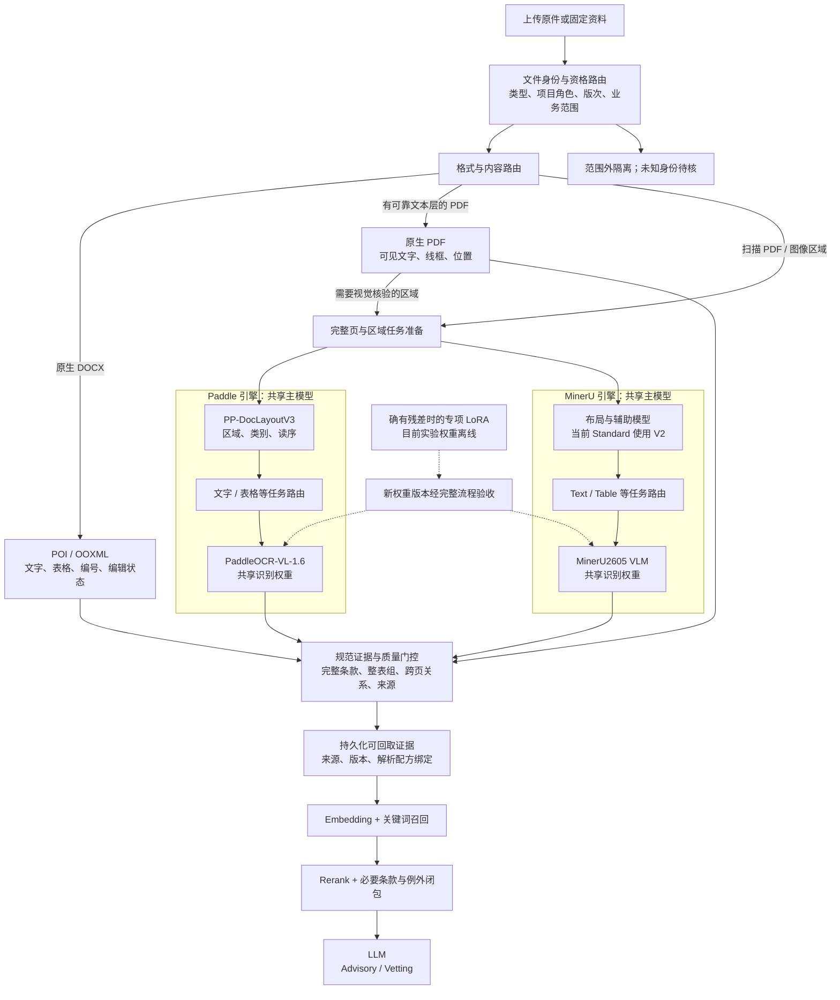

# 下一轮原件监督、来源隔离及最小消融

## 当前 Goal 与解析质量通过线（2026-10-11 最新，覆盖后文历史安排）

**最新用户阶段安排：先覆盖，再提高。** “微调”指逐轮提高最终准确度，包含规则、参数和必要训练，不限定权重SFT。当前先保证范围内每类文件／任务家族都有真实正常完整解析基线和可解释的主要残差，优先修明显遗漏和错属；随后按共享收益与业务风险提高。下面的最终验收线保留，但不要求先把一种文件逐字符精修到最终门，再开始下一类。自动计算字面差异，人工集中核关键、高风险及异常区域；不追加无新假设的小区域试验。每轮结果与未核范围继续更新HTML，基线展示不追認整源／固定库通过。

Root 创建时已验证本次新 Goal 为 `active`、未设 token 预算、`createdAt=1791724559`；2026-10-12 曾读回 `blocked`，用户明确“继续”后实际原件质量工作恢复，本次最新工具已读回 `active`（`updatedAt=1791768556`），目标身份不变。此前 blocked 报告保留当时状态，未自行重建。`createdAt=1791721859` 是此前目标的历史创建记录，不作为当前目标身份。执行顺序严格为：**各类正常完整解析基线 → 渐进提高解析质量 → 固定 GCC／GCT／SL 技术资料的向量库质量 → 项目资料接入与业务验收 → 冻结及 H800 验收**。当前18个任务家族均已有完整正常输入基线，继续按共享缺陷与业务风险提高；固定资料全部所需解析范围最终验收通过后才进入固定库。固定资料解析质量未过，不开展来源兼容、哈希 OOM、Java／测试启动、发布登记、索引接入或 embedding／rerank 调优。原件质量任务可并行标注与调查，GPU 作业仍串行；Drafting 冻结。后文此前“接入第一批”“工程与解析并行”以及其他 Goal 创建记录均为历史阶段，不是当前任务顺序。

最终部署目标已确认是 **Kubernetes（K8s）＋单张 H800 80GB**，Linux 独立环境镜像、GPU resource／device plugin、models／raw／parsed／index 持久存储及 120B MoE 同卡阶段调度按 [范围入口](../../docs/oer-scope-and-rules.md) 和 [handoff 当前记录](../../docs/HANDOFF-ocr-embedding-rerank-20261008.md) 后置核验；集群版本／runtime／storage 与共卡管理未确认，manifest／镜像构建／集群部署未执行，不作为当前解析基线与质量提高的前置。

下列数值是本项目新设的工程验收线，不是模型官方保证，也不追认为用户此前已确认的数字。**通过按来源版本及完整适用范围判定，各门必须同时满足，不计算一个可以抵销关键错误的综合分。** 训练集拟合、软件测试、正常退出和局部原件成绩均不能替代此门。

| 验收门 | 通过标准 | 核验与拒绝条件 |
| --- | --- | --- |
| 完整范围 | 事前冻结文件、版本、适用物理页、页内 region 及 clause no 清单；应处理页／区域／条款覆盖 **100%**，遗漏、无理由重复或截断 **0** | 分母来自原件独立库存，不能来自 parser 自己识别到的块；逐页有输出不等于页内正文／旁注／页脚完整。空页、页眉页脚和已排除内容分别记录理由，不能事后缩小分母追认通过；存在未核范围则整源待验收。 |
| 文字 | 独立源核范围内普通正文 **CER ≤ 0.1%**；所有已清点的关键条号、引用、数值、单位、日期、项目／当事人专名、文件身份／版次、否定词、AND／OR／比较符号、条件／例外及其关系 **100% 正确、零已知错漏** | `CER=(替换+删除+插入)/参考字符数`，列实际字符分母、错误明细和页范围。仅可按事前声明投影排版换行，原始 strict 差异仍保留；不得用改拼词、改数字、大小写／连字符修复或删除实义标点降低误差，原件拼错照录。CER 合格仍不能抵销任何改变意义的错误。 |
| 层级与归属 | 完整适用条款的父子层级、正文读序、旁注／脚注／guidance 的作用范围、条件／例外／引用关系清单 **100% 对应原件** | 就近段落归属不能代替条款树；局部短语条件不能扩大为整条条件。依赖视觉的归属须核原图。未核的必要关系计待验收，不能猜成正确或以 unknown 标签放行。 |
| 表格／表单 | 范围内 **所有完整表组**逐组核；行、列、合并格、单元格文字和归属、真空白、勾选／未勾选、编辑标记、表头、表外说明、读序和跨页续接 **100% 源对应** | 文字对但放错格、框数对但位置错、补格、漏尾页、错接另一表均不通过。正常 parser 须形成实际续行／表头关系，人工 sidecar 源映射不能代替自动 join。原生物理格与模型逻辑格区别声明；视觉等价框字符单列规则，不能覆盖 raw 错误。同一 provider 完整表组采用，不逐格拼表。 |
| 来源定位 | 所有条款、表组、旁注及引用资产均能定位回正确来源／原页或原生 DOCX 锚；核验清单中 **100% 定位正确** | 区域须完整包含目标并能区分相邻条款／单元格，不要求 bbox 像素级全等。页码、来源或作用范围错即失败；派生页与原页不混称。位置可离线核，不以前端／服务兼容为前置。 |
| 正常流程与回归 | 冻结配方从完整原件运行，完整 input／output，无关键内容截断；旧已正确关键项 **100% 保持**，普通文字 CER 不恶化 | 回归对照事前冻结的原件 gold，不能仅以旧 token 不变判断正确。必须检查实际正常完整 parser 的最终采用结果，不能用训练专用手工裁图或手工修 raw 代替。分别记录 native／Paddle／MinerU 采用单元和理由；有新增关键错漏则候选不采用，已正确成果保留。 |
| 独立复核 | 参考文字／结构从原件建立，与候选输出分离；独立复核覆盖计划全部执行；上述门无未关闭的关键缺陷 | Codex 不同作者复核注明身份，不能写成真人确认。已暴露开发页、训练页与真正独立来源留出分别记，loss 下降不计质量收益。 |

### 全量检查与抽样的边界

GCC／GCT 等可完成全文核对的固定文件做全文核对。SL 技术资料按 worksection 分批，但全库仍须完成全部适用页／条款清点及结构覆盖；**所有表格／表单、扫描页、旁注与脚注、跨页单元、多栏读序、控件／编辑标记页及双路不一致区域做源对应核对**。关键字段／关系清单逐项检查，不用抽样准确率代替其全量分母。

SL 普通正文的独立字面抽检按每个 worksection 事前冻结：至少取适用页 **10%（向上取整），且不少于 10 页；不足 10 页则全核**，并覆盖各版次和存在的布局类型。风险定义也在抽检前冻结；先按固定 seed 选择并包含尚未暴露的随机层，不能从看起来正确的结果挑页，高风险核验与抽检分别列数。每个 worksection 及抽检总池分别满足 CER 门槛，不能用大章正确文字稀释小章问题。发现漏条、语义错误或系统性版式问题，扩查同版式／同配方影响的完整范围，修复后重验；发现普通字面错误也记录并核同类模式。尚未冻结抽检范围、没有来源参考或存在影响范围未知的缺陷时，状态是待验收。

**抽检成绩只证明已核样本；它不证明所有未逐字核对的字符都是正确的。** 报告必须并列全量结构／关键项覆盖、全文核对覆盖、抽检字面成绩、未逐字核对范围及剩余风险。不能把“抽检 CER ≤ 0.1%”写成“整库字符准确率 99.9%”或“全库绝对零错误”。以上 10% 是最低检查量，不能限制针对缺陷扩查。

### 固定版本成果与自动解析器的验收分开

已核的固定来源版本按上述门验收，可持久复用；这不等于 parser 已能自动适应所有新版本。未暴露的独立来源／版次留出，须在原件核对后按同样关键项、结构和文字门评价，训练及近重复来源家族不得跨 split。独立留出数量尚未建立或质量未过，就明确“泛化未验收”；不得因固定版本通过，宣称模板换版能力通过。反过来，不以追求未证明的泛化无限推迟已核固定版本成果，而以准确版本身份限定复用。

当前 **固定资料全范围解析门尚未通过**；局部表段、路由改善、完整页监督准备不改变这一结论。每轮真实训练／解析实验后更新现有 HTML：实际范围、分母、关键错误、旧正确项、完整 parser 与 fit、独立复核／留出及是否采用；失败或无改善也保留。只有固定资料所需全部来源范围通过后，才进入固定向量库的切块／embedding／rerank 质量阶段；业务与 H800 验收另设门，不能作为当前 OCR 已通过的替代证据。

**2026-10-11 用户最新优先级纠正：先确认原件解析质量。** 来源兼容、哈希OOM、Java／测试启动、正常发布／登记和索引接入全部后置，不作为离线解析／必要训练的前置。已停止新的这些工程作业；已启动自有作业安全收尾，候选与失败记录保留，服务和Drafting不改。当前先推进SL正常完整parser裁图／整表／框与blank残差，以及AoA完整原页Text监督转换和字面残差；保MinerU已正确整表，补完整目标、严格旧correct回归及必要SFT。目标完整范围保持，解析质量确认后再恢复后续接入／检索／业务验收，不把工程兼容检查算解析成绩。下文此前“并行工程”或“来源接入第一批”的安排按旧阶段读取，由本段覆盖执行顺序。

**2026-10-11 冷哈希最新离线进展：** prepare03已通过独审，Root完整owned构建仅正常化源码和新冷回归两个来源增量；最终旧实现准确serializer OOM、新实现同输入128MiB堆成功且legacy SHA保持，11项正常化／memo／冷测试及完整package通过。仍未主采用／部署，85项Advice真实Spring测试在初始化阶段错误，不能算业务通过；不同作者诊断JVM启动属性／临时目录接缝，下一步仍须真实冷API与来源门控验收。此次避免额外完整规范化JSON字符串，未删除证据，也未证明完整input/tree有界读取。收据和正常来源prepare04以handoff顶部为准；HTML19:44已验收快照未改写为离线候选上线。

**2026-10-11 19:31 当前接入增量：** 正常routing refresh候选已采用/部署，SCC252/SP266接口实际刷新成功，原件及parsed hash保持，project_document/sha_verified资格已具备；未发布/登记/索引。部署后Advisory catalogue的冷哈希路径实际Java heap OOM，失败在完整tree标准化字符串序列化；四冻结Drafting响应保持。先修保持原哈希的冷路径并验证真实API，不用暖缓存成功、加堆或删字段追认通过。具体收据和未完成门以handoff顶部新段为准，下文unknown/null按观测时历史状态读取。

用户新要求的每文档训练总成绩图表已在2026-10-11 19:44快照交付并通过实际浏览器核验：固定6项+2b35项为41展示项/40原件，36有界指标，三未填模板Drafting-only隔离。基线/表段fit/正常完整parser、模型训练/任务路由/native解析/未测分别标明，页表/分母/证据身份明确，不能用异构质量项总加权比例替代完整原件质量。不同作者逐指标复算161检查通过；具体HTML、截图与显示验收见docs/testing/oer-progress-report.md。本轮AoA原物理1页完整source-only标注已通过不同作者独审，未发现无法确定的可见文字span；完整mixed-task目标converter仍待，开发已暴露、humanConfirmed/blind/训练准入false保持。这不增加optimizer steps、模型正确分子或独立blind数量。

## 当前可审阅训练设计（2026-10-11）

本节是当前实施计划与训练取舍；后面的实际收据与历史增量用于复核，不把计划写成已执行。目标是在本机完成范围内原件的可靠解析、检索与业务证据接入，并能处理模板换版。优先质量，固定合格结果按来源／版本／配方持久复用，仅对变更组件涉及的任务重跑。Drafting冻结，2a未填三模板不进入Vetting／Advisory；BQ／SOR／General Summary、非PRE技术PSS、SL非技术内容及2d／2e答案不进入本任务训练或业务索引。

### OER goal 已重新启动（2026-10-11）

用户已停止并删除旧goal，随后明确要求按修订方案重新启动。Root本轮读取goal状态为null后，已调用create_goal建立新目标，返回status=active；未设置token预算。新目标继续沿用已完成代码、实验、原件质量证据及失败记录，按当前真实来源身份和四个里程碑推进，范围、质量优先及完成条件保持。后续H800部署／推理验收与本地开发、训练和质量验收分别报告，不能以目标重建追认任何业务完成。

已采用总目标：在本机完成比赛范围内、可适应来源换版的OER链路，贯通文件身份与页内任务路由、原生和双视觉解析、完整条款／表组／条件关系、质量采用、来源持久化、embedding／rerank和业务证据回取；按归因实施必要训练并证明正常解析及回归的实际收益；以官方问题、Vetting结构化报告和前端原文／原图／完整表组验收证明结果。固定合格结果复用，来源失配拒绝、未知局部门控，所有原始证据与失败保留。Drafting冻结、范围排除、本机训练／H800后置等已确认规则全部保持。

执行里程碑及证明分别为：（1）当前有效来源及解析结果正规发布／登记、不可变身份及有界读、失配拒绝和模板换版回归；（2）完整原页／条款／表组质量、自动层级／旁注／续页定位及旧正确项保护，按缺口补完整监督和隔离留出；（3）完整所需corpus上的真实候选召回、同池重排与条件／例外／引用闭包及有界LLM证据；（4）官方题、结构化报告及实际前端回取。关键来源缺失、整表错属或未决采用不得由HTTP200／索引ready／局部正确／unknown标签自动抵销。当前尚未建立可证明泛化的独立blind集，也没有完整业务成绩。

工程接入和解析质量是同一goal内部的并行工作。训练是修复手段：路由／输入／结构问题先纠正；完整输入中的真实识别残差才进入识别训练，排序模型只针对真实召回／排序残差。Paddle主路径与MinerU辅助按完整来源质量采用，不要求Paddle在每一表组超过已正确MinerU，不逐格拼接表。已完成无收益的颜色诊断和两公开表LR试验不继续无依据扩展；有新残差／数据／假设才另开准确对照。本地质量通过后才冻结发布，H800兼容／推理是后续阶段，仍如实报告未取得的证据。

当前新事实：读取OOM修复已正常部署，部署后的三实际业务GET及Drafting四冻结响应通过；实际fullset索引仍current_sources_unavailable。当前SCC是document252、SP是document266，旧准备237与“SP尚未上传”假设已过时，旧封印不重写、不直接执行。已在闭库副本只读观测实际原件SHA／parsedHash／路由，schema为consense.current-persisted-source-observation.v1，parseEventReconstructed=false，原副本保持；证据位于`.local/state/oer-current-source-observation-20261011/observe-01/current-persisted-source-observation.json`，SHA `247548e94b77a52d9c0addd79fdd97a60e763613ab9b7802fc71738fd6fb0953`。252／266虽PARSED且实际原件SHA匹配，但sourcePurpose仍unknown、eligibleModules为null；included=true不能抵销资格缺口。先经正规服务接缝刷新既存来源路由，保全原text／structure／archive、source identity和用户role，不重复上传／解析或手改SQL放行，再做fresh核验与当前身份的发布／登记；保护GCC236及54已接入父单元。闭库维护后后端由48324替换为120440，后一次重启保护GET单独核验，不借用旧PID收据。通用crop03仍有zero-padding浅灰框外cap失败，exact三页padding7保全仅用于受控诊断，不宣称生产采用或OCR质量收益。

### 模型与路由架构（用户要求的图示）

当前采用两条OCR引擎，每条引擎共享自己的主识别VLM，并由布局等辅助模型配合；不是每一种文件另训练一套完整模型。文件身份／模块资格路由、原生格式解析、区域Text／Table任务路由及完整表组采用分别表达。Paddle和MinerU主模型与真实任务调用已跑通，通用混合采用、自动关系及全库／业务验收仍在推进，图中的全链是实施设计而非全部完成状态。

同一文件内部可能同时有正文、表格、旁注、图像，因此任务路由以区域或完整跨页表组为粒度，不只按文件扩展名分配模型。整表组选同一provider的完整结果，原始双输出保留；普通文字与表外instruction可保留不同provider来源，不逐格拼表。未来专项LoRA仅在真实残差支持时形成候选版本；当前尚未实现／部署按文件类型热切多个adapter，也不承诺必须为SL、GCT、FoT各造一个专家。图表示逻辑调用关系，GPU按阶段批处理／释放，不能由两条箭头推断同时常驻或双路一致就正确。

### 1. 当前证据决定训练对象

| 对象／路径 | 已完成的实际证据 | 当前决定 |
| --- | --- | --- |
| SL技术三页整表／MinerU完整解析 | 有限源行11/11、53格、18空框、3Remarks通过；允许空白及视觉等价引号，自动跨页和完整文字／混合总体未通过 | 保留同一provider完整表组，补自动组选择、来源与续接；不为已正确结构机械加训 |
| SL同组／Paddle VL1.6 | 同源完整表段LoRA20updates完成；表段拟合改善，但正常完整parser仍2/3拓扑、空框10/18、真空白5/9 | 先验证实际输入与训练输入的差异；不是已解决或泛化成功。必要时改输入增强与识别训练，不再做颜色／二值化实验 |
| FoT8／MinerU Table任务 | 完整表单crop的19区域／13逻辑组内容通过，未认证整页、物理格和编辑态 | 优先接正确任务路由与局部高分辨率／全页覆盖，不训练已由协议解决的星号和槽位错误 |
| FoT9、AoA1扫描 | FoT9文字漏页脚；AoA1项目名误读与符号遗漏，扫描删除状态未完成 | 核完整覆盖、实际模型分辨率与任务协议后，仍有完整输入内字面错误才识别SFT；编辑态另立目标 |
| GCT／Annex及Appendix H原生PDF | GCT已有crop覆盖改进；Annex主要引号／空格差异；H原生物理网格已独审但完整读序／业务归属未全闭合 | 可靠可见文本层、native线框与完整条款结构先行；不把读序／字面表示／物理逻辑格差异都交给OCR训练 |
| 原生项目DOCX／GCC文本PDF | POI／native来源和部分完整单元已验证；并非所有文件全量完成 | 训练对象不是全文OCR；先原生结构、条款／条件／例外、编辑状态与引用闭包 |
| embedding／rerank | 权重更新0；缺完整必要证据集和独立相关度监督 | 来源完整后分别测召回与同池重排，确认排序残差才训练；不将OCR漏字或缺来源误算排序能力 |

文件身份路由与页内任务路由分别处理。前者核原件、版次、项目角色及模块资格，可靠规则／原生结构优先，未知不凭模型猜成标准来源；后者依据实际区域／整表及上下文选择Text／Table／Image任务。当前没有已训练文件身份分类器，也不预设必须新增它。

### 2. 原件标注与数据设计

中间监督格式保持引擎无关：完整文字及源拼词、regions与读序、全部row／col／span、真空白与unknown、checked／unchecked、条款／条件／例外／旁注、完整跨页表组和原图定位。文字、物理网格、自动续接与编辑态分别标注和评分，不能由其中一项推断其他项。模型输出和业务答案不作为gold来源。

下一阶段沿用原计划的**60–100完整页、5–10完整表组的标注预算**，这是待补的数据预算，不是已有训练数据或最小有效样本保证。优先覆盖不同技术worksection的SL条款／连续表、实际扫描表单、旁注及原生复杂表；现有ELE三表段、FEN表、Annex表、FoT／AoA与H结构监督按已复核范围复用，完整页gold缺口仍保留。额外素材必须有可用许可、完整原件和来源身份，不能用大量增强图片凑独立原件数量。

数据先按来源、项目、模板／版次和近重复家族整体划分，再派生裁图／扫描扰动。同一连续表组全部页、同一页的crop／fullpage、DOCX及其打印PDF、同模板近重复均在同一分区。SL内部未训练worksection可做内部开发留出，不能称新来源盲测。真正未暴露家族须在调参前冻结并隔离；当前尚无已完成的独立blind集，不虚填train/dev/blind数量。两张公开PubTabNet表只支撑已有小pilot，不证明比赛新来源泛化。

本次审阅由agent对照原件并独立复核，actor如实记录，`humanConfirmed=false`保持；这不是等待用户逐页标注的要求。有未知文字／关系的实例保留在gold库；当前训练器不支持可靠局部unknown mask时排除对应训练实例，不把unknown改为真空或确定值，验收分母仍保留。

### 3. 分层实施顺序与训练启动条件

1. **工程与输入基线。** 固定源图、实际layout、完整表组、任务模板、原权重和当前精度；复用保存raw。先核内容是否进入模型、task是否正确、grid／实际分辨率、EOS与target完整性。SL裁切候选先做CPU边界独审，再做同完整parser单因素对照；通用规则不含页码、人工gold框或答案。保留MinerU已正确整表，不能要求所有表都先经Paddle微调过关。
2. **真实残差分类。** 检测漏／读序错若持续出现，才评估实际使用的布局组件；Paddle V3和MinerU Standard V2分别验证，不能训练一个后声称另一个已修复。条款树、旁注归属、引用及自动跨页是来源结构实现；扫描删除态需要单独视觉／线条监督。图像原本完整而仍错字／错格，才进入相应识别SFT。
3. **有完整目标的短pilot。** 核已冻结完整train目标和独立dev／内部dev标签，明确暴露史。从原base起步，沿用已经实测的语言LoRA小配方，首段20updates；这是试验预算，不是承诺20步就足够。每轮固定任务与评分口径，记录新旧正确项；没有完整parser可复现的收益则不盲加epoch或学习率。
4. **按证据扩大。** 确有dev收益且旧关键项保持后，扩大原件与版式覆盖，再开展保全内容的输入增强；裁切边缘／缩放／扫描扰动须保持正文、框线及slot，标签变换可复算。同源增强仅用于训练稳健性，不算新来源。先保持视觉／projector冻结，只有多来源残差支持且本机完整输入资源允许时才评估其他可训练模块。
5. **真实回接与采用。** adapter、merged模型、新进程HF和官方完整parser逐层复验。normal parser上完整原页／表组得分才是采用依据；训练裁图拟合不能替代它。更新model／recipe／projection／quality身份，保留原权重和回滚映射；尚未采用任何本次实验权重。

### 4. 本机训练起点与目标方言

| 项目 | PaddleOCR-VL-1.6 | MinerU2605 VLM |
| --- | --- | --- |
| 已验证的小配方 | LLM-only LoRA，rank8／alpha16／lr1e-5，microbatch1，三完整表段累积；实际20updates／60micro forwards | LLM-only LoRA，rank8／alpha16，microbatch1／accum2；两fresh-base实验各20updates，仅lr1e-5与2e-5不同 |
| 精度与冻结 | 训练CUDA BF16／SDPA、LoRA FP32；视觉／projector及未选模块冻结。native官方混合精度或受控FP32配方单独记身份 | CUDA BF16／SDPA、LoRA FP32；视觉／aligner／embedding／lm_head冻结；具体推理配方保持独立身份 |
| 输入与loss | 完整物理任务图／官方实际prompt；assistant完整目标与EOS监督，prompt／image／padding正确mask | 同样保完整目标；raw OTSL结构token参加loss，不能用HTML替代或decode时抹掉special结构token |
| 已测结果 | 同源表段fit改善，未在正常完整parser稳定恢复，不算泛化 | 两轮五任务完整输出均无可观测改善，不继续对同两公开表盲调LR |

实际token预算按固定checkpoint有效context及每个完整input＋target＋EOS计算；当前8,192上限的任务超限就报告，不能截掉表尾／条件／EOS或静默降图质过关。gradient checkpointing等资源措施按实际可用实现核验。新配置每次绑定新配方，不将BF16训练成功写成FP16完整质量已通过。

### 5. 训练与质量验收设计

训练和验证至少比较：原base、未合并adapter、merged模型、新进程重载及实际完整parser。same-run输入／task／参数固定；loss、梯度和权重差异只能证明发生更新。先查导出／精度／输入差异，再判断有没有来源质量收益。

| 层 | 主要指标与拒绝条件 |
| --- | --- |
| 文字 | 全文字面／CER／WER与覆盖分别报；clause no、金额、日期、单位、否定及引用ID单列exact。原件拼错也照录；空白／引号等价诊断不能覆盖strict失败 |
| 表格／表单 | 全部row／col／span／cell归属、空白和框状态、完整组的条件／备注与续行；框数正确不能替代位置正确，原生格与模型逻辑行分开 |
| 布局／来源 | 正文／旁注／页眉页脚／资产覆盖、原件定位、坐标变换及可回取完整图；页码／版本／source失配拒绝采用 |
| 回归／留出 | 已核旧正确项逐项保护；关键依据出现新错则对应scope拒绝或回滚。内部同源dev和真正独立blind分别报告，没有blind就不宣称泛化 |
| 检索 | 固定完整corpus及必要证据集合，测候选Recall@k、同池rerank的MRR／nDCG以及父条／例外／引用闭包覆盖；缺源不算rerank失败 |
| 业务 | 最后跑赛方问题样本、Vetting结构化报告、前端原图／整表／来源引用；软件测试和index ready不能替代真实模型和业务验收 |

### 6. 接下来实际推进的批次

第一批闭合通用路由／输入与正常来源接入：SL保MinerU整组及Paddle表外来源，FoT正确Text／Table分工加全页coverage，native条款／表格完整读序；来源读入OOM修复已独审、部署并通过三处实际业务GET，当前待解决252／266的路由资格及正常发布／登记，其他大归档写／原件读路径未由这三处GET覆盖。第二批补完整gold与不同家族留出，按真实未解决残差做上述短pilot和输入增强。第三批逐层fullparser回接、真实embedding／rerank检索诊断、赛方八题及Vetting／前端验收；确有排序残差才启动排序模型训练。

所有调参／必要训练在本机A4000 16GB的自有窗口串行占GPU，标注与CPU结构工作可并行；不卸载其他服务，Bonsai继续抑制。H800 80GB是本地版本通过后的部署／推理验收目标，不是默认训练场；LLM共驻／阶段恢复按实测资源确定。本地代码、模型和业务质量通过后再冻结包与回滚材料，现在不提前封板。

## 2026-10-11 最新质量优先顺序：颜色单因素无收益，继续核完整表段输入

用户最新再次明确质量优先。新 RGB 完整 parser 的 GCT／Annex／SL 三项已真实执行关闭，保存输入证明原页、layout／bbox、非 pixel 生成输入和配方保持，只发生一次颜色通道交换。三组旧正确项全部保全，但 SL 三段 rawVendorHtml 与旧 trained BGR 逐字相同；仍中页7行／26origins对原件6行／23，拓扑2/3、35非control strict18/35／空白投影20/35、unchecked10/18、blank5/9、严格及空白续接端点0/2。RGB契约修正没有实测来源质量收益，不采用实验权重，也不以此前 image-only 的34/35替代本次完整parser分数。

**颜色单因素诊断已结束，不再继续颜色／二值化实验。** 少量栅格通道不等不当作彩色业务内容，也不将一般OCR预处理原理当作本轮收益实证。下一步单独核实际 layout 裁图与训练完整表段图的边缘：来源外框、检测bbox、裁切舍入、裁切padding、processor输入各按实际保存像素验证，先区分真实内容／墨线丢失与同内容边缘／resize敏感，再形成不依赖页码／人工参考框／target的通用候选及CPU边界回归，决定受控模型消融和必要增强训练。保持完整内容、原始raw及严格字面评分；表格归属、空白和controls不过则拒绝该scope进入业务证据，不能补格修字制造通过。性能基准和最终冻结打包后置，Drafting冻结。实际三项终态、逐像素审计、质量台账及正常来源读入OOM候选状态见 [实施交接](../../docs/HANDOFF-ocr-embedding-rerank-20261008.md) 顶部。

### 上一阶段颜色边界诊断（已执行，结果以上方为准）

目前唯一持续任务是 OER，Drafting 冻结，速度／吞吐基准后置。三段保存实际输入与 pilot 使用同一 300 DPI 完整原页 PNG，但实际完整 pipeline 的 `ReadImage(format='BGR')`／crop 数组送入 native `fetch_image` 后被 `Image.fromarray` 当作 RGB；PIL `convert('RGB')` 不交换 BGR 通道。三段逐像素 lineage 已证实这一边界差，resize／normalize 的两条路径均能逐 uint8／float32 精确复现。先前只替换 pixels 的 A/B 同时包含颜色与裁切边缘变化，不能归因裁切单因素；完整 parser 最小候选只在明确 BGR 的调用边界转换，实际 bbox、原图、权重、FP32、生成预算不变，PIL／path／已 RGB 输入不全局转换。仍须真实完整 parser 对照与旧正确项保护，不能提前宣称恢复 34/35 或采用线上权重。

下方 Paddle 已完成的 20 updates／60 micro forwards 的训练输入是三段**完整物理表段图片**，不是三张完整 PDF 页；训练页家族已暴露，blind=0。完整原页只在后续完整 parser 运行中输入，不能把训练表段拟合当作完整原页泛化。新颜色实验没有新增 optimizer update；MinerU 两轮仍无已测识别收益、embedding／rerank 更新仍为 0。准确当前证据、失败和正常来源接入阻塞见 [实施交接](../../docs/HANDOFF-ocr-embedding-rerank-20261008.md) 顶部，旧缓存提速／准备记录按历史阶段读取。

## 2026-10-11 当前状态：MinerU 两轮及 Paddle 首轮更新完成，质量分别验收

**Paddle fresh04 首轮已实际20 optimizer updates／60完整表段micro forwards，导出、fresh HF与native reload全部成功。** 3,022,848个FP32 LoRA参数，CUDA BF16／SDPA、rank8／alpha16／lr1e-5，SL物理3436／3437／3438的三完整表段每次一起积累；这些不是完整PDF页的训练图。原输入／target／EOS未截断、视觉／projector等494张量冻结。Root03三阶段均exit0、准确child及owned Job关闭、七服务身份保持／cleanup为空。train-export完整Root137.2585900秒、fresh HF30.6615000秒、native34.6336012秒，非纯训练计时。训练worker终态SHA `b5728d69eb1db25dd9a3ff7d98286c183409c47fbe34679e6ffdf3ca08af44c4`，Root03 train/HF/native终态SHA `27ab3dbc8333d00f3b6f860cf7cc7db5965103e910a958a5bd1b57ff45cd41d0`／`2a77d28a274da52ae59c660e2461bb12bbc637bb3e9609c3273fb222be1abadc`／`b70619aacdda01d743660a5326e1d9194e82f5ffe5069e83e284bfeb6235b7af`，目录 `.local/state/oer-paddle-targeted-quality-pilot-preparation-20261011/root-launcher-preparation-03/` 与同根 `prepare-04/executions/`。

Root完整readback核20次finite／非零梯度与更新、全部620 merged keys／494 frozen byte保持、实际2073桥calls全成功、HF fresh三完整IDs／文字与in-memory merged全等、native620混合精度policy全等。兼容窄审56checks已通过（SHA `6a22bf60d249602060a1d7541a8798b433b0931d0ac1805337544f548551a43c`），原failed03不重试或覆盖。

**实际质量独审58checks已终态，测到训练页fit改善，但仍有真实文字残差。** `.local/state/oer-paddle-actual-pilot-quality-independent-20261011/review-01/terminal-receipt.json` SHA `f5fba3321b8e19b4be5d7fdeb5bb44d8497af24be114b320339ed4ea437ef4f0`。完整row／col／span／origin topology2／3→3／3，middle7／25／9→source6／23／8；18源控件中位置及视觉未勾选状态10／18→18／18，unknown8→0；9真空白5／9→9／9。35非control origins按已确认视觉转写sequence与span严格匹配14／35→28／35，空白差异等价18／35→34／35。未消失1格为item6 `sl-ele-3437-r04-c1` 丢末两条indicating前两个bullet hyphen，不能追認全文质量通过。原接受的14literal／18whitespace-equivalent／10unchecked／5blank全保持、回退0，baseline未绑定中页不扩大旧正确项分母。两跨页源成员拓扑0／2→2／2及文字片段空白等价2／2仅是source mapping，自动join／法律归属仍false。unmerged／merged／freshHF完整3IDs／全文同，native质量各分相同；native620值由Root实际readback、独审只读取全部保存policy描述符。raw未修或补格。

来源图形填写横线未进入text/topology gold，单列布局未知；原件空白折叠／视觉引号和编码差异分别评价。未勾选`□`／`☐`不同码点不当作识别收益或业务No。此为同一已暴露train家族fit，blind0／human与legal接受false／线上采用false。下方Paddle“0更新／未开训”均属本次完成前历史；MinerU两轮仍无识别收益，embedding／rerank更新仍0。

**此前pilot03实际尝试失败，当时Paddle optimizer／micro forwards均0。** cached native06 source/export全量回接通过后，Root实际执行pilot03的train-export；首个HF base generation前向因固定custom调用 `create_causal_mask(inputs_embeds=...)` 与installed Transformers4.57.6签名 `input_embeds` 不匹配失败。Root失败SHA `37936628c24e14a231dcb6ba9f310dd94d0fcf393bc3adcfbe310dc30a717263`，worker SHA `8ae6c3d6add16ecd82794b1dd3d5eb480c386818834f0d9b5b894ea13af09914`，trainingSteps／microForwards均0，actual exit1／owned Job及准确child关闭／七保护保持／cleanup为空。failed03保持；后续fresh04仅增owned custom模块局部API别名桥及HF reload同桥，原checkpoint、共享环境、完整输入／target、LoRA配方和native06保持，实际训练／回接完成见上。

**新完整缓存对照已实跑并不同作者核验，0训练／0质量提升。** native05 source Root1287.2453258秒→native06 cached source32.9951827秒，39.0131倍；worker阶段1282.9289611→29.0757041秒。两source完整三页118／417／146 IDs、EOS、含special token全文及620policy均exact，相同policy SHA `3f198aefaf55fca5704748c3ce9da6e9abbab37402481e3b9ba8e52429b838a6`。实际对照31检查收据SHA `a7f9a6423bcb545bc4762f69c07c58862a47afdd42ea303ba2b0e6f8ad1a21ac`；含加载／策略核验／取证／关闭，不是纯解码或训练速度，actual KVcounter仍未测。cached native-export也正常exit0，Root38.3281489秒／SHA `3af42ffda62cb1371d7939b026f1771b710cdb20ff48b01d10826f978da6217b`，所有620policy和三页IDs／全文与cached source exact。Root limited source-only admission SHA `a990e9ea33dbda824cf73908427715fce70894ae3160be69370ed748748f9909`仅准完整三页技术pilot，human／legal／blind及线上采用保持false。源3437仍由6／23／8生成7／25／9，首尾拓扑保持；glyph`□`／`☐`字面差别独立，不据缓存提速或码点拟合追认质量。旧运行／准备状态均保留历史；上述已成功的native source/export和HF04 Job均不重启。

**2026-10-11 13:17实时状态：native05已实际执行，训练仍0。** Root仅启动一次native-source，session96194正在运行，准确worker25448／wrapper92948／Root53868。完整620个native张量policy ledger已保存，SHA `3f198aefaf55fca5704748c3ce9da6e9abbab37402481e3b9ba8e52429b838a6`，165BF16语言＋455FP32视觉／projector通过；第一张物理3436完整118IDs及实际EOS已保存，后两张及phase终态仍待。目录 `.local/state/oer-source-supervision-next-preparation-20261011/paddle-zero-step-runner-preparation-05/executions/native-source-01`；没有重新执行成功的HF04零步导出，也没有Paddle optimizer updates或线上权重采用。`☐`／`□`原始编码拟合与视觉未勾选状态／表格拓扑分别评价，不能借码点变化制造质量收益。有限SL三页pilot的Root串行launcher已封存交窄审，尚未执行；native源／零步export完整对照成功后再按有限source-only准入训练，human／legal／blind保持false。下方native04失败和fresh05准备状态保留历史。

**新实际失败：native-source04在Paddle library导入阶段被owned写入规则拦住。** 安装源码 `paddle/dataset/common.py` 用 Windows `expanduser('~')` 派生 `.cache/paddle/dataset`，没有 `PADDLE_HOME` 覆盖；尚未进入 `from_pretrained` 或generation。Root失败终态SHA `33d6d551bf153bd5a9329d5e6efe015473e8464bc418f8223d0583ec5ae1edd7`、worker failure SHA `915e0d4e0b955c7cb7e3691da3ba3a8a6502d6ec29a05c2fcab73d5e8c731e51`；准确child／Job关闭、七保护保持、cleanup为空、trainingSteps=0。fresh05 native repair正在准备，仅将child缓存定向到exact owned phase，完整三页输入／EOS／620policy和原先成功的04 HF checkpoint保持。有限pilot的native-reload也发现同一缺口，旧候选保留并作相同fresh delta，不以此宣称训练开始。

本轮实时复核：两份 MinerU receipt 的 SHA 保持 `073b00cb544d6770421c78084a867a5fa7aaac5ed47fb9a8eea8cfde95568b5e`／`36592c6f6b1491df43554dba051f45d91fd0702af4b0cd5099714cc99db68902`，各20步且导出／fresh reload 成功、未线上采用；Paddle HF Root receipt `d81605d3fa57cb2fe30f41c459dedfb768bc5a6a746f62dcdf1a558327513654` 的 trainingSteps=0。native-source／native-export 执行器已封存并进行独立窄审，实际执行仍待；SL 完整三页连续组的 language-only LoRA 候选准备不计训练。embedding／rerank 仍未更新权重。

**Paddle最新实际增量：fresh04的HF零步CPU加载／导出成功，权重训练仍0。** Root准确owned Job执行后actual child exit0，完整作业20.243285秒／worker阶段16.797711秒；原始checkpoint正常由固定custom HF类加载，完整620个BF16 tensors的key／shape／dtype／value与原文件全等，untied embedding/head保持；实际导出文件1,917,255,968B／SHA `85a479d506a11e724e7285d395c551be69f41dbc16b6342d3cacfb189aed71db`也与原文件逐字节相同。完整tensor ledger SHA `f9a5c174586a72f966646c0c668aee80318a39ec114e26a0fbcb28659590b3dd`，620项均保存，不截成抽样。phase终态SHA `e122a69fb3da8ccd1c76a598af31192d31d5a49599d900f3a5307989f6b4243d`；Root终态 `.local/state/oer-source-supervision-next-preparation-20261011/paddle-root-zero-step-execution-02/hf-zero-export-01/terminal-receipt.json` SHA `d81605d3fa57cb2fe30f41c459dedfb768bc5a6a746f62dcdf1a558327513654`。准确child及owned Job关闭、七保护身份保持、cleanupErrors为空；仍保留唯一blocked socket构造探针。HF forward／optimizer／trainingSteps均0，native原权重与导出权重的CUDA完整三页generation／回接对照、实际训练及质量收益仍待，不能把620-tensor零步一致当作OCR改善或native已经通过。下方candidate01失败与fresh04“仅准备”保留为本次成功前的实际历史。

**最新实际Paddle零步HF尝试失败，尚未完成模型加载／导出，更未训练。** candidate01已独审准入后由Root精确owned Job执行，worker在Transformers本地custom代码的`check_imports`检查报缺少`einops`，actual child exit1；8.592966秒是完整失败作业耗时。Root terminal `.local/state/oer-source-supervision-next-preparation-20261011/paddle-root-zero-step-execution-01/hf-zero-export-01/terminal-receipt.json` SHA `3d18b6209c9f0db318374726415b2ae49b9bf6f89ada4b19ed5888d15ca86e72`，owned Job及准确child关闭、七保护身份保持、cleanupErrors为空。worker failure SHA `bb2439abd404b9d9c9a7564b10bffcc1b7de68308c14f33158fdb5df92af2af4`保留唯一被禁止socket构造尝试，不能称没有网络尝试；无实际DNS／HTTP。原失败和partial不覆盖、不在同目录自动重跑。

Root仅从已有paddle-gpu环境复制33个准确`einops0.8.2`纯代码／metadata文件到fresh04的隔离依赖目录，原共享venv、原权重及服务不改。独立CPU import验证准确owned`einops0.8.2`且未导入Torch；这不是神经模型加载验证。fresh03保留了错误的HF路径校验准备，fresh04将校验与计划都明确绑定自身`executions/hf-zero-export-01/checkpoint`；native必须有未来实际成功HF终态，不用静态路径冒充成功。fresh04 plan SHA `1747ed566ff906dc1afc7a60d31a83abed932b0c3e503c656b180eebb0709170`、worker SHA `4e028abeb825fd4b3453a9bfe17ae5fa5318c4124d31e85bbf98fc94955414a3`，当前仅准备，实际执行和native三页回接仍待。

**最新Paddle进度仍是训练前准备，不是开训。** 固定PaddleOCR-VL-1.6 revision `c5630abae1d940eafe0697512a0325494b02ab42` 当前custom类／loss／native权重接缝已静态调查，完整CPU processor04实际生成三页27数组，355作者检查通过。终态SHA `c48147b47a1b85a810cbc258c5e38b9d0ee78edc50ff37d45eaf8afe9ec25649`、manifest SHA `e90a47e3701011c91e363ef49f550da307192080727ae7bc530495967ab7bf44`；完整prompt／target＋EOS／total分别1287／106／1393、1245／377／1622、1234／130／1364。Root独立只读核所有数组、labels完整目标及固定Rust IDs、源53／18／9和两续接、封存输入保持，243项检查通过，收据 `.local/state/oer-source-supervision-next-preparation-20261011/root-cpu-array-review-02/terminal-receipt.json`。原review01的文件尾LF／EOS假设错误及CPU作者TEMP／sentencepiece／被禁止IPv6探针失败均保留，不重写成功收据。精度训练／导出／native roundtrip尚待；PEFT未安装、未改共享环境、未训练Paddle、未换线上权重。

预算差异已归因到转录codec：static03另存typed unchecked `☐`提案，每框3token；CPU04使用原gold视觉`□`，每框1token。三页6／8／4框产生12／16／8token差，恰好118→106、393→377、138→130；原target没有为预算而删cell或截断。task只排除源target文件的最后一个LF后拼EOS，所有cell内部空白／真空白保留。CPU预处理不改变后续主模型CUDA训练要求；三完整物理任务属于一个连续组与同一来源partition，不能把39逻辑origin全文给单页或拆出伪blind。

本节覆盖下方“第二轮只准备／尚未开训”和“累计质量20步”的历史状态。MinerU第一轮lr1e-5与第二轮lr2e-5均从原base完成20 optimizer updates／40 micro forwards，累计实际执行40质量更新，**不是同一个checkpoint连续40步**；此前三步compatibility-only单列。两张公开完整PubTabNet表用于train，三项已暴露GCT仅dev；CUDA BF16／SDPA、rank8／alpha16、4,399,104个FP32 LoRA参数及完整输入／target／EOS保持，第二轮只改LR。Paddle／embedding／rerank权重微调未开始，线上权重未替换。

第二轮实际收据 `.local/state/oer-public-table-quality-pilot-preparation-20261011/learning-rate-2e5-candidate-01/actual-steps-20-01/training/receipt.json` SHA `36592c6f6b1491df43554dba051f45d91fd0702af4b0cd5099714cc99db68902`；train/export/fresh-reload86.182054秒、owned全作业92.020746秒，LR`[0.00002]`，作业exit0且准确关闭。不同作者独审 `.local/state/oer-learning-rate-2e5-independent-quality-review-20261011/actual-review-01/terminal-receipt.json` SHA `94a94bb3a638758d02c0dcbc94973d360bad2bd926948f0d35587aefbc05169f`；同目录完整比较JSON SHA `7a39934833b96fc8ffb693dc694088f4c5e7f3126b27a29d0a20a3006cb2f0f9`。五任务same-run base／训练后／fresh reload完整IDs及全文全等，与旧20步输出也一致，无识别提升／退步。

大表98／100 literal text＋span、100／100 span；小表11／12 literal、12／12仅去空白投影。112 origins总体109／112 literal＋span、110／112去空白＋span；70数值cells及7星标cells保持。两个词误`Treatment→Treatments`、`Mentally→Mortally`及小表`- 0.1024→-0.1024`空白差异未改；GCT4／5完整字面正确、GCT6两空白差异保持。独审允许OTSL separator whitespace但不补raw结构，原自动scorer失败保留；旧endpoint94／100不是same-run baseline，不替换HF98／100制造收益。loss下降不当识别收益；新LR未跑未合并FP32路径，旧LRprobe不充作它的因果证据。

下一步补原件监督及残差归因，不再对同两张表盲目调整LR。SL三页连续表体是内嵌图像，native文字层仅页眉／clause标题；完整53物理origins／39逻辑origins／18未勾选controls／9真空白及两条continuation的image-first gold已完成源文字／网格不同作者核验，Root目视三完整页及三完整crop、584项CPU检查通过。独审收据`.local/state/oer-source-supervision-next-preparation-20261011/sl-ele-root-independent-01/terminal-receipt.json` SHA `5d65462ebf820fa52d83bc2b8fd7212967277287e6ee861f2ceb859ed19a004c`；humanConfirmed=false、trainingAccepted=false、fullPageGold=false及blind=0保持，不能把源gold独审自动当作训练准入。同项目／模板／版次／派生近重复保持同家族，2d／2e隔离。原件监督准入、完整跨页协议、frozen77／完整parser／独立holdout／业务和线上采用仍待。

Paddle真实结构残差已定位到生成模型：SL物理3437完整输入与原raster在BGR→RGB下像素一致，全部23源cells均入图；完整424原始IDs生成7行／26origins／10controls，源为6行／23origins／8controls，item4多拆一行／重复两框。raw26cells与发布cells逐格一致，排除crop遗漏及HTML后处理。114项检查通过，`.local/state/oer-source-supervision-next-preparation-20261011/paddle-actual-structure-residual-02/terminal-receipt.json` SHA `4e9459330755e90c7ab309dc8ed5ec22dbfe2c07978dda86ea37f28788aa8aad`，完整诊断SHA `becf7f51d834f9851a56f9a06c70453e443264b75c8be698b153fa750510eb5d`。Paddle当前checkpoint loss／PEFT／导出／native seam只在兼容准备，尚无训练步骤；MinerU已保全该完整表组的53cells／18controls，不因此机械再调其学习率。新监督须保留完整输入／target及两条续接，收益与旧正确项分别验证后才考虑线上采用。

2026-10-11 最新实际结果：**probe02三路径推理已完成，20步质量pilot仍无可观测识别收益。** session78203 exit0，六个fresh children均exit0并关闭，151.4672142秒；base、未合并FP32 adapter、BF16 merged五题完整IDs／全文均一致，16诊断点logits变化而top1不变。Root comparison SHA `cafd1e71ca395712485f5cd079fe4485e4c01f1143e49d0a789f02debfeea0e1`；不同作者 actual review terminal SHA `f2d3e31ea24adf34e4958a61762aca1fa6756318fd7498c33833f0a309a7e0f0` 已核。336 FP32 adapter hooks实际参与；不以BF16舍入单独归因，不将teacher-forced诊断当generation kernel等价，不重跑已结束session。下一候选从原base、只改lr1e-5→2e-5、仍20updates，其余输入／target／精度／seed／控制保持，目前仅准备，未准入或开训；真实累计质量updates仍20，若下一轮执行才为40，非resume。Paddle／embedding／rerank仍未权重微调；frozen77／parser／blind／线上采用门仍未通过。下方“运行中”及“未开训”的旧快照按历史阶段读取。

2026-10-11 接续：probe02 作者已修复旧01四执行缺口，29不同CPU方法通过，439seal pins读回保持；原changed-gold夹具没有真正改变空值的失败已保留，仅修夹具重跑。新plan SHA `6590be309e99ec9c2b07039278331ccf0ba84fffa38405e2c03c8a8f137c3d6f`、seal SHA `f101c6bef7432e26fc19d91caf292babda6a710cbf73ee42aada5516a20ef47d`、terminal SHA `6d9bbe4255ed4019013744dcf9e0371584457743926292e21cc4d84f182c6d73`。不同作者fresh独审35方法通过，terminal SHA `2ed445108d448cb0492ea9686d8658563eb58557bc0d68135ed9ff5bb057afa4`；Root完整pins／五任务fresh校验和七保护进程身份通过，新grant SHA `981163fb6af7a721af66881be23c1ed78dc186919eb241aaa50c5f8bda17a10a`。首次资源门前退出、执行目录未创建，失败保留；确认terminal后再准入一次，session78203实际三路径推理已exit0。此对照无训练步骤，五任务无识别收益及BF16单因果结论见顶部最新独审状态；不替代完整77／parser／blind验收，线上模型未切换。

更新：2026-10-11。此文是 OER 内部解析质量、调参与必要训练的实施交接；比赛边界以 `../../docs/oer-scope-and-rules.md` 为准。现有开发证据、训练兼容 gate、质量留出及真实业务验收分别计数。本文不登记未核 gold、不切换线上模型／数据库、不读取赛方答案作为训练材料。

三路径归因接续状态：`controlled-inference-probe-01` 只完成作者准备和15不同CPU契约，Root默认CPU核415pins及完整五任务计划通过；terminal SHA `f617905d7d5ebf56d3ded7c06cd55641365176a169a251d0be519eb8f35eeea3`。计划比较原base、BF16 base＋未合并FP32 LoRA、BF16 merged；base／merged必须严格重放20步同轮完整IDs／文字，未合并336参数及forward实际dtype另核。原gold／baseline token分歧12／2／0／0／2位置均纳入，有限teacher-forced上下文只用冻结baseline，不把gold输入模型；它与逐步generation kernel不等价，也不冒称全模型FP32推理。**不同作者实际CPU复现四处阻碍：worker未精确核seal.plan路径／bytes／SHA及softwareAndInputs、finally输入pin异常可能阻断terminal保存、job.close异常可能跳过准确child kill／wait／保护观察、sites=[]可静默完成零个诊断任务。Root未签accepted grant／未GPU，暂不执行probe01。** 原15＋独立4＝19方法通过，独审终态已封存于 `.local/state/oer-controlled-probe-independent-review-20261011/review-01/terminal-receipt.json`，SHA `b34cc63a7afda317be15ba6c91fc37a365013084b5d70987c87a9f6245c420e4`；作者正在新probe02窄修fresh-child准入、异常terminal保全、准确cleanup与完整诊断sites绑定，旧sealed01及实际CPU负例保持。此处只有准备与发现的新执行缺口，没有新增训练／推理成绩，不改变20步无可观测收益结论。

2026-10-11 最新实际终态覆盖下方未开训快照：**第一轮20步质量pilot已完成。** 原base、CUDA BF16／SDPA、rank8／alpha16／lr1e-5、micro1／accum2，4,399,104个FP32 LoRA参数，40micro forwards，完整target＋EOS；83.632132秒训练／导出／fresh reload、87.2610213秒owned整作业。模型allocator峰值allocated3,851,002,880B／reserved4,374,659,072B，非整卡使用；七保护进程保持、owned Job已关闭。实际目录 `.local/state/oer-public-table-quality-pilot-preparation-20261011/execution-repair-03/actual-steps-20-01/`，training receipt SHA `073b00cb544d6770421c78084a867a5fa7aaac5ed47fb9a8eea8cfde95568b5e`，outer terminal SHA `09d2be9cb1e58f1dbad419313d16b6121d0de895d455a358b6c02962f9da7b81`。

Root完整同轮base／after／fresh五任务IDs、文字、input hashes、controls全部相同，output482／56／21／16／55均stop；比较收据SHA `8dc8239ff7f81a3163eee2234a6b4470f8d4da9434e3d81cdcf57954fd7bb179`。**零可观测输出收益，不能以loss下降或执行20步宣称质量提高。** 不同作者完整源测量也确认无变化：大表98／100正文＋span、两词残差；70／70数值／7／7星标保持，小表11／12literal，12／12只在空白投影；dev4／5literal全对，dev6两newline→space且仅空白投影全对。独审终态已封存且Root重新核SHA：`.local/state/oer-public-table-quality-pilot-independent-20261011/review-02/independent-quality-report.json` 为 `9b9d6d4f7f3064d3c336d76aeee64e9afcebaf4e90b3c38a9183ae795d3c1862`，terminal为 `70be7ada79c855df6bbf3b481b4240c8ee9fdcd1f080397593a1707f2b0b4892`；106控制检查通过，0模型／GPU／权重读取，来源及target保持。旧endpoint98origins与本轮HF100origins控制不同，是训练前即有的差异，不归因训练。此轮frozen77／完整parser未运行、线上不采用、blind仍0；不自动加步数，先诊断小更新、推理阈值／合并精度及训练数据规模，再按实际残差决定下一次。Paddle／embedding／rerank尚未正式权重微调。

只读CPU权重审计已终态，Root核 `oer-public-table-quality-pilot-preparation-20261011/weight-update-audit-02/terminal-receipt.json` SHA `f750de9c98ffcc0db1f36126ac1d1abb9b72da10021705248c411e6278cdf2df`：168／168模块实际有BF16合并变化，目标357,826,560元素中19,320,383（5.3993709%）改变，338,506,176非零FP32增量合并后舍入为原BF16值；FP32 delta RMS／base RMS＝0.0002304718。513个非LoRA tensors／1,596,400,128B保持；CPU预测与实际GPU merge有2元素差异（最大9.3132e-10），准确保留而不追认bit全等。0模型构造／GPU／推理／API，输入完整保护。此为小更新／合并精度假设的权重级证据，尚非五任务输出不变的因果证明；下一次推理对照须分别比较未合并adapter与已合并权重，再决定有效训练配方，不以舍入比例直接裁定原因。

2026-10-11 接续有限训练准入：两完整公开 T1 PNG／112 origin 的文字、annotation OTSL、原件许可／作者与仅 b 标签投影已由 Root 再核，`root-admission-review-02/source-review.json` SHA `8866753c4360969333c3e2e9d8aee3e7dcd2cbf8515b4a9b2ca7966675969a31`；五个独立执行边界方法通过，0模型／GPU／训练。限定 pilot 为两公开表同 train union＋三已暴露 GCT 完整任务仅 dev，无 blind，起点原 base 而非三步 merged。本轮只准备 20 步，最终执行 seal／CPU prepare 及实际开训仍待；40／60 是从 base 重跑参数，不能冒称累计恢复训练，后续实际累计最多60需重新核准。原有独立完整质量／blind缺口不因这项有限准入自动补齐。

基线不同作者已评分：大表非空 cell95／97 literal、70／70数字、7／7星标及7／7编号，两个词错误与两处表头 blank/span 残差；小表11／12 literal，12／12仅属空白投影。完整原始 target／output／ledger不改。许可与完整监督只覆盖供应 PNG 的文字及 annotation OTSL，不覆盖 typedbold、整篇物理页 geometry 或法律采用。根目录对应 `oer-pubtabnet-complete-target-independent-20261011/review-01/`，报告SHA `375a6ddcb98b167256db5af604e504791d8fd1684ae12d64a3a6a72fcc423927`。下一步真实训练后必须对照 same-run base、保护70数值＋7星标，另跑 frozen77／完整parser，不把 train 拟合当泛化收益。

2026-10-11接续状态：**正式质量微调尚未开始。** MinerU实际三步CUDA BF16 LoRA、导出／fresh reload／完整parser回接属于compatibility-only；77／77完整文字与token IDs、3／3 raw OTSL同原模型，未测到质量收益。Paddle、embedding、rerank未正式权重微调。独立质量train／dev／blind仍0／0／0；具体训练／回接／对照收据见下方，不以优化器执行成功替代质量验收。

全页控制已完成，原始实际收据 `.local/state/oer-scan-fullpage-control-preparation-20261011/actual-01-three-requests/run-receipt.json` SHA `364ea35315862be7b6f3ead93549da5458af14cdb621cc072996b88e10072c09`，不同作者报告 `.local/state/oer-scan-fullpage-independent-20261011/review-02/INDEPENDENT-FULLPAGE-REVIEW.md`。FoT9 Text完整字面10／12区域、独立字段6／6，漏两页脚；FoT9 Table字面4／12区域、字段同时保字面及独立行仅1／6，合并Works／Sections及引用增连字符；AoA1 Text字面11／13区域、coverage13／13及articles3／3，找回`of`同时CHUNG→CIJUNG及▲漏识别。全300DPI transport保持，processor栅格约1064×1484；相比历史crop同时改变coverage／局部像素／视觉上下文，不能归因单一resize或权重。保留高分辨率局部recognition、全页补coverage和正确Table路由；不采用全页单路，不为crop遗漏或协议选择问题机械训练。

新增公开素材调查见 `../../docs/testing/oer-independent-training-sources-20261011.md`。两PubTabNet PNG／原annotation／许可保存，完整OTSL候选含100＋12 annotation cells；这不是112个已验收gold，paper物理页未知。读取baseline raw前的source-only补核已确认两PNG各唯一对应paper Table T1，100／12 annotation cells顺序文字仅折叠空白后全匹配，大表1至7编号原PNG可见；补核 `.local/state/oer-pubtabnet-complete-target-preparation-20261011/source-mapping-review-01/source-mapping-and-numbering-review.json` SHA `a4a0005aac2a7a9d2db90899cdb4156ce1bd087ec4ebd02047e98075a0ed0cc4`。旧按文件序号猜T2的错误artifact保留，不能沿用。公开benchmark可能已用于模型预训练，不能默认计为blind。训练专用`licensed_public_training_asset`契约在隔离副本实现，不改变旧competition route，不进入业务RAG。Root新实际两base BF16／SDPA完整Table请求已exit0，收据 `.local/state/oer-pubtabnet-complete-target-preparation-20261011/actual-01-two-complete-table-requests/run-receipt.json` SHA `502a01ceac6479705c42cefb9e786bcf5853c0dc32bf905ec2dddc269f20576e`；input187／106、output482／56、均stop，26.7778138秒，source targets未传模型、trainingSteps0、完整控制及清理通过。raw结构／字面独立评分及许可／完整gold／split准入待完成，不因baseline成功就放行正式训练。

2026-10-11最新独审覆盖下方生成快照中的pending：完整Table route源19regions字面19／19、13group13／13，旧padded Text分别14／19及11／13；四completion槽各1#和源两星**11.1(7)修复，无字面退步。different-author终态 `.local/state/oer-scan-table-route-independent-20261011/review-01/terminal-receipt.json` SHA `8f8af453a1ffacfe14b07c7c4170e46f9e5a1959922fb57de320d47f503c1df1`，完整raw21行各3列、唯一合法headingspan、HTML补空0、全387输出IDs仅去EOS后CPUdecode逐字等于raw。不是全OCR／坐标／physicalgrid／编辑态／法律采用／blind准确率，也未部署通用router。当前两残差可由正确任务协议在不改权重下消失，不为这些项机械启动SFT；其他原页仍需完整来源监督和必要训练判断。CPU独审TEMP guard失败及一次blocked network／DNS来源未知保留，不能冒称没有attempt或被允许实际联网。下一步已委派完整FoT9 Text／Table同图对照和AoA1完整Text输入的CPU准备，targets只用于生成后评分，正式SFT及独立family0／0／0状态不变。

2026-10-11最新实际路由对照：Root已执行一次同一完整padded图的官方LF Table Recognition请求，保留base BF16／SDPA、8192及原Text所有采样参数，仅改task文本。终态 `.local/state/oer-scan-table-route-preparation-20261011/actual-01-request-01/run-receipt.json` SHA `cc4d6e8ba6e4c6366a4d10654d45e50daf95245c650dde6141c7377f7e6bbbd8`，实际exit0、input2049／output387／stop、完整controls通过、23.9962093秒／0training，七保护服务保持且owned18132关闭。完整raw OTSL保留；Root初步读回PRE.B4.070、源两星**11.1(7)、completion四行各一#及LD四行各一$，尚待不同作者对完整19regions逐项source核对。官方table frequency默认0.005而本单因素仍0.05，边界明列；不按后处理补空HTML判raw正确。物理cell／strike／color／法律采用未验证；正式质量SFT未开始，0／0／0独立来源家族状态不变。若上述识别残差独审确认可由任务协议解决，不为已解决项机械增加LoRA steps；仍对范围内其他原页的真实残差准备监督与必要训练。

2026-10-11最新同源开发结果：FoT8两个实际base BF16／SDPA完整裁图对照已完成，独立核输入像素／transport／完整输出，见 `.local/state/oer-scan-crop-control-independent-20261011/review-01/INDEPENDENT-CROP-CONTROL-REVIEW.md`。外扩后PRE.B4.070完整读出、LD组$NA＋3blank文字行恢复；Completion仍重复#，源2星读3星，编辑状态不在当前普通Text Recognition协议。已有3扫描完整原页49regions及其中FoT8完整form19regions source-only候选；5个页外区域不得当该crop训练target。当前先核官方Table Recognition／raw OTSL路由并做同完整图单因素控制，不用后处理补空cell结果冒称raw结构正确。正式质量SFT仍未开始，独立来源train／dev／blind家族0／0／0，humanConfirmed=false；这些现成开发targets不以模型输出反推或借官方答案改写。

## 目前确实可用的监督与缺口

原件库存 `.local/state/oer-training-quality-20261010/source-separated-inventory-01.json` 基于已冻结 selection；本轮 gap ledger 为同目录 `quality-supervision-gap-02.json`。14 是原始文件 SHA 分组数量，23 是其中已暴露开发选页，**不代表 14 个独立项目、14 个互斥模板家族或 23 页完整标注**。本次只核库存／selection 字节，没有再次遍历、散列全部大原件；不能由本次 inventory 追认全量原件验收。

| 已有材料 | 已核内容 | 尚缺的 gold／边界 |
| --- | --- | --- |
| GCT 原第 2 页完整第 4／5／6 条款 | 新鲜原图目视复核的 3 个完整 crop／433 字符；输入与全文目标不截断；source-only Codex 审阅，humanConfirmed=false | 同一已暴露来源、全部 train、只用于 compatibility。不存在独立质量 train／dev／test 家族；不能计泛化收益。 |
| 完整 GCT 两页 reference v4 | 24 regions、11 正文条款、4 侧注关系；原件全文与模型输出逐 region 回读 | 原框近似、非全页精确标注；side note ownership 尚无 parser 明确边。评估 reference 未用作训练 target。 |
| SL 物理 3436–3438 连续三页组 | 53 cells／18 空框结构库存、11 完整 physical row descriptions、3 页外 remarks；三页完整 raw OTSL 与历史输出相同 | 缺逐 cell 原文字面、精确 row/column/span、cell bbox 的独立完整 gold；缺三页来源续行／表头归属的已验收边。库存不得自动升为 OTSL 训练监督。 |
| 14 原件／23 开发选页／37 关键检查 | 原件调查、旋转／扫描／表格／布局的已暴露开发检查 | 非逐页全文 CER、非精确 layout／cell gold、非 blind holdout。没有把选页之外的页面核过就计入完整监督。 |
| 官方 8 个 Advisory 问题与 Vetting | question-only collector、独立离线评分边界已实现 | 完整业务质量成绩尚待真实冻结系统运行；2d／2e 不进入 OCR target、embedding／rerank relevance 训练标注或生成提示。 |

完整 merged 模型已经通过官方 MinerU 4.0.10 remote VLM seam 解析 GCT 两原页及 SL 三原页，77 calls 全 stop。这证明完整 parser 兼容，不补足上述 gold 缺口。当前独立质量 train families=0、dev families=0、blind test families=0。

### 已完成的同输入权重消融

`base-bf16-controlled-03/actual-exact-77-01/` 完成全部 77 个冻结 recognition 请求的原始 base BF16／SDPA 对照：原始 base 权重＋与 merged 字节相同的十个 processor／tokenizer／template／config 文件、相同完整图像／prompt、参数及实际 processor grid／tensor，batch1、无截断／CPU fallback。执行 manifest SHA `da4c7512df37ef4a013f7bc88fc79c11c41f77136b91b9e91c2dfe963b57e99d`；独立 CPU 100 项检查／11 契约通过。不是重新跑 layout／crop／parser 的全链作业。

77／77 完整 token IDs 与文字、3／3 raw OTSL 都与三步 merged 一致，77 stop／0 length。总 79.326 秒、请求累计 68.314 秒，输入／输出 tokens 累计 13,841／2,194；allocator 峰值 allocated 3,017,497,600／reserved 3,955,228,672 bytes，整卡采样峰值 11,989 MiB 包含既有保护服务。只有自有 18105 进程被关闭，GPU lease 已释放。三步实际更新在当前完整同输入开发池**没有 recognition 收益**，后续不以该三步结果宣称质量训练完成。

生成后 source-only CPU 回读保留 GCT 八条既有完整正确条款 8／8 literal、SL 十一描述／编号／span／controls 11／11、三条 remarks 3／3。GCT 完整 parser 原有四项残差仍属于 crop／条号 ownership／页脚结构，不能以文字 SFT 要模型补造没进入图中的条号。SL 53 cells 仍非完整精确 cell gold。这次控制排除了 processor 序列化差异与权重效果的混杂；source-family split 缺口未改变。一次 scorer 的 schema 假设失败保留为 `source-scorer-first-failure.json`，修复只在 CPU 评分器按 pinned scalar HTML 接缝识别实际 raw OTSL，不改模型输出或来源。

## 开发原件清单和应标的实际困难

下面只列已有 source-only 调查的方向，不把未核文字补为标签。训练家族须先按同项目、同标准模板、同版次及近重复作 union，再切 split；crop、旋转、扫描派生和 DOCX→PDF 与父原件同组。

| 原件 | 已暴露物理页 | 下一次精确核对的任务单元 |
| --- | --- | --- |
| 2b `04 - GCT.pdf` | 1；本轮又核完整 1–2 | 条号 1 的实际 crop 覆盖、条号 3 的 detached aside 与正文关系、四处侧注归属、两页原件 `- GCT/页码 -` 外侧横线漏裁。 |
| `05.1(3) - Annex 1 to 6.pdf` | 历史28，本轮source-only另核27–29与26/30边界 | 完整FORM EXP-01(Building)为27–29三页，Page1/2/3of3；26封面、30改为SC/SSC另一表单。三页Rotate270与正向身份／侧向表格混合，不能全局旋转。42/54/44cells只是native库存，完整targets仍0；须核全表文字、空项及外围说明。 |
| `05.1(4) - Appendix H - Info to be supplied by Tenderer.pdf` | 28–31，本轮27/32只作边界护栏 | PartC四完整physical tables／44cells／16空bodycells／20logicalitems已source-only闭合；PartB2／PartD guard不监督。缺表外全页、自动续页关系及独立来源质量留出，table内文字和spans见下方新增闭包。 |
| `05.1(5) - Appendix I - Restriction to award tender.pdf` | 2 | 主文与脚注的原文字面及 ownership，不能只标一个看对的关键词。 |
| `06 - FoT (scan).pdf` | 8–9 | 扫描原文、红色删线的状态和覆盖范围；文字识别与修改状态分开评价。 |
| `08 - AoA (scan).pdf` | 1 | 扫描全页全文和区域角色；未核项保留未知，不从模型输出反推 gold。 |
| `APA_Site Boundary Plan.pdf` | 7 | 正确原图返回、文字／图例定位与图像关系；不为图纸造不存在的全文 OCR target。 |
| `APB_List of Contract Dwg.pdf` | 3 | 完整清单 header、cell、identifier 与重复行定位。 |
| `APC_Sketches and Details.pdf` | 17、19 | 图文定位、原始方向和字面短标签；原图渲染与模型输入图片身份分开。 |
| `APL_List of BS Subcon.pdf` | 3 | 完整列表行／列、文字及页外说明。 |
| `APU_List of Ref Dwg, Doc.pdf` | 3 | 完整引用清单，identifier／版次不按常识修正。 |
| `APZ_Commissioning Management Plan.pdf` | 4 | 全页标题层级、正文读序和表／图归属；缺完整逐字监督。 |
| 2a `09_General Conditions of Contract.pdf` | 16 | 条款层级与脚注定位、全条款字面，保持已核 scope。 |
| `26_Specification Library_SL2022_042024_Batch02.pdf` | 1133、1329、3436–3438 | 技术部分原物理页 1127–4300 内按 clause no／worksection hierarchy、整表组与页外说明定位。不能用非技术部分补数据。 |

BQ／SOR／General Summary、项目非 PRE 技术 PSS 和 SL 非技术部分仍排除。标准 NTT／SCT／SCC 只用于 Drafting；其 DOCX／PDF 派生不加入 Vetting／Advisory OCR 质量训练集。2b 当前项目文件可按真实身份路由，但不是新独立项目来源。

## 可行的来源隔离方式

现有文件中的未选页，可做下一轮**同来源内部诊断**，并提前冻结与选页、邻近条款、近重复表单的分组；它们依然属于已暴露文件／项目／模板家族，不能改名 blind holdout。SL 不同 worksection 可用于定位模板内失效类型，不能由同一本 SL 内拆页宣称独立文档泛化。

真正的 source-disjoint 质量 split 需要新增已知原件来源。当前仓库还没有确认这样的训练／留出材料。候选取得方向为不同真实项目的许可公开合约／扫描表单、不同发行机构和明显不同版型的技术文档；取得后须核来源、许可、版次、模板相似度、文字重复和父派生关系，再整体冻结。一套相同 GCT／SL 标准模板换项目名、换日期，仍可能因 nearDuplicateGroup 与 editionFamily 被合并，不能只因路径或 SHA 不同就分到 test。

同源的合成变量替换、打印 PDF、旋转、降清晰度等只能作为 train augment／工程稳健性测试。即使从未跑过模型，也不代表独立原件 family。官方问题样本作为单独业务回归：先冻结代码／模型／索引，用题目生成；答案只在生成完成后的隔离评分阶段读取，不把已知答案变成来源相关性训练标签。

## 最小下一轮：先排混杂，再针对真实失效

### 已准备的完整表格闭包和参数实验

闭包目录 .local/state/oer-training-quality-20261010/appendix-h-source-only-gold-candidate-04-02/source-only-closed-01 保存手工原件全文OTSL、source review、native ruling、独立逐cell／OTSL／裁切核验与正式compatibility-only manifest，SHA为68e0c6ae4147e5ebdc6025bc8f5ced15ba8fd4f37c8f77a54c293c1b75546514。4samples／3169目标UTF8bytes、1source／1family、全部train、humanConfirmed0；dataset字节闭合通过，15训练契约0失败，真实产品encoder默认CPU预检4.723秒／0steps／未加载模型。旧候选将pressure单位放在完整label之后，已保留并修为原图第一行Maximum working与单位后接pressure；新targets经独立原件110检查，不以模型输出生成监督。

每页正确物理拓扑为3rows×5columns、11cells：Description rowspan2，OfferedMaterial colspan4，第二header行4cells，body整页5个高cell。20设备编号是第一个body cell里的文字，不能虚构20物理行；4页共44cells、16空报价bodycells。相邻页纵线位置也不同，outer bbox／cell bbox逐页来自原件native ruling和原图复核。报价空cell是视觉空白、业务unknown，没有变成No／N/A。原件27/32仅确认Part边界，目标只覆盖28–31完整表格，不能追认表外全页gold、字符精确坐标或自动续页关系。仍同一已暴露项目家族，独立质量train／dev／blind families均0。

cpu-budget-03/receipt.json（SHA为0bb462672d1f85a0f122a1b6734d4f2e85eaddfca23b4bf15d0dc4c3a66d1542）预检12图像版本；其read_text投影把Windows目标CRLF读成LF，最大完整input＋LF target＋EOS为2232／8192tokens。独立直接读字节预检确认实际raw CRLF目标最大为2240／8192，仍完整不截断；dataset.py直接read_bytes().decode保留原目标字节，不能把2232写成实际raw目标预算。prompt/image mask与全部OTSLtoken监督完整、GPU initialized=false、0weights／0neural。另发现现行默认训练task prompt缺官方任务的开头LF，相同图与官方`\nTable Recognition:`相差1输入token。八个baseline全采用官方prompt且不含target，因此不影响DPI对照。下一次确需训练时须新建显式UTF8 LF写入及官方prompt协议的冻结版本，保留旧targets和manifest；当前未改产品训练代码或旧监督字节。

旧150DPI crop作为兼容reference；纯DPI对照使用同次CPU PDFium／init_forms／同原PDF点框外扩1pt的fresh150和fresh300图，避免把旧crop padding差异混成DPI收益。第一轮CPU页render上下文API假设失败在cpu-budget-01保留，后用准确page.close／bitmap.close显式生命周期运行成功，没有模型调用。独立closed／pool／预算核验209项0失败，实际无GPU、权重或训练。

冻结8请求计划为same-envelope-dpi-ablation-prepared-01/manifest.json，SHA为2c0b4a8c1062e81d262cde25b42b3af838a35adbfffa27f66ce9150a019f4bff。已在lease `oer-training-20261010-h28-dpi-control-04` 下完成：四whole tables×fresh150/300图、官方Table Recognition输入；target仅生成后评分、不传给模型。原base BF16/SDPA、同processor／greedy vendor参数／batch1，8stop／0length，完整输入与运行controls全部通过。输入14655／输出2131tokens；总85.693秒，请求累计75.980秒／中位9.891秒。allocator峰allocated3016270336／reserved5316280320bytes，整卡137采样峰13282MiB含既有保护服务，不能当作模型独占；关闭owned18106／PID74536后7989used／8181freeMiB，lease已释放，没有训练或线上切换。run receipt SHA为8bad6196913e7e0fd8fdd4873d28d0d468c74fa77e509154af20a5478aace3d8。独立实际214项0失败，同时保留初次tokenizer路径假设失败。

生成后source-scoring-v2逐source cell／item核对，两DPI结果相同：20／20编号、22／22单位、16／16Offered空区域；逐项仅忽略空白9／20、严格限定三种实际LaTex单位encoding归一14／20，再单列Maximum working字段的单位读序指标20／20。后两个是公开的表示／字段顺序指标，**不是原字面exact**。完整description body的单位encoding指标2／4，单位读序指标4／4；source11cell聚合每DPI44cells中ws40／44、unit42／44、field-order44／44。p30/31模型把Description分为两子列，单位仍在Description内部、未填写Offered业务列；四Offered列全部预测子格都检查为空，业务unknown不推断成No／N/A。

真正的物理拓扑残差每DPI0／4：原件每表11cells，实际分别66／51／90／108cells；模型把连续body高cell拆为设备／压力逻辑row，p30/31另拆单位列。每页两DPI预测拓扑一致，升DPI未解决物理格问题。第一评分器漏算rowspan占列并遗漏LaTex wrapper，v1脚本和所有错误评分完整保留；v2单独目录修正CPU评分，不改raw推理或gold。现在没有建立缺字／数字／单位／拼写的recognition残差，不为序列化或逻辑拆行继续训练。下一方向是原件native ruling／坐标与模型文字归属的canonical候选，须独立原件校验后才考虑生产adoption。FP16仍是后续单独同图／同attention控制；不能同时改DPI和dtype。

1. **同输入权重消融已完成；后续参数消融先冻结。** 上述全部 77 recognition tasks 已完成 base BF16/SDPA 与三步 merged BF16/SDPA 的同图／同参数权重控制，完整 IDs 全同、无收益。历史 base FP32/eager 与 FP16/vLLM/full-torch 仍是混配基线，不能因本次权重消融通过便追认精度差异已单独验收。下一次以确有 source-only 文字／table 残差的完整任务为对象，固定 processor、attention、权重、全图、完整 target 和全部 vendor sampling 参数，优先比较 BF16 与 FP16 或图像 resolution 单因素；不为已经完全相同的 77 tasks 重复训练。新 CUDA 作业仍由主任务授予显存窗口，actual GPU／dtype／完整 EOS／raw OTSL／allocator 与整卡采样留账。
2. **完整 source-only 标注单元。** H四完整table已按上方闭合；下一步补Annex27–29完整FORM组，而不是只取旧28一页。GCT条号／侧注按crop/ownership工程残差处理。先从原图／原生文本层逐字核，记录未知范围；未核完整target不进SFT。表外说明、跨页关系和全页监督单独标注，不能由table内部gold追认。所有标注保留来源actor和humanConfirmed=false真实状态。
3. **按残差分工。** GCT 条号 1 在实际 VLM crop 内缺失，先处理 layout／crop coverage；条号 3 已被识别成 aside，先处理分类／ownership，不能通过文字 SFT 要模型补造图片里没有的编号。侧注归属与续行关系属于解析／canonical 结构。字面误识别才用完整 crop recognition SFT；数字、日期、identifier 和原件拼词单列。当前 SL 组描述／controls 全同，没有已建立的 recognition 残差可用来论证继续训练它会提质。
4. **最小训练兼容扩展。** H四完整table八baseline已经完成，上述残差优先交native-rule结构候选而不是为了迭代次数训练OCR。未来确有文字／span残差且工程层不足时，才冻结新canonical LF＋官方prompt协议，用四完整task、结构token完整loss、无截断、merge/export/new-process及fullparser回接验证。仍为compatibility／同源诊断，不以四页回归分数宣称质量改善。SL三页完整cellgold仍缺，不用当前模型输出补target。
5. **质量训练 gate。** 得到按模板／近重复 family 隔离的完整 train 与 dev 后，才转 `purpose=quality_training`。保持现行 BF16／SDPA、LLM-only LoRA 小起点和已测峰值；少量步数、完整目标、不改视觉／projector、保留失败。OCR 字面、layout、table span／续行分别算完整分母；已有正确条款、数字和整表必须回归。没有独立留出，结果只称开发诊断。
6. **embedding／rerank 单独消融。** 给同一完整候选 pool 的 source-only 相关度和 corpus 中完整必要证据分母，分别测 embedding recall／MRR、同池 rerank nDCG／MRR、整组闭包的必要证据覆盖；不得把不同候选池或业务答案泄漏叫 rerank 改善。只有错误确实来自排序且已核完整 relevance labels 时才考虑微调排序器。

source gold 和质量 split 未完成是当前主要质量瓶颈；训练代码／模型导出／完整 parser 重载兼容已跑通。上述计划保持“先核实际失效和完整目标再训练”的顺序，不为迭代次数造新的规则或改 Drafting 变量识别 harness。

## GCT横向裁剪单因素实际终态

冻结完整两原页／全部vendor layout的计划 `gct-crop-horizontal-single-factor-prepared-05/manifest.json` SHA为b43eaa81e7b3f87727a2d030268ce490099f5ee36145b0eeee41a2cd6d3a79e2。4任务×horizontal margin 0／1／2／3倍detected line height，加原始detached marker3正确control，共17完整recognition请求；正文任务为完整intro段，不追认整个多段legal clause。保持200DPI、原权重CUDA BF16／SDPA、官方开头LF prompt／greedy vendor生成参数，只变横向margin。line height为完整vendor line bbox高度中位数，无lines才用block高度；非companion邻区按y重叠及2pixel guard限制。短左aside基于尺寸／距离／行高仅标observed geometric companion candidate，不猜法律ownership；region/glyph IDs只作本次原件评分调查锚点，不是生产parser规则。

4原crop从form-aware原PDF新渲染像素完全重现。正文1条号距左crop边界约64pixels，普通几pixels padding不足，3倍行高包含完整actual source marker墨迹；正文3也在3倍时完全覆盖`3.`且侧注未混入。两页source实际上是`- GCT/1 -`／`- GCT/2 -`，slash已读对，缺的是bbox外左右装饰横线。native footer bbox与原图支持1倍行高完整覆盖双dash；footer墨迹不是完整字型轮廓验收。17图完整CPU processor＋source target＋EOS最大201／8192tokens，实际CPU张量、GPU initialized=false／0weights／0neural；目标以明确UTF8 bytes保存且只用于离线评分。CPU receipt SHA为d4707340a7bda51a489c717ff3c12ad6fc03795989b363297bdb2989e7d2f743。

在Root授予lease `oer-training-20261010-gct-horizontal-padding-05` 后，owned18107／PID93364实际完成17stop／0length，12项controls逐请求通过；输入1924／输出225tokens，总18.257秒／请求累计7.709秒／中位0.309秒。allocator峰allocated2388142592／reserved2772434944bytes，整卡29samples峰10763MiB含既有保护服务。只终止ownedendpoint，端口已闭／lease释放，退出后7916used／8254freeMiB。run receipt SHA为e2324823fa689ff01ce9c138bdc90c0cc4fb8a42c1c478fd9d44e39113429a4c。0训练／0线上切换／没有动Drafting变量识别harness。

source-only严格逐字score：4baseline针对完整region为literal0／4，统一factor3为literal4／4。正文1／3需factor3，页脚factor1已逐字返回含双dash全文。没有忽略编号、横线、标点或数字；仅空白指标另列，raw失败全部留存。真实负例condition3 factor2只覆盖partial3、返回`6.`，数字与literal均判失败；factor3图片包含完整3、返回`3.`且整个intro逐字exact。4baseline＋detached3共5条完整tokenIDs与此前base77一样，证明原输入无收益、完整字符覆盖才带来本次差异。scorer首次误假设旧77run内嵌rows提前失败，原脚本和 `source-scorer-first-failure.json` 保留；修复只从已有逐request receipt读取旧base观察，0新neural。

因此四处完整recognition-region残差可由通用横向crop覆盖解释，不需要让OCR训练补图外字符。本结果独立实际回读524项／0失败，receipt `.local/state/oer-main-source-page-20261010/official-register-independent-01/gct-crop-independent-receipt.json` SHA为5fcc38bf7bdb426c9acbe1e1915b0d9069ec2d9404cd31c876c460326acfd166。不追认全legal clause grouping、侧注ownership、global reading order、其他PDF、blind generalization或production canonical adoption。候选若后续采用，须在完整parser／原件角色、重复marker去重与业务引用中另外验收，不直接复制GCT固定数字或特定block ID。

## 识别前pixel-only裁切接缝候选（2026-10-11）

准确官方4.0.10源码已确认：`MinerUClientHelper.prepare_for_extract`直接由layout bbox裁源图；`resize_by_need`与DocVortex crop/paste的pad只有白底，不能恢复源图外墨迹；`_apply_block_content_and_line_metadata`在`_finish_pdf_window`的recognition完成后才建lines。因此17请求的saved post-line行高只能解释开发残差，不能倒送到识别前crop。这是新recipe的必要边界，不追认17请求分数为当前新candidate分数。

owned `geometry_crop_policy_candidate.py`只读识别前原图pixels与type／bbox／angle：灰度196、每row至少max(2,width×0.002)墨迹、补至多2row内部空隙、inkrun至少3row；crop高度／稳定inkrun数量估行高，以3倍行高横扩，纵界不变。run高度异质或稀疏保留vendor／unknown，type为table／equation／image／aside或非零angle不干预。y重叠邻区限制2pixel guard；短左aside只是observed geometric companion，不赋法律ownership；若guard缩小原框或新边界切墨迹则保留原crop／unknown。官方ContentBlock对合法bbox范围与顺序的输入契约保持，候选不接受绕过vendor的未知几何。原layout bbox不改、recognized content／post-lines／原件名字页码／gold都不进入策略。复制准确官方helper到owned源码，只在隔离worker进程内替换方法指针，installed files及在线服务不改。

`fullparser-pixel-crop-candidate-prepared-06/manifest.json` SHA为3132041790f48fd5bbd89f16949f9e6cf4f8d841fbf9baf13e051059c7d34984；完整GCT2＋SL3的saved geometry删除content／lines后预备。stock77／77完整input pixels exact复现，candidate44changed／33preserved；三完整SL表图都exact不变，官方prompt／sampling／task序列不变。独立CPU1395项／0失败，receipt SHA为e19a9ead8e24d0ad72d6abb58fa4609d11f08df337520e8a71c57f5b4801b101。owned CPU safety最新273项通过，覆盖blank／稀疏／partial edge／side note／overlap／旋转／表与全77资产、reading四边及无效坐标。以上只证明输入及unknown约束，不证明44个新crop recognition皆正确，也不是fresh layout／parser。

`cpu-processor-inputs-01/receipt.json`实际154次stock／candidate完整CPU processor调用，无监督target／weights／neural／GPU；最大input2041，context8192下最少6151生成空间，保留full image／official prompt／grid／tensor／完整inputIDs digest，未截断。独立699项／0失败receipt SHA为8ba1146e121ebb583fa5f1d9bbef8567e5bba598d905ac3bc8374055dab07f49。下一道门须新Root lease下fresh官方complete parser stock与candidate同模型／精度／attention／渲染／aux recipe：逐任务记录实际完整inputs、raw tokens／OTSL、控制和全源回归，保全三表及既正确文字，不从旧77pool相同追认fresh成功。

重复marker reading projection只在识别后保全原aside与body两份raw observations的前提下，按唯一geometric companion、完整x/y四边bbox coverage、有效有限坐标、standalone decimal token与正文开头完整codepoint相等及空白边界隐藏一份reading显示；数字不相等、partial glyph、多个claim、长side note或geometry match不唯一均unknown／两份保留。不删原aside证据、不重排body、不猜完整条款ownership。独审actual-policy synthetic证明初版缺y coverage守卫：只进半个marker也可能隐藏；原negative receipt SHA为848a223990fee7a896ba2d7a1d9d03ed16c8b80fd6349b0792b5a14096734eb9和旧code保留，v2仅补完整框守卫。独立250项／0失败，receipt SHA为8a10ed2f2ede0c770931be73fa9e0cc31a325d501ccc39a993231eac0cdfd518。该owned projection仍仅CPU验收，实际fresh parser／canonical／业务引用尚未验收。0training／0online adoption，humanConfirmed=false及独立质量families0/0/0仍保持。

新执行manifest为 `fresh-fullparser-pixel-crop-execution-prepared-08/execution-manifest.json` SHA90729a22dcb5a15a8d13464442b7968438de2ec5589cb7d9597ec4e6f50d2978，包含accurate base snapshot／weights／processor／runtime source lock、准确installed vendor helper、owned copied worker／policy／observer／reading／runner／scorer各SHA和上述独审收据。CPU-only runner执行前验证通过。stock和candidate各跑完整GCT2＋SL3，localhost18108、baseBF16/SDPA、官方ONNX辅助CPU真实记账；预计154recognitiontasks，完整inputs／prompt／sampling／forms／actual dtype／IDs／rawOTSL／allocator与整卡采样保留。5600MiBfree准入，不卸载其他服务、不fallback／截断；主任务登记及BGE窗口优先。准确helper的60861bytes／SHA95384dd304dfb382c082e88d4613841d95e21dd7f85fae361876da9d8f76bb10由runner在GPU前复验。数值endpoint可逆还原，只改model／recipe两身份标签。新source-only scorer在两recipe完整结束后才读取原件reference，检查full77保护及actual processor grid／tensor形状dtype／input tokens／prompt与CPU154证明、33未改输入全IDs及3whole tables，strict4完整intro／footerregion，完整GCT24regions与SL11parts／3remarks；分母与归一政策分开。

fresh observer初次CPU01因候选ledger父目录缺失失败保留，只补mkdir，准确方法指针及installed SHA恢复；最新03演练169项通过，完整77stock／candidate输入与五完整页保持预备值，未运行fresh辅助／VLM。06／07manifest保持原字节、实际0执行，因readingv2及准确helper source drift guard已由08取代。任何后续代码／配方变化须新manifest，不能覆盖冻结run或把prepared写成actual。

08执行准备独审50项／0失败，准确receipt为 `pixel-crop-independent-cpu-audit-01/independent-execution08-receipt.json` SHA91ecd3d16ce57a3406cda0af012f4b22b77c89dc68d3627f519a91e62019a01c。actual default runner在GPU sample／endpoint／subprocess／network trap下完成依赖和模型文件bytes校验，0GPU／spawn，不以GPU的实际模型load完成冒充此CPU gate。独审初次StringIO没有reconfigure方法的audit-script失败保留，wrapper修复只属观察程序，不是产品失败。随后四次fresh parser的实际状态如下。

## 08完整parser实际结果及CPU阅读适配（2026-10-11）

Root精确授予 `oer-training-20261011-fullparser-pixel-crop-08` 后，实际起前8179used／7991freeMiB满足5600free准入。stock GCT38／SL39、candidate GCT38／SL39四worker全部exit0，共154stop／0length，run receipt SHA为c75a21f661310374e6720b0760ca9337e32fa6b9b5747b0abbb4d1ceff3073f7。完整官方parser实际执行，不是saved layout replay。base全部CUDA BF16／SDPA、原／candidate相同forms和真实ONNX辅助CPU配方；保持Windows控制试验的原身份，不称H800 full/torch通过。input28408／output4396tokens、实际请求累计143.344秒／median0.435秒、全四parser作业186.672秒。allocator peak allocated3017497600／reserved3955228672bytes；整卡296样本峰12310MiB包含保护resident。owned18108／PID56172已关，OS回读PID不存在／listener0，lease释放，runnerexit sample8335used／7835freeMiB。runtime summary SHA为c9f8bc40f673c48cad4af66556cf90d63fa419a4e88006aa5281439641522af2。

准确 `source-scoring-v1/source-only-quality-summary.json` SHA为e9800f8a7ac712e26a6ccc8c7bf0e52cacd6f24ff9db0e0169af12eb29c50684。全77保护全部通过：freshstock与原冻结图匹配、freshcandidate与CPUcandidate匹配、整原页／geometry／task／prompt／sampling／actual processor input tokens／grid／tensor形状dtype／effective context／penalties／CUDA BF16 SDPA皆保持准确recipe。33未改图完整generated IDs33／33相同，三whole tables rawOTSL及IDs3／3相同。严格原件四intro／footerregion literal4／4；fullGCT24regions只忽略空白stock20／24→candidate23／24，source数字保留；SL11parts描述、编号、四单位span与controls及3remarks均保留。53 cells仍库存，非新完整cell gold；法律ownership／跨页adoption未验。

condition3长段仅两source U+2019弯撇号变U+0027普通撇号导致严格23／24。单列正常smart/ASCII quotes＋空白等价为stock20／24→candidate24／24，不能称literal或隐藏原差异。原reference与输出U+FFFD均0，curly“booklet”保持正确。初次临时Python诊断stdout没指定UTF8，被Windows管道显示成替代glyph，执行者曾误认为reference坏字；该解释已撤回，原UTF8 bytes／codepoints、可见原图、准确原literal及误判更正在 `after-run-cpu-reading-v2/source-unicode-codepoint-readback.json` 持久化，SHA59e84448d3e08028f604a69028ee174a8069aee3f7dd65728c7ae03eaf16f87b。没有新gold、没有修改原件／reference／score，为这种表达差异继续训练没有依据。

fresh08原reading projection全部unknown并保全raw：准确官方 `_normalize_pdf_model_list` 无条件pop angle和merge_prev，并非只省略零角度；因此不能直接忽略全部原角度。新独立文件 `fresh_parser_reading_projection_v2.py` SHAe48df08106883ae5bd3f1d1051441a4d831a492989b41cd5ecc7c857072c9c0a仅对整页captured pre angles为None/0且merge flags全false允许已证的字段省略等价，必须唯一全页geometry一致。任何旋转、true merge、多匹配／bbox变化仍保留unknown；不推断raw中被删的角度或续接。marker策略仍要求exact standalone／bodyprefix／全四边／唯一claim，rawaside和body不删不改、layout reading order不动。

after-run CPU adapter实际24项回读通过，完整五页匹配唯一，仅GCT3一个重复观测在reading隐藏，三页SL无marker隐藏；源/raw/08unknown projection/原评分/冻结08代码全部保持原SHA。receipt SHA为357b4698b7ea44548e90e93b6dc6311cd6047ab711d0f6561afafdbd311e696d。这里只重读已完成实际观察，0新neural／GPU／online mutation。该阶段当时待独立回读；最新独审和候选状态如下，production canonical／source seal／业务引用验收仍单独保留；源家族独立0/0/0、humanConfirmed=false／blind=false保持，0新增训练，0线上采用。

## 最新 CPU 闭合与质量单元准备（2026-10-11）

Root fresh08 独审已完成 2,278 项／0 失败（receipt SHA `e21eb4c6f6b8f50ea812f46f9b2ae93c1e69e33cf9f2e3c415e0b056ab2ffde5`），reading-v2 实际独审 31 项／0 失败（`root-reading-v2-independent-02/receipt.json` SHA `0520412f36012a9186cc8a6c3ad8fe1bd290e06d6d4e4e50533f46d4b7e34d04`）。后者保全 raw38／39，验证零角度／无 merge 的唯一全页 geometry 等价，以及 rotation／true merge／drift／ambiguous／wrong marker 可见守卫。不是在线 adoption 或独立 source-family 准确率。

`fresh-gct-canonical-cpu-prepared-09/run-01/receipt.json` 为 182 检查／0 失败，SHA `84ab87d9b193d973fec0d5bf7d2a69123332124a37883f5daf1b148942c40138`。完整 GCT 两页 raw38、source regions24、17 actual-policy 正负场景保留；strict ws23／24不改绿。純 fresh canonical 两 header 整块真实重叠，拒绝 overlap 是正确 gate，不能改 bbox、裁段或者用 reference 代替输出。其后采用来源已审、同原件完整 Paddle header 的 mixed 候选以 35 whole fresh blocks＋1 whole Paddle block 构成 20 units／4 margin relations，另 3 fresh raw blocks 完整留存；源码/recipe与实时发布均未改。

`canonical-low-capability-mixed-close-06/receipt.json` 为 89 项／0 失败，SHA `68a15ba266640b79b85273a0a6dd06fbaf3f3673705250280c4d4d3e23cd62ab`。当前产品重建和 owned registry cold load exact，projection content SHA `28bf74b6e8be792175b6d34994a7cb51bb21b5f06a2d37b8f9452f1d9d3301fa`。20units=11main clauses＋4margin＋1header＋2footer＋2page-number，不宣称所有语义属性已审（attributes仍unknown/human false）。只有 1合法Paddle header asset；2fresh整页PNG已capture进raw CAS但未link，full source-image return不追认。此前 candidate01依赖pin、02aggregation身份误断言、03overlap、04asset_location_unbound、05独立验证asset签名TypeError各失败保留；06仅补正确当前签名回放，不覆盖05收据。

原 raster linkage 的设计工作现已收尾，转向完整 source gold。`raster-mapping-design-07/receipt.json` 38checks／0fail、33negative，SHA `788093ea463feb7a444babb8a5ace60a1c6ab28cc8745d609536aa4b504c7cea`。正例为 synthetic fixture／no actual renderer，专用于 source/input/page/event/pixels/recipe/forms/coverage/coord/helper join shape；0GPU/neural/render。08实收 helper ordinal＋PNG/RGB digest 无 physical-page/render-event/config/scale join，保留unknown。默认200DPI与same dimensions均非实际renderer身份，frames数学不能认证pixels。后续获新GPU窗口的完整parser可记录actual returned-pixel event，不改08；也可以由主任务的独立source-page renderer提供独立来源链，不能把它重标为provider-input。首版 seam 对 selected input、rotation/crop/userUnit 或同像素多页身份不支持时保留 unknown，不补造。

新 source-only 质量准备包含10原页／4原件容器／5配对组：SL2701–2702（PIL1 nested clauses）、3960–3961（FEN whole table）；FoT2–3（scan form）；APZ5–6；Annex5原33–34（native PDF Notes＋whole table）。前三组等8页的初始manifest位于 `next-source-only-quality-prepared-10/run-03-body-pages/`（receipt27checks、SHA `3c1b7032221de839c29d07ff9005d825d4e6131bdf1eb65640e56f741879642d`）；Annex5两页在 `annex5-source-quality-prepared-12/run-01/`。原件SHA/原物理页/完整form-aware CPU图/native objects和chars分别保存，不读取模型输出或2d/2e。APZ5实看为version2 cover＋blank prepared-by/name/signature/date表，6为TOC；此提供原件没有目录列出的长篇body，不称plan-body能力样本。`source-label-review-04/source-label-review-v2.json` 是新label补充，旧run01版本API失败、run02的TOC样本、run03manifest及文件名均保留未覆盖。

| source-only whole-table 候选 | 完整原件分母与保护 | 当前门 |
| --- | --- | --- |
| SL FEN 原physical3961，前页3960 | 14×4 grid／35 physical cells；title colspan4、fence rowspan6×2、wire rowspan3×4；40nonempty native text objects全归属、255native ruled paths完整；header／blank0／following-table clause引用分开；source `1, 2 or. 3`的点保留。literal非空白codepoints35／35。 | `sl-fen-source-gold-prepared-11/source-gold-candidate-02/receipt.json`，135checks／0fail，SHA `720d9fd1d7857011b2d0c4529884fe648cef5b386cf3c86e0db1408fa63f4bcc`；source OTSL715bytes，SHA `fbdd918668b5b1b2d8adab56b1eb772b529b888e662ecae86f2f8c02199762af`。独立原件grid／literal复核待办，trainingEligible=false。 |
| 2b Annex5原physical34，前页33 | 8×3 grid／16physical cells，36nonempty source objects全归属；两col各rowspan4／2；header／blank0／copies与identifier分开；原Session、弯撇、em dash与`1 original +1 PDF`全部保留。前页是Notes1–4，非table rows续接；literal非空白codepoints16／16。 | `annex5-source-quality-prepared-12/source-table-gold-candidate-02/receipt.json`，65checks／0fail，SHA `e40fc10f190ed673fdcbc8c4acb342905e6e0fa704a402a527f5e205d76d0194`；source OTSL687bytes，SHA `582ecc7e5b7aa49457e608974908f387f3524c2100d0e53c079114cf6c4d22e9`。独审待办，trainingEligible=false。 |

两个都是完整whole-table候选，不把表外page prose／上一页完整条款／Notes自动列入target。当前完整whole-page gold仍0，native rule coords保存为source坐标而非independently pixel-certified；没有OCR输出、新训练、模型切换或索引adoption。下一步先独立 source-only 字面／physical-grid／bbox／header／continuation／blank 复核，再冻结整表input lineage／official LF prompt／完整target预算与完整parser评分。确有recognition残差才决定训练，不能因尚未跑新题而盲训。

同SL原件／版次不同worksection，以及同20250101项目包不同PDF/table family属于内部开发诊断。当前两parent union都历史暴露，不能从10候选页或51cell候选凑train/dev/blind。真实独立source/template/edition/near-duplicate家族train/dev/blind仍0/0/0；`source-label-review-v2.json`预先列三个尚未获取的genuine licensed source-family slot，不填不存在的原件，也不移动已曝光组伪造blind。两份gold的后续独审状态见下段，原候选humanConfirmed=false／trainingEligible=false保持，保留质量split主要缺口。Drafting变量识别13文件继续冻结，OER本轮没有干预Drafting／Word版式。

两份新whole-table独审现在已完成：`base-control-independent-cpu-audit-03/fen-annex-source-gold-independent-02/receipt.json` 1,048checks／0fail，SHA `1890c01940a574da000c190eb131fff9fee7334591511590cc5d8f344060f860`。独立实际四原图与四原PDF页完整objects/chars/text/frame逐字段equal；FEN35cells／14×4／40nonempty text objects、Annex16cells／8×3／36objects全部独有归属，51cells原literal／数字／bboxes／grid／spans／完整OTSL逐项通过。每cell四边核实际native ink coverage和长rulecentre，保存原page全部255／97paths，明确page paths并非都属于table。各targetUTF8／noBOM／CR0／LF1只在末尾，行间用`<nl>`，cell视觉换行按target声明转空格，原符号不归一。FENnumeric-to-a-e legalmapping仍unknown；blank0只指本两表的physicalcells，不推断业务事实。

独审01的842checks／28FAIL及script原样保留（receipt SHA `12a4b8cc4045afe0aee5b831af032922f2af58f29fc0f645ef66cb98dd690a67`）。26项corner矩形中心轴假设没按完整ink覆盖检查，2项重构漏末LF；新02只更正独立检查，候选／targets／authorreceipts／原native capture全保持SHA。审阅者一度称“每rowLF”的解释已按actualbytes撤回，不能将checker误解记成source defect。终态1048不与842累加，实际0新render／model／GPU／服务／DB／product code。该独审认可这两份完整table的source-only文字和native物理格，不认可independent pixel-mapping／full-page gold／blind／训练。当前可在新完整recognition/fullparser作业结束后用于评分；root安排新GPU窗口，正式目标仍不得输入模型请求。源family独立0/0/0和原候选trainingEligible=false/human false保持，新监督／质量split／线上adoption分别验收。

2026-10-11 后续 CPU 准备已冻结新的完整 stock parser 作业：SL 完整物理页3960–3961（前条款与整表）、Annex5完整物理页33–34（Notes与整表）。输入采用准确pypdf6.19.0的完整选页recipe，原件SHA／页对象payload／资源／表单／页frame保持，warm与cold CAS重放均通过；selected input是原件派生输入，不重标为完整原件。`.local/state/oer-training-quality-20261010/fen-annex-stock-fullparser-prepared-13/execution-manifest-v2.json` SHA `d96252451e2aa30a171635df04b078a8ebff00ae5bb9dcd1d26e5ee2f140d44f`，13 owned source文件、149 runtime文件分别固化。拟独立port18113与lease `oer-training-20261011-fen-annex-stock-fullparser-13`；CPU默认入口为`run_fen_annex_stock_fullparser_v2.py --manifest-sha256 <该SHA>`。只有Root独审后给出绑定此SHA的直接GPU授权，才可执行。当前没有新完整parser输出或GPU成绩；训练、线上服务／索引adoption、Drafting变量识别均未变更。

新renderer证据来自真实执行边界：spawn child实际`get_page(index)`与`_render_page_bitmap`调用记录actual physical mapping、DPI200、max-edge3500、effective scale／原生frame／bitmap原bytes和RGB；父进程在官方decode前读实际协议返回bitmap，decode后唯一精确RGB与同一PIL object对应到helper。helper只调用一次原版prepare，记录官方返回四数组等长及任务分母、实际RGB转换与`Image.crop`裁框／裁图像素、旋转／mask／resize后完整PNG、prompt和sampling。四个完整选页的实际返回RGB与从原件对应物理页按同配方独立渲染的RGB逐字节相同。全页／原表bbox的数学覆盖和semantic/legal归属仍分开评价；不使用helper ordinal、文件名或same dimensions推断物理页，不为fresh08补造映射。

`cpu-real-render-lineage-05-actual-layout-preparation/receipt.json`为56checks／0fail，SHA `deb9bc09757f438038fff99db68e0597c1bd95b7606d75cfc17a20bf2977ecb6`；这是实际4页渲染、官方layout准备和helper接缝演练，recognition的全页text几何明确为synthetic，0layout模型／神经模型／endpoint／GPU。`cpu-contract-negative-probes-03-layout-recognition/receipt.json`为29checks／0fail，SHA `b72ec132d22e02eb0345a9954accce428be3ec93de872df3847414af712859bd`；含严格OTSL格／span／blank拒绝、四数组尾项守卫、真实worker gold open拒绝终态，以及fixture layout＋recognition完整请求正向、extra／missing／duplicate ID／错PNG／ledger尾项负例。fixture响应没有reference文本，不算真实模型结果。作者03、04、Root独立01以及所有较早收据／源码保持原样，不累加这些分母。

完整endpoint accounting现在分别精确匹配实际layout与recognition完整PNG SHA＋官方prompt，最后核两类之和与全部endpoint请求相等，多余或未归属请求失败。旧fresh08实际GCT38、SL39次调用全部是recognition，0VLM layout prompt：standard/ocr的准确路线用ONNX小模型layout，high VLM接已给blocks。一般`layout_detect`／`aio_layout_detect`可能产生单独请求，新observer仍覆盖这个入口；不把可能路线追认为本配方已有调用。新的任务数量须由新布局产生，尚未预造分母。

两份独审整表只放在独立`post-generation-scoring-manifest-v2.json`（SHA `9cb4af8bd74b9c68e77bbaed36d24336ba8e7710e6938f6e1c1a9d47a26d0f6e`），scorer须等两次完整parser退出且owned endpoint终止才读。worker审计明确拒绝两gold目录和2d／2e；实际拒绝probe已保留最终失败receipt。初版`cpu-contract-negative-probes-01`因finally重复读被拒绝的路径，真实PermissionError已发生但terminal receipt缺失；该失败及原worker/v1计划保留，v3 worker只修缺失／拒绝来源的terminal核验，不将其追认为parser或OCR能力错误。v1计划c850被v2取代而未执行。模型输出仍不成为gold；humanConfirmed／blindHoldout／trainingEligible保持false、独立train/dev/blind family仍0/0/0。下一步先跑这两份新整表stock baseline并分格查看字面／数字／span／blank／裁图覆盖残差，不能先训练权重。

2026-10-11 独立准入复核随后将上述 d962/v2 四页计划判为 NOT_ADMITTED，不能执行GPU：`fen-annex-admission-independent-01/independent-admission-receipt-01.json` SHA `2c9de0a3ff7003dddacf98b6be288b777cd57c116f1feff4aebc87c720221085`。34项附加probe为18过／16失败，全部属于同一recognition lineage核验缺口在两来源的8字段变体；完整图像SHA／官方prompt／四数组分母与layout守卫原本通过。该状态不是OCR准确率失败，当前真实4页模型baseline仍未发生。

最小修复以全新`stock_fullparser_request_join_v2.py`实施：识别call的物理页、provider索引、fullInputPixelSha须等于唯一actual event；helper link的物理页、provider索引及detached fullRenderLineage完整值也须等于该event。layout守卫、renderer、实际crop／helper、worker、来源／模型／精度／预算均保持。`execution-manifest-v3.json` SHA `51bebfbb7f406d068ded6ddcbb0da107d103080584f00acd942e6637d093714a`固化14 owned code／149 runtime；`run_fen_annex_stock_fullparser_v3.py --manifest-sha256 <该SHA>`默认CPU完整pins与原件warm/cold重放已通过。新计划仍等待Root独立准入及绑定新SHA的直接GPU授权。

原独审34个正负例只调整versioned import／owned输出与UTF8-LF写入后，作者重放34／0（`author-independent-34-replay-01/independent-join-probes-receipt-01.json` SHA `61b0affbbcc76785c52f318c71d030b2fe362b732545915d973719e8ad78a338`）；这是作者重放独审用例，不冒称新的独立准入。真实四页CPU接缝新06为56／0（SHA `7e7f4bc8508d1b944d4b75255fdbe28abd880d16d8b168b8c816e28968d13cf9`）、版本化完整请求／数组／strict OTSL／真实gold拒绝负例新04为29／0（SHA `2a532c93fefd5f423ef3033bae8c40570bbd1252347dd978c415213dade0e01f`）；分母不累加。d962计划、原独审失败、旧代码与所有旧证据在v3冻结时逐SHA核对保持原样。0新模型／endpoint／GPU／main code／installed／live服务修改，后续仍应先观察两完整表的实际stock baseline残差，再决定调参或训练。

## 2026-10-11 实际 SL 两页成功、事后 wire join 失败及 Annex 单来源补跑准备

本节替代上一段「v3 尚待 Root 准入／没有模型输出」的当前状态，旧记录保留历史身份。Root 实际独审 v3 的 14 owned／149 runtime pins、warm/cold、56／34／29 CPU 复验后准入；独审收据 SHA `8a0b68e8b3279f98d148052c845c8818a3589ee84dd25b9448da6baf8504cf8e`，精确 GPU grant SHA `65b0d996bb7abcb998370ecdda1d1f1ccb86328df88b96d1e776cc5f4fa23327`。准确 v3 manifest 仍为 `51bebfbb7f406d068ded6ddcbb0da107d103080584f00acd942e6637d093714a`。

实际 tool session63204 已 exit1，不是观察等待超时。完整 SL 原物理3960–3961 worker 成功：45 recognition／0 VLM layout、45／45 finish_reason=stop，完整 model／middle、原始 OTSL、PNG／crop、renderer→PIL→helper、ONNX／forms证据已保留。worker43.625秒，45实际调用累计33.263121500378475秒、中位0.3955125999636948秒，input6296／output1025tokens；whole-card sampled peak8581MiB（含其他保护任务），不能把它称为本模型独占显存。成功 worker receipt `actual-stock-baseline-01/sl-fen-full-context-two-pages/receipt.json` SHA `1e49bead43c04153b4ecaa98b60c993b6e6f8d22966e297b79e14dbcc084c5dd`。

整作业在 SL 生成后 CPU request join 失败，Annex33–34尚未执行：官方 `http_client.build_request_body` 实际发送 exact system字符串 `You are a helpful assistant.` 加 user内容数组，旧 consumer把所有content假设为数组，引发 `TypeError: string indices must be integers, not 'str'`。原始 `actual-stock-baseline-01/run-receipt.json` SHA `3421d3ff9b2c2f3b9ee55adffbb3a7262bee191ddf240489b96ed5ee56b84ed6` 仍 failed、runs=[]，不得补写成功。owned endpoint18113／PID58236已正常终止，listener=0，保护服务未停；这次是事后验证代码缺陷，不是模型未完成45次生成，也不是表格准确率结论。

窄修保留为全新 `stock_fullparser_request_join_v3.py`（SHA `ebdbb866c4ea2c48f2dec42938f038199c9e73353bf0c5a6e54c54f65da94c71`）：仅接纳上述官方exact system字符串；其他string role／字符串变化／未知shape拒绝，recognition来源／页／pixel／完整lineage及layout守卫均保持。以45真实保存请求全量CPU重放，`actual-sl45-system-wire-cpu-close-01/receipt.json` 52checks／0fail，SHA `68c05f69140912d0a7c2852ed5602654e50de97c8e7a4889026383a0e1aa4713`。原独审34例的新consumer作者复验为34／0（SHA `fb2bef1541391c17f21959e54a005a2445c5b8cd7dcedc5564263be8825d1e18`），原29例以实际system:str＋user:list fixture复验29／0（SHA `49235eb766db81d5cc57fac5fd19ec758f3e5dd6ba7ec31c267ebeff9acf7978`）；不将三个分母累加为独立质量样本。

为取得两个完整表的baseline，已准备**只补Annex33–34完整两页**的 `execution-manifest-v4-annex-only.json`，SHA `9a65dbd1cd28318fb12b5d517e1adfd2918e80e72f39d4d3be49e17e4ea88045`，13owned code／149runtime。准确CPU入口为 `run_annex_stock_fullparser_v4.py --manifest-sha256 <该SHA>`，本次实际exit0；硬1source／2pages，Annex原件与派生完整页warm/cold重验sourceCount=1。新owned lease为 `oer-training-20261011-annex-stock-fullparser-14`、port18113、输出新目录 `actual-annex-stock-baseline-02`。旧SL不重跑：`retained-sl45-original-job-pins-01.json` SHA `be25e1ed64a8047b154a3fd3a25ed0b18391633ce29c0442e82e577e98256cc7` 固化原baseline全部208files及原manifest／failed／worker／grant；`saved_sl45_continuation_replay_cpu.py` 按原身份实际208逐SHA和45完整PNG＋prompt＋lineage join通过，receipt SHA `e66dd9545d943d73f4fa6f73590658fb69a81199ecebb9bcecda8c007c0db321`，此重验也在v4 CPU预检中执行。

v4当前仅准备，仍须Root独审和绑定新SHA的精确GPU授权，未启动新endpoint／未跑Annex／未读gold或评分。后续Root分别核两作业的准确generation manifest、完整worker、raw／requests及owned endpoint终止，再联合source-only评分；明确这是跨两次作业的已暴露开发baseline，旧SL `generatedByCurrentManifest=false`。不追认旧failed状态，不用单一成功receipt掩盖失败；humanConfirmed／blindHoldout／trainingEligible仍false，独立source family train／dev／blind为0／0／0。来源字面／数字／span／blank／裁图覆盖的准确率尚未评分，参数调整与必要训练须以该残差为依据。没有主代码／installed文件／线上服务／索引／模型权重变更，Drafting识别13文件保持冻结。上述本机证据路径均相对于忽略的 `.local/state/oer-training-quality-20261010/fen-annex-stock-fullparser-prepared-13/`，脚本在其父目录。

### 2026-10-11 Annex-only v4 已实际完成，两来源等待 Root 联合评分

Root 对 v4 精确 manifest `9a65dbd1cd28318fb12b5d517e1adfd2918e80e72f39d4d3be49e17e4ea88045` 独审后准入：13owned／149runtime逐SHA、Annex warm/cold1source、保留SL208files／45实际完整join、原34／29复验及实际system-shape负例均通过。独审 `root-annex-v4-admission-01/root-independent-admission-receipt.json` SHA `3eaa37eda35eba9f30365493c9b422e73e0f19f51336caf7699962716d2f7a32`，精确grant SHA `8d2f26db1ba74d8f1ec95f1462f7f8259c6046fe6918f09f2eeb4304931c4b09`。随后仅执行Annex物理33–34两完整页，不重跑SL、不读取gold。

实际session87514已exit0。`actual-annex-stock-baseline-02/run-receipt.json` 状态 `stock_complete_one_source_parser_finished_quality_unscored`，SHA `3e37de0e2ec0d02346a5f2195eda3063305eaa3ef518d3a0db1c66115433cb7c`；完整worker receipt SHA `bf3baa5e41717e950ddc9045b89f3a374cf6ba80b9f17b05a9359a73e6efdeda`。完整18recognition／0VLM layout，18exact PNG＋prompt＋page provenance joined、18／18finish_reason=stop；worker32.92200000002049秒，整作业43.188000000081956秒，实际调用累计23.292735599912703秒，input4380／output615tokens。原始OTSL、middle/model、完整渲染／crop／helper／请求、forms／ONNX证据均留存。

whole-card sampledpeak9407MiB（69samples）包括原有保护服务；本作业allocator peak allocated2927704576bytes／reserved3915382784bytes，不能用整卡峰值冒称模型独占。ownedendpointPID64344已退出，18113listener实际0；退出后GPU5439used／10731freeMiB，未停止其他保护服务。终态摘要 `annex-v4-terminal-summary-01/receipt.json` SHA `4801c09d04ce62049dbcf7941a0904b16eaf2b365836a80aad71eb01a3578335`。

这组Annex成功不改写此前v3失败：原SL仍归属于51be generation manifest，3421failed／1e49successful worker保持原SHA，v4 `retainedSlGeneratedByCurrentManifest=false`。两来源分别完成完整生成，现在由Root核准确双manifest／双worker／raw与request完整性／两ownedendpoint退出后开展联合source-only评分；本agent仍未读source gold、未评分、未训练／改权重或在线adoption。此为跨两次作业、历史暴露的开发baseline，独立family0／0／0、humanConfirmed／blindHoldout／trainingEligible=false保持；成功运行尚不表示表格字面／数字／span／blank／裁图覆盖质量通过，也不是H800 full/Torch性能证明。Drafting冻结、主代码、installed文件、线上服务及索引均未修改。

### 2026-10-11 两次作业的生成后 source-only 逐格评分

Root复核双worker成功、原generation manifest与owned endpoints均退出后授权CPU评分。新consumer `score_fen_annex_cross_two_jobs_v5.py`（SHA `ce3868e0ad3dfc0da86c23bd79553258df1b8e4d53478846e1ee5b43e45b39c8`）消费SL原51be manifest／3421 failed job／1e49 successful worker与Annex9a65／3e37 successful run／bf3 successful worker，各自身份分别记录。`cross-two-jobs-scoring-manifest-v5.json` SHA `945638f1d38851ab31c6b50b15240607d9f70dc5b8a6cd62a6683266433ace4b`；实际 `cross-two-jobs-source-scoring-02/receipt.json` SHA `250fd4024c9e3c8842d1504e49f9e19d960a1ac3ce669ed6e5efe6bb311e07e7`。旧v4 score因作者误用独审字段`failures`而KeyError（实际是exact schema的checksCount1048／failed0／status=pass），原failed score receipt SHA `8a3b724addf5dab14cd9cb01033e6de19bc520751638abfec658565538a28513` 和旧consumer／manifest均保留；只在新v5绑定正确独审schema，未改任何target／raw或generation receipt。

| 整表 | 原件完整分母／实际结构 | 字面／仅空白折叠 | 数字、span、blank | 明确文字残差 |
| --- | --- | --- | --- | --- |
| SL FEN physical3961 | 原与实际14×4／35physicalcells，缺格0、extra0 | 34／35 literal；34／35 whitespace-only | 35／35span、digit-token、numeric-token及blank状态；真正含数字格12／12 | `fen3961-r08-c1`原两行`Line wire`／`Mesh wire`按target声明成为`Line wire Mesh wire`，raw是`Line wireMesh wire`，词边界少一空格；rowspan3仍正确。 |
| Annex5 physical34 | 原与实际8×3／16physicalcells，缺格0、extra0 | 14／16 literal；14／16 whitespace-only | 16／16span、digit-token、numeric-token及blank状态；真正含数字格10／10 | `annex5-34-r1-c0`和`r2-c0`原U+2019弯撇变成ASCII撇；首格两处、次格一处。原Session、em dash、copies及identifiers均保留。 |

完整51格全部计分，literal48／51、whitespace-only48／51；数字51／51包含没有数字的格，实质数字分母另报22／22，不能把空digit序列当作22以外的独立数字测试。两表expectedBlankCells=0、actualBlankCells=0；51／51blank状态一致不代表已证明空白报价表能力。整表strict门保留**0／2**，不因3局部文字差异只涉及空格／撇号而放宽目标或归一化。没有缺／invalid／ambiguous表任务，下一步等待不同作者按实际raw逐格独审；作者评分不冒称新的独立质量验收。

几何上两表已核native rule-centre／完整cell参考box均在真实crop数学边界内，但下沿余量FEN约0.527825px、Annex约0.0000068px。该结果**不是完整border stroke／双外线像素覆盖证明**，independentPixelMappingCertified=false，完整ink边线及完整page／legal范围仍unknown／未验收。不能把这个2／2center-bounds指标写成「完整裁图质量通过」，也不能未经归因便把3文字残差归咎于漏裁。两原始table raw分别固化为SHA `4713084a666fbe4027e6fe416827aa4f0918f60ffd05ffb7d93e556937e4061a`和`493377899c71cdd63cc394bb6ee8588791d1e2dfae5eca76a0955125258bcdc6`，原模型文字不后修。FEN数字1–5与法律a–e的映射仍unknown。

新增真实source-scorer接缝的CPU synthetic负例8／0：每来源分别missing table／ambiguous table／invalid raw／单数字变异，完整35或16格分母保持；前三类全格失败、不排除分母，数字变异准确少一格，原generation输出不动。`cross-score-denominator-negative-probes-01/receipt.json` SHA `df7a63471fe74c1227fabd3d6795dd553af9136c82ee2c38b46889aa98fef221`，这是评分器契约验证、qualitySampleCount=0，不能与51格或独立样本相加。

当前只保留跨两次作业、已暴露开发baseline，humanConfirmed／blindHoldout／trainingEligible=false，独立family0／0／0。0新GPU／模型调用／SFT／权重变更、0线上adoption，不读2d／2e。暂不为这3局部文字残差启动训练或改gold；下一CPU工作优先调查Appendix H的物理拓扑0／4：native ruling／文本层的自动whole-table候选，保留MinerU原raw逻辑行并列，不能逐格拼接两个引擎、用手工gold作生产输出或写死SHA／页号／3×5形状。候选与误merge／断线／缺边／跨页／布局范围负例先在忽略目录验证，主代码及live不采纳。上述评分证据位于忽略的 `fen-annex-stock-fullparser-prepared-13/`，相对于 `.local/state/oer-training-quality-20261010/`。

### 2026-10-11 Appendix H 自动物理表格拓扑 CPU 候选与完整 raw 并列证据

当前优先处理Appendix H原件physical topology0／4，未新启动模型／GPU／SFT。原PDF `05.1(4) - Appendix H - Info to be supplied by Tenderer.pdf` 保持SHA `3af9dac37c6b6337b8dedf4b1db3183e0741f96b27d204486a7f14992c305145`、1905298bytes；本实验只选择物理27–32为观察范围，Part C28–31为目标、前Part B2和后Part D为邻页守卫，不把选择写入通用算法。没有读取2d／2e，手工gold从未输入自动候选算法，未将gold表作生产输出。

全新capture v2初始化forms后才访问页面，保全每页实际path segment／matrix／fill与stroke颜色、原始TEXT对象／文字／逐char box／完整页上下文。`source-native-02-colors/receipt.json` SHA `d061f1489726b26df3d97302af833ac97683148a70aaf1d869152dedaa12156f`；旧capture v1／candidate v1仍保留。H规则实际为opaque black filled thin rectangles，而非stroked paths。`native_ruling_whole_table_candidate_v2.py` SHA `3e6e0c67869b18e08d42ead4b9ab2c93e6ef7c5fa129a6cb9ea1c18914f7ae95` 与runner SHA `33fe2415be6a2a59655142754326e9c23d4c92ba108f7e1b8eb1f66d80be6c3f`只读新source observation，没有source SHA／页号／H表形状常量。

支持边界是原生非透明非白色、轴对齐、闭合细rectangle／joint；numerical tolerance0.025pt、最大厚度3pt、长短比2，至少2rows／2columns。connected ink→实际规则centre axes→完整outer closure→内部墙存在／完整不存在→矩形物理cells；endpoint junction ink按实际厚度排除，不能把merged header缺墙误认为broken wall。任何partial internal wall／缺outer border／native ink延伸到已恢复外轴之外／未知inner path／旋转／nonrectangular merge／无法唯一归属文字都拒绝或unknown，不插值补边、裁成partial subtable或nearest-char归属。layout_region若不能容纳完整ink component也拒绝。自动跨页拼表未实现，相同坐标不形成continuation。

实际`native-candidates-02-conservative/receipt.json` SHA `087a5401f0e42f219e79c173cc0752f46b8313d76d78af7f70b84d324d005729`：

| 物理页与原件角色 | 自动规则grid／物理cells | 视觉空cells | grid内nonwhite chars／唯一归属 | ambiguous |
| --- | --- | --- | --- | --- |
| 27 Part B2邻页 | 3×2／5 | 1 | 446／446 | 0 |
| 28 Part C | 3×5／11 | 4 | 594／594 | 0 |
| 29 Part C continuation | 3×5／11 | 4 | 471／471 | 0 |
| 30 Part C continuation | 3×5／11 | 4 | 504／504 | 0 |
| 31 Part C continuation | 3×5／11 | 4 | 467／467 | 0 |
| 32 Part D邻页 | 2×2／4 | 1 | 463／463 | 0 |

Part C候选总44物理cells／16视觉空cells／2036nonwhite chars，候选每cell含原char／空白char／完整TEXT fragments／matrix／box、row／column／span；原页上下文并未删除。`observedNonWhitespaceGlyphSequence`明确只是保全非空白glyph的观察序列，不能替代完整重构cell text；零box换行与不能唯一归属的control whitespace列入unresolved，原native对象仍保留。textReadingOrderAccepted=false、semanticRole／businessBlankMeaning／crossPageContinuation=unknown；视觉空格不是已确认法律意义，未核表标题／Part身份／续接不能因拓扑候选推成已验收业务事实。

`probe_native_ruling_candidate_cpu_v2.py` SHA `db9f3f747a08c75b33f2ce7a1be8ff9e061d962d0e3a1b35712ee305d140a3d5`完成CPU正负契约17／0，`negative-probes-01/receipt.json` SHA `3666004fed302dc0dace10269f63c338edb46339c1068a40f2b8be78f739cb03`。它包含不相关2×2grid、完整缺墙rowspan正向；1pt内墙断线、四行表缺bottom不能缩成三行闭表、layout scope裁断、neighbor两表保持两个components、connector误连、unsupported stroke、旋转、两物理页相同坐标不拼接、显式space保全与zero-box newline unknown、跨cell glyph不能nearest归属，以及gold／2d／2e／model_output／endpoint五种open拒绝。全部syntheticFixturesOnly=true、qualitySampleCount=0，不将17与源cells／独立样本累加；作者测试不是独审。

自动native输出冻结之后，`preserve_native_and_mineru_parallel_evidence_cpu_v1.py` SHA `bc17c8cf85cc6ceb8c89276972c10b768e355230a52f8b6fe25ecf52fec2e41f`才读取旧8bad成功run和2c0b生成manifest。原8次complete endpoint保存byte-identical copies、exact raw Unicode→UTF8字节、全部输出token IDs与strict raw OTSL解析，source／physicalpage／ordinal／variant／原请求／全CUDA实际controls逐一绑定。新`native-mineru-parallel-evidence-01/receipt.json` SHA `31ed8d0238e765bcd75ccfe8ad4882fd2b6100a8cb6b46825df798d897527720`。旧run含sourceOnlyTarget descriptor，元数据可见但gold文件未打开；读取白名单明确拒绝所有目标文件、network与subprocess，modelOutputsRead=true只属于此事后证据脚本，nativeAlgorithmInputsChanged=false。

| 原物理页 | 未改MinerU raw logical rows×columns | raw OTSL origin cells | 两DPI关系 |
| --- | --- | --- | --- |
| 28 | 14×5 | 66 | 150／300均同结构 |
| 29 | 11×5 | 51 | 150／300均同结构 |
| 30 | 16×6 | 90 | 150／300均同结构 |
| 31 | 19×6 | 108 | 150／300均同结构 |

raw origin cells是模型序列自身定义，不能重标成原件物理cells；没有给raw logical cell虚造源bbox，也没有逐格映射或拼接两个引擎。每页保留完整native candidate artifact copy与原8请求独立raw；原generation job／manifest／raw bytes不改。该并列展示为后续whole-table路由选择的研究证据，不是canonical已采用。

`render_native_candidate_source_overlays_cpu_v1.py` SHA `5dbbc8cd41da961b6164007eff23bbb58b365c711d432d2debc36e5602c4b289`从未改原PDF独立fresh Poppler150DPI渲染六完整页，保存actual command／stdout／stderr／原图与单独overlay，source前后SHA相同；receipt `source-overlays-01/receipt.json` SHA `16ca2304bec18d7408e1410b11bba61c45f10b3fe427aa4a67f216e5bdcd83d5`。bottom-left point→top-left pixel数学映射明确记录，不能冒充独立pixel certification。作者实际查看四页Part C完整原图及六页contact：body没有逐设备item横线，四高Offered cells、header rowspan／colspan与候选线框一致；Part B2／Part D邻页保持独立。`author-source-visual-observation-01/receipt.json` SHA `7aa982acd8e39364fd5a2ac02dce1bd1fafe9094c73fe9f203dd00de2fa31946`仅记录布局目视，perGlyphPixelTextAccuracyAccepted=false、exactInkPixelCoverageCertified=false；Poppler各页Symbol／ArialUnicode显示字体warning保留，未用它宣称所有文字准确。

这些是已暴露开发source上的作者自动候选／契约与目视证据，**不能报拓扑独立质量4／4通过**。等待另一作者对原页、grid／spans／全文／所有边界／blank／源身份和完整raw独立回读；humanConfirmed／blindHoldout／trainingEligible／independentQualityAccepted／productionAdopted均false，独立family train／dev／blind仍0／0／0。原件、模型权重、main code、installed、online服务／DB／index未改；本轮0GPU／0neural／0training。所有H14输出路径相对于忽略的 `.local/state/oer-training-quality-20261010/appendix-h-native-table-generic-cpu-14/`，scripts在其父目录。后续仍先闭合原生结构／读序和whole-table选择接缝，不为物理／逻辑表示差异先训练recognition。

### 2026-10-11 Appendix H 不同作者独审：物理结构闭合，完整文本和在线采用仍未闭合

不同作者已独审冻结manifest SHA `d558cfb4b147e94ed867472dc169a20d53e28a794a7b68259e93ff3340203eb4`，不import／执行作者scorer或probe，不修改candidate／gold／source。独立PDFminer／pdfplumber读取原PDF rectangles并按实际interval／graph重建axes与span；fresh PDFium逐char／TEXT fragment／matrix／box／完整页文本回读；fresh Poppler六完整原页所有像素相同，并逐张实际查看physical27–32原图。Part C physical28–31（印刷SCT.H/27–30）四表的有界物理拓扑4／4、44／44cell与span相符；每表3×5／11physical cells／4原空白格。四页非白字符594／471／504／467，共2036唯一归属，无模糊cell归属。正文四Offered列是连续高格，没有按设备item分横线；邻页Part B2、Part D保持分别3×2／5cells与2×2／4cells。空白offer的业务含义仍unknown，页标题／续页为本次人工原件观察，不追认自动Part路由或法律cross-page merge。

`attempt-02/receipt.json` SHA `d5542e46776a9d1d680afdcd33554d4ff3c13aaabde5c4660e555dcb83bc9821` 有456机械检查／0失败，含不同作者新18synthetic边界probe（两个正例，四缺outer边、三1pt内墙gap、L形merge、3旋转、unsupported／transparent inner ink、scope裁断和跨cell／outer glyph负例）；不是456个OCR正确项，作者原17不再次计入。另8完整原MinerU raw独立读回153检查／0失败，核完整request／PNG bytes／page variant／token IDs／stop／Unicode UTF8 raw／独立OTSL cell与span；保留原逻辑网格14×5／66、11×5／51、16×6／90、19×6／108，不映射或拼接成原件physical cells。153与部分pin核对重合，不和456相加成独立质量分母。

生成冻结且独立source capture完成后才读source-only gold，gold身份和human-unconfirmed保留。拓扑44／44、blank状态44／44，其中真正空白physical格16。删除全部空白的**非白序列诊断**40／44；四body差异仅22处原PDF raised `2`（保留U+0032）与gold声明U+00B2 `²`的编码约定，各页4／6／6／6，未修candidate／gold／raw。候选只保留glyph observations和TEXT fragments，未发布完整重建cell text，故全文literal评分分母／成绩为null，不能报40／44全文正确或0／44失败。空格、换行、完整读序和零面积control归属仍未验收；physical27–32整页零面积whitespace分别87／109／89／99／90／74，不是表内错误数。首次receipt的全零坐标count0不可解读为零面积count0。

六表164条已存在规则centreline共16564采样全部dark，仅为有界位置检查；不是所有border ink像素或逐glyph准确认证。原字体warning保留。首次reviewer run因自己的1e-5pt连接容差小于原件实际.01pt joins而中止，failed receipt与命令输出原样保留；仅reviewer v2改用候选已声明.025pt容差，未改产品或候选。早期GBK console打印²失败同样保留事实，不归因模型。终态 `terminal-receipt.json` SHA `09611a266a9b9ccf0f16d702f4da3036d006b72e83f67a71bf58a47e1ff92f33`，90 immutable frozen files前后exact；本段文档在immutable核验后追加，不声称文档SHA不变。

全部证据在忽略的 `.local/state/oer-training-quality-20261010/appendix-h-native-independent-20261011/run-01/`，原失败在run-01，成功回读在attempt-02。0GPU／0新模型／0训练／0main product／installed／live／DB／index写，只有OER一个任务，Drafting未继续。full independent quality、canonical whole-table routing、productionAdopted／humanConfirmed／blind／trainingEligible仍false，独立family0／0／0；下一步闭合完整来源保全读序及whole-table选择接缝，不因physical／logical表示差异单独启动recognition SFT。

### 2026-10-11 H15：原生全 cell 阅读表达、Unicode／样式与 whole-table producer

本候选补H14独审后尚未闭合的完整cell reading。H14的线框／原观察／v2代码／manifest保持冻结；H15 producer只读取原PDF、已核source capture和结构，不读手工gold、旧模型输出或2d／2e，不做fresh全OCR或模型调用。原PDF SHA和全部原native glyph／control／TEXT／matrix／bounds不改，原Unicode编码观察与视觉raised关系分别表示；不为22处U+0032／U+00B2约定改gold／全局字符替换／SFT。既有不同作者终态09611的物理结构与literal=null边界继续有效，不能以新的作者读序候选追认旧gold全文通过。

`capture_native_text_styles_cpu_v1.py` SHA `8d950f06d20b56ad8fafbed3bd765e264ec957dda91d0d71a0341d41785b5938`从实际原PDF初始化forms，逐个source object／TEXT／bounds／matrix和所有char index／text／box与H14 v2完整观测严格等值后，新增actual PDFium source TEXT pointer→稳定ordinal、Unicode codepoint、generated／hyphen／Unicode-map状态、字号／font-name原bytes与UTF8／flags／weight、char origin／matrix／angle、fill／stroke color与TEXT renderMode。`source-styles-01/receipt.json` SHA `2a7d57f9aa7c523c1b30283368781e3d0d4cf2598da52c046206dfa245e0680e`；六页4340完整chars、548generated records全保留，generated全部无source TEXT pointer，未删零面积或空白。首次caller未创建owned parent导致mkdir FileNotFoundError、尚未进入style捕获；失败receipt SHA `1c366c7301555a2d9ed898b22db2a97466227400225ce3697dee0561a167d0d1`保留，显式创建parent后原脚本与参数不改、实际exit0。

通用`native_whole_table_reading_candidate_v2.py` SHA `39d29ce5b1cc8720fedb5aa5955c844b325b4c7d04a363a4c5f7803246e65fd6`无source SHA／页号／3×5／本文字值分支。whole-table selection只选择该物理页全部完整且不相互overlap的native候选；重叠候选双方unknown，不取first。严格输入schema／source版本／frame／原完整TEXT／char denominator／glyph／fragment／matrix／box，row／col／span为非bool整数、span正数、与observed axes exact且覆盖完整atomic grid，完整nonwhite与blank分母一致。结构选择不裁body／header，不跨page自动拼，不能推legal Part身份或采用值。

每页全record分区而非丢弃来源：native char以actual TEXT object identity及唯一完整cell geometry证明归属；object／char交界或未知不能nearest赋格。PDFium生成的连续空白／CRLF只有两端nongenerated actual TEXT anchors都已唯一证明同一格、run中所有control字符与几何也在该格内，才以明确source-sequence proof归属；跨两个cell、表边界、缺anchor、generated flag unavailable、zero-area坐标在别处或未知map状态保留unknown及原record。零面积不是自动归属或删除依据。

输出分别保存完整原native page observation、完整style supplement、每char原record及attribution proof、所有source TEXT fragments／matrix、source extraction顺序的exact attributed cell text、各visual line／原separator及raised候选；CRLF和空白不折叠，raw Unicode不替换。sourceChar/index/Unicode/矩阵/框及完整上下文均能回到原PDF身份，不能把raw native text-object fragments与PDFium全char序列不一致时默默拼成新原文。PDFium-generated CRLF是抽取器观察，明确区别于source TEXT片段及PDF内容流中的字符编码。

raised候选用同cell相邻source glyph的fontsize比≤0.85、向上baseline偏移0.15–0.8倍base字号、间距≤0.5倍base字号与normal horizontal style，保存base anchor／原font／offset／sourceCodePoints，不按字符`2`硬判断，也不改`2`为`²`。本原件Part C实际4／6／6／6共22raised candidates，font约8.04pt、base12pt、偏移约4.56pt；`superscriptSemanticAccepted=false`，源U+0032和视觉raised关系独立。visual lines按已记录baseline与横向origin形成候选，原native序列仍另存；非水平、Unicode map异常、未知font/origin及无法唯一line归属保留unknown，不把多列语义／法律阅读顺序推成已验证。

实际`run_native_whole_table_reading_cpu_v2.py` SHA `fab0284efe5ee042fb287a37b91096017977ab79845c6741800b43b86972f11e`完成六原页source-only producer，`reading-candidates-02/receipt.json` SHA `ceb5aef963be048188e5dd648d223d79096fca5df6161acd81e2d0cff2bd0dbc`。输入的原v2 receipt／actual source／capture／producer及每page style／structure descriptor在开始与成功前精确复核；无Torch、GPU、network模型调用或线上写。

| 原物理页 | 完整source char records | 归属cell | unknown controls | 表外 | cells／视觉空格 | raised-style候选 |
| --- | --- | --- | --- | --- | --- | --- |
| 27 Part B2邻页 | 724 | 555 | 18 | 151 | 5／1 | 0 |
| 28 Part C | 844 | 728 | 23 | 93 | 11／4 | 4 |
| 29 Part C continuation | 694 | 569 | 24 | 101 | 11／4 | 6 |
| 30 Part C continuation | 736 | 611 | 24 | 101 | 11／4 | 6 |
| 31 Part C continuation | 690 | 565 | 24 | 101 | 11／4 | 6 |
| 32 Part D邻页 | 652 | 557 | 14 | 81 | 4／1 | 1 |

总4340=3585归属＋127unknown＋628表外；Part C2964=2473＋95＋396。它们是**完整原页source record分区，不是OCR错误数、表内错误或独立质量样本数**。四页Part C仍44physical cells／16visual blank cells、2036nonwhite source glyph；有glyph的28cells中native顺序与geometry line候选一致、全部源glyph可放入line候选、display unknown0。空格cell的空sequence一致是平凡事实，不把53／53或44／44候选计为全文质量。完整cell native attributed text现已提供，但literalAccepted和readingOrderIndependentlyAccepted仍false，须不同作者逐glyph／空白／control／style／原图独审。

新`probe_native_reading_source_contract_cpu_v1.py`以source-only captured fixtures检验source／typed producer边界，qualitySampleCount=0。v1实际28项中4失败：结构cell保存的native glyph字面与TEXT fragment未直接核原source、negative span与boolean column未拒绝；receipt `source-contract-probes-v1-01/receipt.json` SHA `f73f323e2baefb523fcee1f14876a65399b0461985b64cb2739eb93f546c451c`，原v1算法／runner、成功reading01 receipt SHA `46d3e046b8ecbb9656b37f25a356af3f47d3a013f153d8c5902f3c3b76167b27`与输出全部保留。v2只补exact glyph／fragment／geometry／grid／型别守卫及policy数值有效性，不改reading规则。same28全部通过，`source-contract-probes-v2-01/receipt.json` SHA `a106f7e2cd30987acb71de70c64d237bb43f37a241fc61dd8d4974a0c4e449ab`；actual六page reading输出与v1逐SHA完全相同，不为通过改原件／结构／空白或Unicode。

28项包括六actual全record保存与完整分区、错source/page/tail/codepoint/matrix、结构literal/fragment/span/type、gold／model身份拒绝、零面积控制在别处／unknown generated flags／跨cellcontrol、overlap whole tables、非水平glyph／Unicode map未知、raised编码不替换及四类source-only禁止I/O。它们是契约／真实source replay，不能累加H14作者17／独审18／44cells为新质量分母。SOURCE_TEXT相关类型验证和owner proof仍是候选，不等于当前在线canonical producer已采纳。

交付仍有明确边界：127页级unknown controls不分给邻格；PDFium source字序与visual行候选的相符是作者诊断；native object TEXT与完整char抽取控制分别保存而不擅自归一；其他render modes／复杂变换／多栏与法律scope没有扩大为已验证支持。未知样式／页／身份、Part和cross-page continuation、blank business meaning、独立pixel全ink／逐glyph以及全文字面质量仍未通过。未改原gold、H14线框／原capture／旧模型raw、主代码、installed、在线服务／DB／index或权重，0GPU／neural／training；humanConfirmed／blind／trainingEligible／fullQualityAccepted／productionAdopted=false，独立family0／0／0。下一步交不同作者独审H15完整来源／读序／style／typed边界和whole-table producer，再由Root决定采纳。H15证据相对忽略的 `.local/state/oer-training-quality-20261010/appendix-h-native-reading-cpu-15/`，scripts在其父目录。两个现有doc在H15 append前的完整实际字节保留于`retained-prior-docs-03/`；不将含独审新增段的当前文档冒称H14旧SHA不变或重构历史旧文档。

### 2026-10-11 H15 v3：只修原生整数来源契约，保留H15 v2独审终态

不同作者独审manifest SHA `496593f7435907d74064cbde2a6adab4b2cb5eaac78073bac1cf0da093c02725`、报告SHA `555f036ca07feef7b3027720fc1011771407604e6ac4092f497ecb60218a79ac` 已完成原件保全／bounded geometry审核，但通用typed adoption被扣留：22自写producer probes中14达预期8不达。确切8红例为generatedFlag=True／False、hyphenFlag=False、unicodeMapErrorFlag=False、index0 nativeCharIndex=False、physicalPageNo=0／True及componentOrdinal=False。不是本原件有8个识别错误，也不是live数据受损；Python布尔值与整数的等价绕过了可复用pure function的契约校验。

新 `native_whole_table_reading_candidate_v3.py` SHA `0864b8ef85b5fa7b80c6c294a63a1902eb2dda48cf2610cf776198fd3d032bf3` 保留旧v2全部字节及失败，仅添加native_integer守卫：三个来源物理页分别为非bool正整数；complete nativeObjectOrdinal匹配原inventory enumerate；TEXT style子集、actual pointer与frozen fragments为非bool非负integer并沿用原membership／exact identity；两套完整nativeCharIndex分别非bool后继续等于enumerate；三个原生flag非bool整数且原域{-1,0,1}；componentOrdinal在status筛选前非bool非负且全候选unique；原rotation只加int型别、不改unsupported rotation→unknown；由len／sum／source-index构成的完整char、cell、nonwhite／blank分母及source indices只补非boolinteger，不改计算。没有改sourceCodePoints／Unicode、font/path flags、任何style值、读取或空白归属算法。

| 验证层 | 本次实际结果 | 新receipt SHA | 不能据此声称 |
| --- | --- | --- | --- |
| 作者复用不同作者22确切冻结inputs | 22／22、0失败、每input SHA及前后semantic digest不变；baseline exact，rotation及overlap仍safe_unknown | `fa37b16529afd23360f80c13cc97234a586cd81147c49643923605216c8d6996` | 不是新different-author独审；不作质量样本 |
| 原作者28契约原脚本／原配方重放 | 28／28、0失败 | `4645212c8e9330eaab87d46769ef4e3bcd856b77918b22832ce5dc9b23d429ec` | 不与H14及22合并为OCR分母 |
| 同六页完整source-only v3 producer | exit0，六reading候选与v2逐bytes／SHA全相同 | `c8b6976fa4c6d31e3de6c29b9f86e941ba9b1c03eb210850c0c500111347fcc0` | 不代表文字／法律semantic读序新获通过 |
| 完整保全证明 | 204旧source/code/evidence descriptor重核；8个未改函数AST相同，六页SHA精确相同 | `346982fcf2f635148b1c8b9f4aba43f76b641fa5b0a983c9a097d8f878851af0` | 机械source一致不是全文score |

六页4340=3585assigned＋127unknown controls＋628outside；53physical cells／18blank，19 `lineWhitespaceUnknownIndices`与24不同TEXT-fragment/extraction通道完整保留。源TEXT片段与PDFium生成CRLF／trailing空白是分开的原生表达，不能将通道差异报成24 OCR失败；displayOrderUnknowns=0不代表19行内空格定位已接受。Part C四页44cells／16blank／2036nonwhite，22原U+0032 raised观察不改。完整cell字面、semantic label/value关联、legal Part身份、cross-page continuation、完整glyph pixel outline、blank业务含义、多栏／复杂变换及canonical adoption仍未接受。

新script与run只写忽略owned目录，未修改原raw/gold、H14／H15旧code/output/manifest或Root handoff。本次append前先保留两份质量doc完整当前bytes；不把合法历史追加误报SHA漂移，也不重构文档历史。humanConfirmed=false、blindHoldout=false、trainingEligible=false、productionAdopted=false，独立train/dev/blind families0／0／0；0新GPU／OCR／model／HTTP／训练／main／installed-runtime／DB／index／在线操作，Drafting recognition及确认值保持。全部新证据见忽略的 `appendix-h-native-reading-cpu-15/h15-v3-typed-source-01/`；scripts在 `.local/state/oer-training-quality-20261010/`。下一步不同作者复核v3型别守卫及本次保全链，Root决定主采纳；没有因红例通过而训练或增改读取算法。
